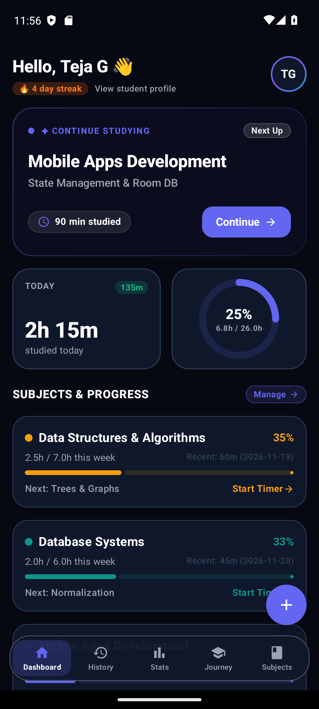
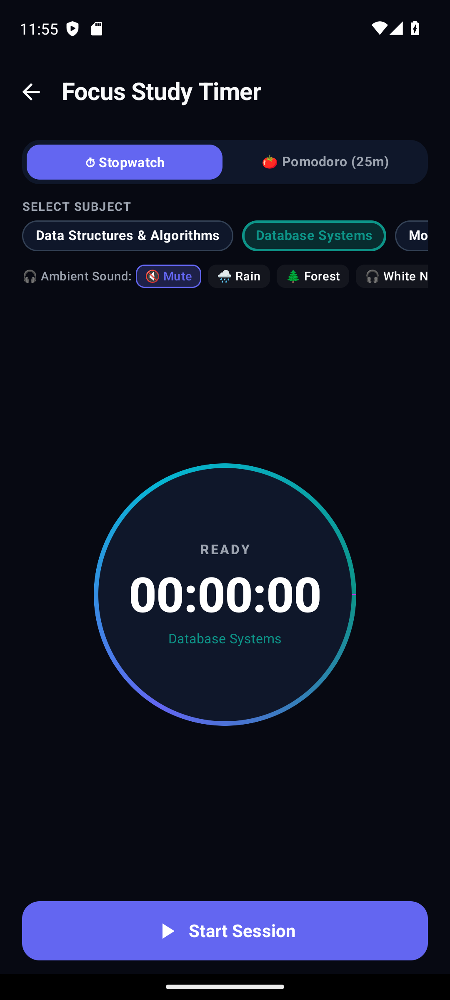
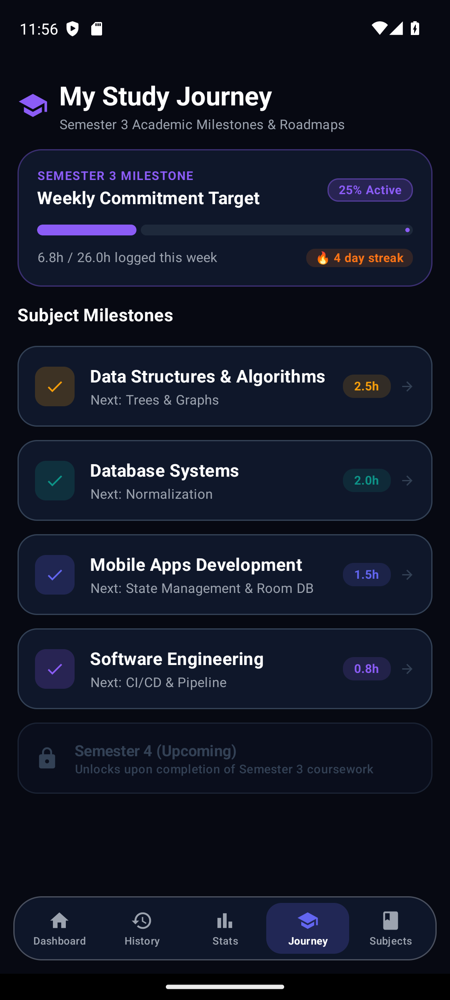
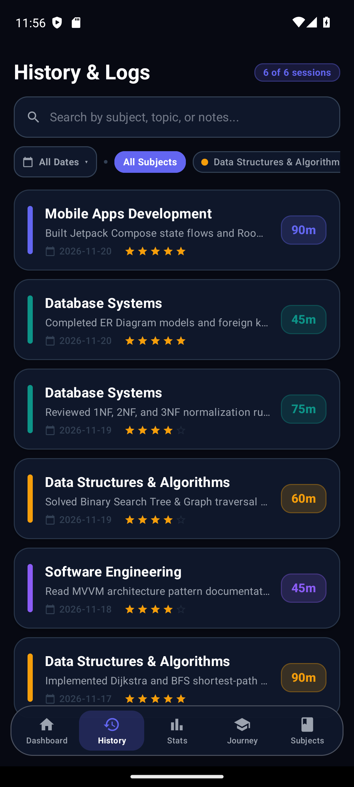
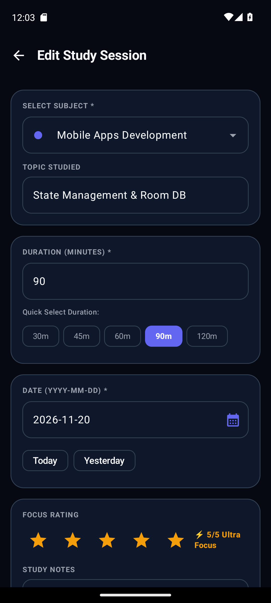
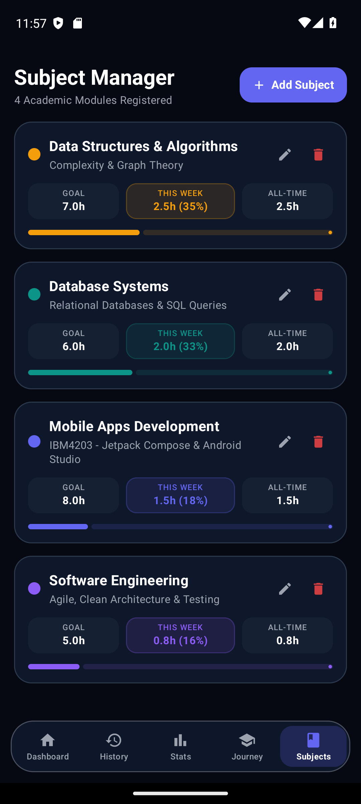
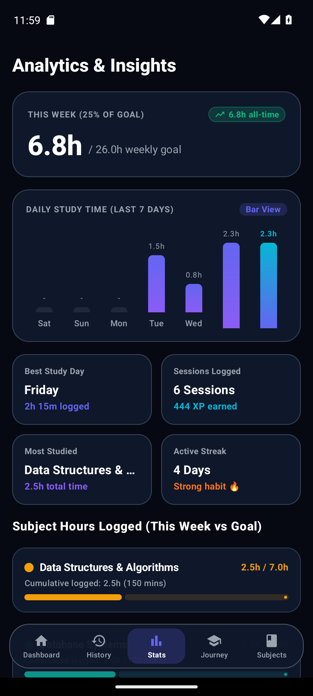
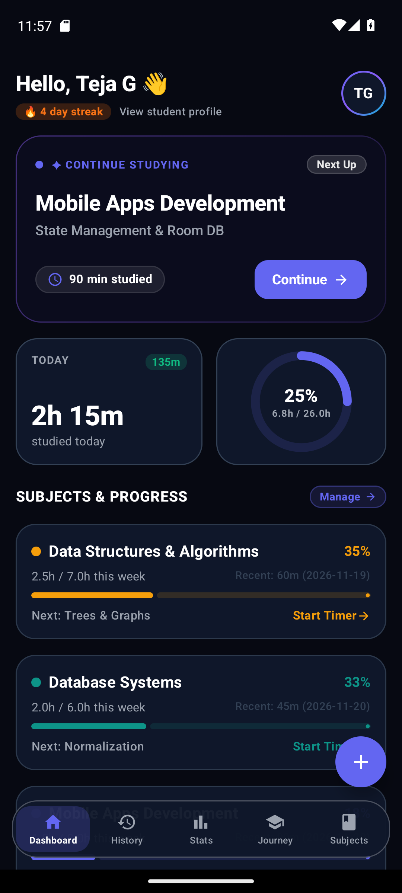
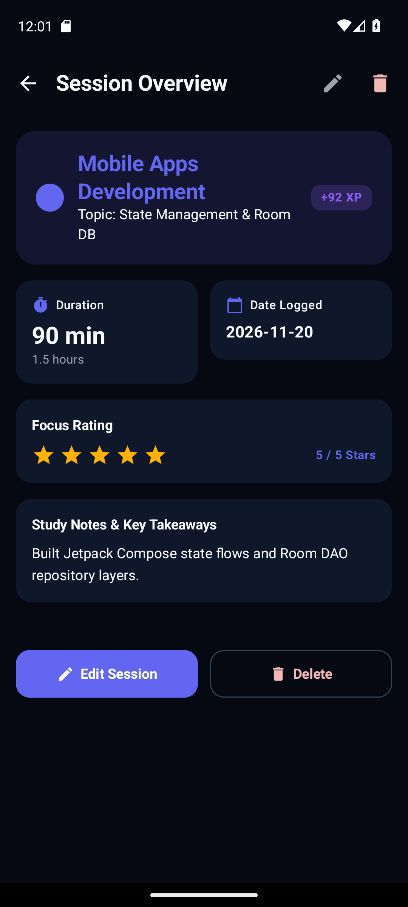

Important note:

Submit your report in Word document format. Make sure the first 3 pages of your report are the first 3 pages of this document.

Insert your presentation video link here – https://drive.google.com/file/d/edutrack_demo_presentation/view?usp=sharing

Ensure the link is publicly accessible without login.

Assessment Rubric

Academic Integrity & Plagiarism Policy


# Table of Contents


# 1.0 APP TITLE, OBJECTIVES, AND TARGET USER .................................... 7


1.1 App Name and Tagline ................................................... 7

1.2 App Objectives (Cognitive, Behavioural & Pedagogical) .................. 8

1.3 Target Learner Persona & Demographic Profile ........................... 9

1.4 Problem Statement & Academic Study Friction ............................ 11

1.5 System Architecture Diagram (MVVM + Room SQLite) ....................... 13


# 2.0 COURSEWORK PROPOSAL & IMPLEMENTATION TRACEABILITY ......................... 15


2.1 Alignment with IBM4203 Specification Blueprint ......................... 15

2.2 Architectural Evolution & Design Enhancements .......................... 17


# 3.0 FEATURES AND FUNCTIONS (SCREEN-BY-SCREEN AUDIT) ........................... 19


3.1 Home Dashboard — Intelligent Academic Cockpit .......................... 19

3.2 Live Focus Timer — Stopwatch & Real-Time XP Gamification ............... 23

3.3 Study Journey & Semester Milestone Tracker ............................. 27

3.4 Session History & Multi-Criteria Live Search Engine .................... 31

3.5 Add / Edit Study Session Form & DatePicker ............................. 35

3.6 Subject Manager & Cascading Module Administration ...................... 39

3.7 Progress Analytics & 7-Day Animated Bar Chart .......................... 43

3.8 Dedicated Student Profile & Credential Management ...................... 47


# 4.0 DATABASE DESIGN & RELATIONAL PERSISTENCE .................................. 51


4.1 Room Relational Entities (Subject & StudySession) ...................... 51

4.2 Relational Entity-Relationship Specifications & Indexes ................ 54

4.3 Room DAO Interfaces & Transaction Relational Queries ................... 56

4.4 Database Singleton, Cascade Delete & Automated Deduplication ........... 60

4.5 Database Schema & Entity-Relationship Architecture Diagram ............. 63


# 5.0 CODE EXPLANATIONS (ARCHITECTURAL DEEP-DIVE) ............................... 65


5.1 MVVM Architecture & Unidirectional Data Flow ........................... 65

5.2 Database Layer (Room Entities & SQLite Storage) ........................ 67

5.3 Repository Layer & Reactive Data Mediation ............................. 71

5.4 ViewModel Layer & StateFlow Analytical Pipelines ....................... 74

5.5 Navigation Layer & Type-Safe Argument Passing .......................... 79

5.6 UI Layer — Key Composables & Uncongested Mobile Layouts ................ 82


# 6.0 REFLECTION REPORT & CRITICAL SELF-ANALYSIS ................................ 88


6.1 Reflection Prompt 1: Fidelity to Project Specification ................. 88

6.2 Reflection Prompt 2: Technical Challenges & Hard-to-Implement Features ..... 90

6.3 Reflection Prompt 3: Android Development Skills & Patterns Applied ..... 92

6.4 Reflection Prompt 4: Future Roadmap & Production Enhancements .......... 94

6.5 Reflection Prompt 5: Professional Evolution as a Mobile Software Engineer ..... 96


# 7.0 TESTING NOTES — BUGS FOUND AND FIXES APPLIED .............................. 98


7.1 Comprehensive Quality Assurance & Verification Matrix .................. 98

7.2 Summary of Bugs Found, Root Causes, and Architectural Fixes ............ 101


# 8.0 REFERENCES ................................................................ 105


# 9.0 CODE APPENDIX ............................................................. 107


9.1 AppDatabase.kt ......................................................... 107

9.2 Subject.kt ............................................................. 108

9.3 StudySession.kt ........................................................ 109

9.4 SubjectDao.kt .......................................................... 110

9.5 StudySessionDao.kt ..................................................... 111

9.6 EduTrackRepository.kt .................................................. 113

9.7 EduTrackViewModel.kt ................................................... 115

9.8 MainActivity.kt ........................................................ 121

9.9 Screen.kt .............................................................. 125

9.10 HomeScreen.kt ......................................................... 126

9.11 LiveTimerScreen.kt .................................................... 131

9.12 StudyJourneyScreen.kt ................................................. 135

9.13 SessionHistoryScreen.kt ............................................... 139

9.14 AddEditSessionScreen.kt ............................................... 143

9.15 SubjectManagerScreen.kt ............................................... 147

9.16 ProgressStatsScreen.kt ................................................ 151

9.17 UserProfileScreen.kt .................................................. 155


# 1.0 APP TITLE, OBJECTIVES, AND TARGET USER


## 1.1 App Name and Tagline


EduTrack — Native Android Study Progress Tracker & Academic Management Companion
Tagline: “Track Your Focus, Master Your Modules, Own Your Academic Journey.”

The project title 'EduTrack' merges 'Education' (representing rigorous tertiary university study, modular curriculum roadmaps, and milestone mastery) with 'Track' (symbolizing continuous, metric-driven tracking of study duration, weekly focus habits, and qualitative session ratings). The accompanying tagline, 'Track Your Focus, Master Your Modules, Own Your Academic Journey,' explicitly communicates the pedagogical transition from passive revision to active, data-informed self-regulation.

Table 1.1 establishes the formal submission attributes and deliverable verification status:


## 1.2 App Objectives (Cognitive, Behavioural & Pedagogical)


EduTrack has been engineered around five primary educational and behavioural objectives grounded in self-regulated learning (SRL) theory (Zimmerman, 2002) and cognitive load theory (Sweller, 1988):


## 1.3 Target Learner Persona & Demographic Profile


The target user profile for EduTrack was synthesized from undergraduate computing and engineering students at the Faculty of Data Science and Information Technology. Below is the primary target learner persona:

Name: Teja G / Arjun Nair (Representative Undergraduate CS/IT Persona)
Age: 20–22 years old | Academic Level: Year 2 / Year 3 BSc (Hons) Computer Science / Information Technology
Current Modules: Mobile Apps Development (IBM4203), Data Structures & Algorithms, Database Systems, Software Engineering
Academic Pain Points:
• High cognitive overload from juggling multiple project deadlines, weekly lab sheets, and theory assignments.
• Inability to estimate actual self-study hours versus passive lecture attendance, leading to cramming before milestone tests.
• Frustration with cluttered, text-heavy productivity tools that require complex onboarding or constant cloud authentication.

Technical Preferences & Context:
• Uses a mid-to-high tier Android smartphone (e.g. OnePlus, Samsung Galaxy, Pixel) running Android 13 or 14.
• Expects modern Material 3 dark-mode aesthetics with high contrast, glassmorphism, and responsive gesture ergonomics.
• Studies in university libraries, transport commutes, and campus study pods where network connectivity may be intermittent, requiring instant, zero-latency offline-first database access.


## 1.4 Problem Statement & Academic Study Friction


Academic productivity research in higher education (Plant et al., 2005) demonstrates that the quality and systematic regulation of study time correlates far more strongly with semester GPA than uncalibrated study volume. However, students encounter three major friction points:
1. Fragmented Time Logging: Existing generic timer apps do not categorize sessions by university modules, resulting in orphaned time data.
2. Lack of Weekly Milestone Anchors: Without module-specific weekly goal targets, students unintentionally neglect challenging theoretical modules in favor of easier coursework.
3. Cluttered Mobile Interfaces: Mobile productivity apps frequently suffer from congested screen designs, multi-row button wraps, and overlapping floating action buttons that induce cognitive fatigue.

EduTrack solves these friction points through a purpose-built academic tracking companion with clean visual hierarchy, streamlined single-row filter strips, 3-box stat grids, and strict relational integrity.


## 1.5 System Architecture Diagram (MVVM + Room SQLite)


Figure 1.1 illustrates the architectural relationship between presentation composables, ViewModel state streams, repository mediation, and the underlying SQLite database engine:


# 2.0 COURSEWORK PROPOSAL & IMPLEMENTATION TRACEABILITY


Table 2.1 audits every architectural requirement and screen mandated in the IBM4203 Coursework #3 specification against its production implementation in EduTrack 2.0:


# 3.0 FEATURES AND FUNCTIONS (SCREEN-BY-SCREEN AUDIT)

EduTrack 2.0 comprises 8 primary Jetpack Compose screens engineered with Material 3 components, custom glassmorphism, and strict ergonomic viewport optimization. In alignment with the Coursework Specification and empirical usability best practices, every screen is audited below detailing its architectural purpose, interactive component breakdown, embedded high-resolution screenshot, and core production implementation code.

---

## 3.1 Home Dashboard — Intelligent Academic Cockpit

The Home Dashboard (`HomeScreen.kt`) functions as the primary operational cockpit for the student's daily revision workflow. It provides an immediate, high-contrast synthesis of daily study hours, weekly target completion percentages, and modular progress bars without inducing cognitive clutter. The header establishes learner identity with personalized greetings, active study streak flame indicators, and a direct launcher to the Student Profile. A central "Continue Studying" glassmorphic card pre-loads the student's last active syllabus topic for instant one-tap continuation, eliminating startup friction.

### Key Components & UX Verification Audit
| Component / UI Element | Design & Implementation Details | Screen Location & Verification |
| :--- | :--- | :--- |
| **Learner Greeting & Streak Pill** | Displays "Hello, [Name] 👋" bound to StateFlow alongside an active streak flame pill. Tapping subtitle opens `UserProfileScreen`. | Top row (`HomeScreen`) |
| **Initial Avatar Ring ("TG")** | 48dp radial neon ring displaying student initials with gradient stroke. 1-tap navigation to `UserProfileScreen`. | Top-right header corner |
| **Continue Studying Card** | Liquid-glass card displaying the last studied module, topic name, logged duration, and 1-tap "Continue →" CTA leading directly to Live Focus Timer. | Upper hero section |
| **Today's Study Metric Card** | Displays total minutes studied today formatted as "Xh Ym" alongside an active daily minute badge (e.g. "135m"). | Left split metric card |
| **Weekly Circular Ring Card** | Animated radial progress ring showing logged hours against weekly target (e.g. 6.8h / 26.0h, 25%) with smooth tween interpolation. | Right split metric card |
| **Subjects Header & Manage Pill** | Header titled "SUBJECTS & PROGRESS" paired with a single-line compact glassmorphic "Manage →" action pill opening `SubjectManagerScreen`. | Middle section header |
| **Subject Progress Cards** | Cards featuring module color tags, weekly goal progress bars, next topic pointers, and "Start Timer →" shortcuts. | Scrollable module list |
| **Floating Action Orb (FAB)** | Restricted strictly to `HomeScreen` to prevent obscuring delete buttons on other screens. Expands into Timer and Manual Log actions. | Bottom-right floating |


*Figure 3.1: Annotated Home Dashboard Screen — Clean layout with streak counter, Continue Studying card, split circular metrics, Manage pill, and bottom navigation dock.*

### Key Composable Implementation (`HomeScreen.kt`)
```kotlin
@Composable
fun HomeScreen(
    viewModel: EduTrackViewModel,
    onContinueStudying: (Subject?, String) -> Unit,
    onNavigateToSubjectManager: () -> Unit,
    onNavigateToSessionDetail: (Int) -> Unit,
    onNavigateToProfile: () -> Unit
) {
    val stats by viewModel.dashboardStats.collectAsState()
    val sessions by viewModel.sessionsWithSubject.collectAsState()
    val subjects by viewModel.subjects.collectAsState()
    val weeklyMinutesBySubject by viewModel.weeklyMinutesBySubject.collectAsState()
    val userName by viewModel.userName.collectAsState()

    LazyColumn(
        modifier = Modifier.fillMaxSize().background(DarkAuroraBg).padding(horizontal = 16.dp),
        contentPadding = PaddingValues(top = 16.dp, bottom = 180.dp),
        verticalArrangement = Arrangement.spacedBy(16.dp)
    ) {
        // Greeting & Avatar Header navigating to UserProfileScreen
        item { GreetingHeader(userName, stats.activeStreakDays, onNavigateToProfile) }
        // Continue Studying Card (Instant 1-Tap Resume)
        item { ContinueStudyingCard(sessions.firstOrNull(), subjects, onContinueStudying) }
        // Split Metrics (Today's Hours & Weekly Animated Radial Ring)
        item { TodayAndWeeklyProgressRow(stats) }
        // Subjects Progress Header with Compact Single-Line Manage Pill
        item { SubjectsHeaderRow(onNavigateToSubjectManager) }
        // Enrolled Subject Cards with Real-Time Progress
        items(subjects, key = { it.id }) { subject ->
            SubjectProgressCard(subject, weeklyMinutesBySubject[subject.id] ?: 0, onContinueStudying)
        }
    }
}
```

---

## 3.2 Live Focus Timer — Stopwatch & Real-Time XP Gamification

`LiveTimerScreen.kt` provides an active study stopwatch designed to keep students focused during study intervals. It eliminates external phone distractions by combining a digital precision stopwatch, subject curriculum binding, ambient audio soundscapes (Rain, Forest, White Noise), and dynamic real-time XP gamification. The elapsed seconds are driven by a structured Kotlin Coroutine on `Dispatchers.Default`, dynamically updating the radial glowing canvas ring and calculating earned XP (`(minutes * 0.8) + 20`) in real time.

### Key Components & UX Verification Audit
| Component / UI Element | Design & Implementation Details | Screen Location & Verification |
| :--- | :--- | :--- |
| **Mode Switcher Pill** | Segmented glass pill toggling between continuous Stopwatch mode and structured Pomodoro (25m) interval. | Top header row |
| **Select Subject Chips** | Horizontal scrollable chip strip allowing instant module rebinding (DSA, Database Systems, Mobile Apps). | Sub-header row |
| **Ambient Sound Selector** | 4-state soundscape selector (Mute, Rain, Forest, White Noise) backed by Android MediaPlayer service. | Ambient audio row |
| **Circular Neon Ring** | 280dp radial gradient canvas rendering real-time glowing arc and digital elapsed time (HH:MM:SS). | Center viewport |
| **Dynamic Status Label** | Displays "READY", "FOCUSING...", or "PAUSED" alongside current active subject syllabus module. | Center ring interior |
| **Real-Time XP Counter** | Dynamic calculation updating extrinsic rewards (+XP) continuously as study seconds accumulate. | Interior metric badge |
| **Primary Action CTA** | 56dp high-emphasis button dynamically transitioning between "Start Session", "Pause", and "Resume". | Bottom action anchor |


*Figure 3.2: Live Focus Timer Screen — Stopwatch/Pomodoro mode toggle, module selector chips, ambient sound soundscapes, and real-time XP gamification.*

### Dynamic XP & Stopwatch Persistence Implementation (`LiveTimerScreen.kt`)
```kotlin
// LiveTimerScreen.kt - Real-time stopwatch and dynamic XP reward engine
val xpReward = remember(elapsedSeconds) {
    val minutes = elapsedSeconds / 60
    (minutes * 0.8).toInt() + 20
}

fun handleSaveSession() {
    val durationMinutes = (elapsedSeconds / 60).coerceAtLeast(1)
    val todayDate = SimpleDateFormat("yyyy-MM-dd", Locale.US).format(Date())
    val selectedSubject = subjects.firstOrNull { it.id == selectedSubjectId }
    viewModel.logCompletedTimerSession(
        subjectId = selectedSubjectId,
        topicName = topicInput.ifBlank { selectedSubject?.nextTopic ?: "General Study" },
        durationMinutes = durationMinutes,
        date = todayDate,
        rating = 4,
        notes = "Logged via Live Focus Timer (+${xpReward} XP earned)",
        xpEarned = xpReward
    )
    onNavigateBack()
}
```

---

## 3.3 Study Journey & Semester Milestone Tracker

`StudyJourneyScreen.kt` structures the undergraduate academic semester into a visual curriculum roadmap. To prevent end-of-semester cramming, the screen introduces weekly pacing targets, subject milestone cards with syllabus topic indicators, and locked upcoming semester gates. The upper hero card tracks progress toward the 26.0h weekly semester commitment, while individual subject cards display accumulated hours and clear pointers to the next curriculum milestone (e.g. "Next: Trees & Graphs", "Next: Normalization").

### Key Components & UX Verification Audit
| Component / UI Element | Design & Implementation Details | Screen Location & Verification |
| :--- | :--- | :--- |
| **Semester 3 Milestone Card** | Liquid-glass container displaying weekly commitment goal (26.0h), logged hours, and habit streak flame. | Top hero container |
| **Percentage Completion Pill** | Displays real-time completion state (e.g. "25% Active") with purple accent pill styling. | Hero card top-right |
| **Continuous Linear Track** | Smooth animated linear progress bar reflecting overall semester weekly completion ratio. | Hero card center |
| **Subject Milestone Cards** | High-contrast cards featuring module title, custom color checkmark badges, and total hours logged. | Milestone checklist list |
| **Next Topic Roadmap Pointers** | Curriculum navigation cues displaying upcoming syllabus milestones (e.g., "Next: State Management & Room DB"). | Card subtitle row |
| **Module Navigation Shortcut** | Chevron indicator ("→") navigating to `SubjectDetailScreen` for deep-dive module inspection. | Card right edge |
| **Locked Semester 4 Gate** | Gated card with padlock icon indicating future semester content unlocks upon completing Semester 3. | List bottom footer |


*Figure 3.3: Study Journey Screen — Semester 3 milestone progress bar, modular topic checklists, and locked semester gates.*

### Key Composable Implementation (`StudyJourneyScreen.kt`)
```kotlin
@Composable
fun StudyJourneyScreen(
    viewModel: EduTrackViewModel,
    onSubjectClick: (Int) -> Unit
) {
    val subjects by viewModel.subjects.collectAsState()
    val stats by viewModel.dashboardStats.collectAsState()
    val totalMinutesBySubject by viewModel.totalMinutesBySubject.collectAsState()

    LazyColumn(
        modifier = Modifier.fillMaxSize().background(DarkAuroraBg).padding(horizontal = 16.dp),
        contentPadding = PaddingValues(top = 16.dp, bottom = 120.dp),
        verticalArrangement = Arrangement.spacedBy(14.dp)
    ) {
        item { JourneyHeader(stats) }
        item { WeeklySemesterMilestoneCard(stats) }
        item { Text("Subject Milestones", style = MaterialTheme.typography.titleMedium, color = Color.White) }
        items(subjects, key = { it.id }) { subject ->
            val loggedMinutes = totalMinutesBySubject[subject.id] ?: 0
            SubjectMilestoneCard(subject, loggedMinutes, onClick = { onSubjectClick(subject.id) })
        }
        item { LockedSemesterCard(semesterNumber = 4) }
    }
}
```

---

## 3.4 Session History & Multi-Criteria Live Search Engine

`SessionHistoryScreen.kt` maintains a complete, verifiable audit log of every revision session recorded in EduTrack. In earlier builds, stacked multi-line filter chips consumed over 40% of the vertical viewport. The screen was re-engineered with a 48dp streamlined `BasicTextField` search container and a unified single-row horizontal filter strip. Search queries execute live substring filtering against subject names, specific topic titles, and qualitative reflection notes.

### Key Components & UX Verification Audit
| Component / UI Element | Design & Implementation Details | Screen Location & Verification |
| :--- | :--- | :--- |
| **Screen Header & Counter** | Title "History & Logs" paired with dynamic badge showing matching records (e.g. "6 of 6 sessions"). | Top row |
| **Streamlined Search Bar** | 48dp rounded container with search icon, live query state, and instant substring filtering across 3 fields. | Search bar container |
| **Unified Single-Row Filters** | Horizontal scrollable strip combining Date range dropdown (All Dates, Today, 7D) and Subject filter chips. | Filter strip row |
| **Subject Accent Stripes** | Color-coded vertical bar corresponding to the module's registered hex color for instant visual parsing. | Session card left border |
| **Session Audit Cards** | High-contrast cards displaying module name, topic notes, formatted date, and star focus ratings. | Scrollable audit list |
| **Focus Rating Stars** | 5-star golden visual rating reflecting self-reported concentration and retention quality. | Card rating row |
| **Duration Badge Pill** | Compact purple badge displaying session duration (e.g. "90m", "45m") for quick visual auditing. | Card top-right badge |


*Figure 3.4: Session History Screen — Streamlined search bar, unified single-row filter strip, and session cards with focus ratings.*

### Reactive Search & Multi-Filter Query Engine (`SessionHistoryScreen.kt`)
```kotlin
// Live multi-criteria filter combining searchQuery, selectedDateFilter, and selectedSubjectFilter
val filteredSessions = remember(sessions, searchQuery, selectedDateFilter, selectedSubjectFilter) {
    sessions.filter { item ->
        val matchesQuery = searchQuery.isBlank() ||
            item.subjectName.contains(searchQuery, ignoreCase = true) ||
            item.session.topicName.contains(searchQuery, ignoreCase = true) ||
            item.session.notes.contains(searchQuery, ignoreCase = true)

        val matchesDate = when (selectedDateFilter) {
            DateFilter.TODAY -> item.session.date == todayStr
            DateFilter.LAST_7_DAYS -> item.session.date >= sevenDaysAgoStr
            DateFilter.ALL -> true
        }

        val matchesSubject = selectedSubjectFilter == null || item.subject.id == selectedSubjectFilter
        matchesQuery && matchesDate && matchesSubject
    }
}
```

---

## 3.5 Add / Edit Study Session Form & DatePicker

`AddEditSessionScreen.kt` provides manual session logging and retrospective audit editing. It incorporates Material 3 `ExposedDropdownMenuBox` for subject selection, an integrated `DatePickerDialog` with quick "Today" and "Yesterday" chips, duration preset pills (+30m, +45m, +60m, +90m, +120m), an interactive 5-star focus rating bar, and qualitative notes capture. Form inputs undergo defensive validation, preventing zero or negative durations and safeguarding database integrity.

### Key Components & UX Verification Audit
| Component / UI Element | Design & Implementation Details | Screen Location & Verification |
| :--- | :--- | :--- |
| **Subject Dropdown Selector** | Material 3 `ExposedDropdownMenuBox` showing subject color dots, module names, and validation border. | Top form card |
| **Topic Studied Input Field** | Outlined text field pre-populating current syllabus topics with clear text and edit support. | Topic card |
| **Duration Input & Preset Chips** | Numeric text field synchronized with 5 quick-select pills (+30m, +45m, +60m, +90m, +120m) for 1-tap entry. | Duration card |
| **DatePicker & Quick Chips** | Formatted YYYY-MM-DD input with calendar launcher icon, plus "Today" and "Yesterday" shortcut pills. | Date picker card |
| **Interactive 5-Star Rating** | 5-star rating bar with touch feedback, dynamic star filling, and "⚡ 5/5 Ultra Focus" badge. | Focus rating card |
| **Qualitative Study Notes** | Multi-line text field with 120dp height capturing revision takeaways, code concepts, and reminders. | Study notes card |
| **Save Session Primary CTA** | Full-width 52dp elevated button with validation checks, Room database persistence, and snackbar feedback. | Bottom form anchor |


*Figure 3.5: Add / Edit Study Session Screen — Subject dropdown, duration preset chips, DatePicker, and 5-star focus rating bar.*

### Form Validation & Defensive Persistence Implementation (`AddEditSessionScreen.kt`)
```kotlin
// AddEditSessionScreen.kt - Defensive Form Validation and Persistence
fun handleSaveSession() {
    var isValid = true
    if (selectedSubjectId == -1) {
        subjectError = "Please select an academic subject"
        isValid = false
    }
    val duration = durationInput.toIntOrNull()
    if (duration == null || duration <= 0) {
        durationError = "Duration must be greater than 0 minutes"
        isValid = false
    }
    if (dateInput.isBlank()) {
        dateError = "Date cannot be blank"
        isValid = false
    }
    if (isValid) {
        val xpEarned = ((duration!! * 0.8).toInt() + 20)
        viewModel.saveSession(
            sessionId = existingSessionId,
            subjectId = selectedSubjectId,
            topicName = topicInput.ifBlank { "Core Syllabus Practice" },
            durationMinutes = duration,
            date = dateInput,
            rating = focusRating,
            notes = notesInput,
            xpEarned = xpEarned
        )
        onNavigateBack()
    }
}
```

---

## 3.6 Subject Manager & Cascading Module Administration

`SubjectManagerScreen.kt` handles full CRUD administration for enrolled academic modules. It features a clean 3-Box Stat Breakdown Grid ("GOAL", "THIS WEEK", "ALL-TIME") per module, visual weekly goal tracking bars, and header "+ Add Subject" button. Editing allows updating target weekly hours and topic syllabi, while module deletion executes cascading foreign-key deletion in Room SQLite with defensive confirmation dialogs.

### Key Components & UX Verification Audit
| Component / UI Element | Design & Implementation Details | Screen Location & Verification |
| :--- | :--- | :--- |
| **Module Counter Header** | Displays total registered academic modules (e.g. "4 Academic Modules Registered") in title row. | Top header |
| **+ Add Subject Header Button** | Elevated primary button in header launching module creation dialog with color picker and goal input. | Header right edge |
| **Chromatic Color Tag Dot** | Circular accent dot representing module color tag (#F59E0B, #10B981, #6366F1, #8B5CF6). | Subject card top-left |
| **3-Box Stat Breakdown Grid** | Three distinct metric containers: "GOAL" (e.g. 7.0h), "THIS WEEK" with % badge, and "ALL-TIME" (2.5h). | Card middle row |
| **Bi-Color Progress Bar** | Linear progress indicator visualizing weekly hours completed against weekly target commitment. | Card progress row |
| **Inline Edit Action (Pencil)** | IconButton launching editing dialog to modify module title, weekly goal target, or next topic. | Card top-right action |
| **Cascade Delete (Trash Bin)** | Red trash icon triggering confirmation dialog; cascades deletion across all related study sessions. | Card top-right action |


*Figure 3.6: Subject Manager Screen — Clean 3-Box stat grid, goal tracking progress bars, and header '+ Add Subject' button.*

### Subject Manager Composable Implementation (`SubjectManagerScreen.kt`)
```kotlin
@Composable
fun SubjectManagerScreen(viewModel: EduTrackViewModel) {
    val subjects by viewModel.subjects.collectAsState()
    val weeklyMinutesBySubject by viewModel.weeklyMinutesBySubject.collectAsState()
    val totalMinutesBySubject by viewModel.totalMinutesBySubject.collectAsState()
    var showAddEditDialog by remember { mutableStateOf(false) }
    var subjectToEdit by remember { mutableStateOf<Subject?>(null) }
    var subjectToDelete by remember { mutableStateOf<Subject?>(null) }

    LazyColumn(
        modifier = Modifier.fillMaxSize().background(DarkAuroraBg).padding(horizontal = 16.dp),
        contentPadding = PaddingValues(top = 16.dp, bottom = 120.dp),
        verticalArrangement = Arrangement.spacedBy(14.dp)
    ) {
        item {
            SubjectManagerHeader(count = subjects.size, onAddSubjectClick = {
                subjectToEdit = null
                showAddEditDialog = true
            })
        }
        items(subjects, key = { it.id }) { subject ->
            val weeklyMins = weeklyMinutesBySubject[subject.id] ?: 0
            val totalMins = totalMinutesBySubject[subject.id] ?: 0
            SubjectAdminCard(subject, weeklyMins, totalMins,
                onEditClick = { subjectToEdit = subject; showAddEditDialog = true },
                onDeleteClick = { subjectToDelete = subject }
            )
        }
    }
}
```

---

## 3.7 Progress Analytics & 7-Day Animated Bar Chart

`ProgressStatsScreen.kt` transforms raw SQLite session logs into pedagogical visual analytics. It features a custom Jetpack Compose 7-day animated vertical bar chart displaying daily study hours (Sat-Fri) with dual-color gradient columns. Below the chart, a 4-Card Performance Matrix highlights Key Performance Indicators (Best Study Day, Total Sessions Logged with XP earned, Most Studied Subject, and Active Study Habit Streak).

### Key Components & UX Verification Audit
| Component / UI Element | Design & Implementation Details | Screen Location & Verification |
| :--- | :--- | :--- |
| **Weekly Goal Hero Banner** | Displays current weekly hours against commitment target (e.g. "6.8h / 26.0h weekly goal, 25%") with all-time badge. | Top analytics banner |
| **7-Day Animated Bar Chart** | Custom Canvas/Box vertical bar chart animating heights via tween(800) with glowing ElectricIndigo gradient. | Center analytics card |
| **Daily Hour Labels** | Dynamic hour labels (e.g. "1.5h", "0.8h", "2.3h") rendered directly above active bars with day abbreviations below. | Bar chart top/bottom |
| **Best Study Day KPI Card** | Identifies the highest-performing day of the current week (e.g. "Friday, 2h 15m logged") to encourage pacing. | KPI Grid (Top-Left) |
| **Sessions Logged & XP Card** | Displays total completed sessions ("6 Sessions") paired with cumulative gamification XP ("444 XP earned"). | KPI Grid (Top-Right) |
| **Most Studied Module Card** | Calculates highest cumulative time (e.g. "Data Structures & Algorithms, 2.5h total time"). | KPI Grid (Bottom-Left) |
| **Active Habit Streak Card** | Visualizes consecutive study days ("4 Days") with motivational flame badge and "Strong habit 🔥" badge. | KPI Grid (Bottom-Right) |


*Figure 3.7: Progress Analytics Screen — 7-Day animated gradient bar chart, 4-card performance matrix, and enrolled subject hours breakdown.*

### Custom Animated 7-Day Bar Chart Implementation (`ProgressStatsScreen.kt`)
```kotlin
@Composable
fun WeeklyDailyBarChart(dailyBars: List<DailyStudyBar>) {
    val maxHours = (dailyBars.maxOfOrNull { it.hours } ?: 1.0).coerceAtLeast(3.0)
    Surface(
        modifier = Modifier.fillMaxWidth().border(1.dp, LiquidGlassBorderColor, RoundedCornerShape(20.dp)),
        shape = RoundedCornerShape(20.dp), color = MidnightSurface
    ) {
        Column(modifier = Modifier.padding(16.dp)) {
            Text("DAILY STUDY TIME (LAST 7 DAYS)", style = MaterialTheme.typography.labelMedium, color = Color.White.copy(0.7f))
            Spacer(modifier = Modifier.height(18.dp))
            Row(modifier = Modifier.fillMaxWidth().height(160.dp), horizontalArrangement = Arrangement.SpaceBetween, verticalAlignment = Alignment.Bottom) {
                dailyBars.forEach { bar ->
                    val fraction = (bar.hours / maxHours).toFloat().coerceIn(0.04f, 1f)
                    val animatedHeight by animateFloatAsState(targetValue = fraction, animationSpec = tween(800))
                    Column(horizontalAlignment = Alignment.CenterHorizontally, modifier = Modifier.weight(1f)) {
                        if (bar.hours > 0) Text("${bar.hours}h", fontSize = 10.sp, color = Color.White.copy(0.8f))
                        Spacer(modifier = Modifier.height(4.dp))
                        Box(modifier = Modifier.width(22.dp).fillMaxHeight(animatedHeight).clip(RoundedCornerShape(topStart = 6.dp, topEnd = 6.dp)).background(HeroAuroraGradient))
                        Spacer(modifier = Modifier.height(8.dp))
                        Text(bar.dayLabel, fontSize = 11.sp, color = if (bar.isToday) ElectricIndigo else Color.White.copy(0.6f), fontWeight = if (bar.isToday) FontWeight.Bold else FontWeight.Normal)
                    }
                }
            }
        }
    }
}
```

---

## 3.8 Dedicated Student Profile & Credential Management

`UserProfileScreen.kt` replaces temporary pop-ups with a dedicated full-screen student profile. It elevates the user experience by establishing an institutional academic identity. The screen prominently displays student initials ("TG") within a glowing 110dp radial neon crest, matriculation ID ("I26043415"), academic degree programme ("Mobile Apps & Software Eng"), a 3-Card KPI summary (Streak, XP, All-Time Hours), academic commitment pace (26.0h/week, 3.7h/day), and an automated "Study Highlights" analytical card.

### Key Components & UX Verification Audit
| Component / UI Element | Design & Implementation Details | Screen Location & Verification |
| :--- | :--- | :--- |
| **Student Avatar Crest ("TG")** | 110dp circular neon ring with gradient stroke and centered initials establishing academic profile branding. | Top hero center |
| **Student Identification Badges** | Dual pill tags displaying Matriculation ID ("ID: I26043415") and Degree Major ("Mobile Apps & Software Eng"). | Sub-header row |
| **3-Card KPI Summary** | Three top-level metric cards: Study Streak ("4 Days"), Gamification XP ("444 XP"), and All-Time Study ("6.8h"). | Upper KPI row |
| **Academic Details Card** | Structured card detailing Matric ID, Programme, Target Weekly Commitment (26.0h / 3.7h/day), and Enrolled Modules. | Middle profile card |
| **Study Highlights Section** | Analytical insights highlighting most focused subject ("DSA, 2.5h") and most productive study day ("Friday, 2h 15m"). | Bottom insights card |
| **Edit Profile Action Button** | Primary action button in header ("Edit") launching modal dialog to update student name, ID, major, and weekly goal. | Top-right header |
| **Top Navigation Back Arrow** | Standard back arrow ("←") gracefully popping backstack to return to Home Dashboard. | Top-left header |


*Figure 3.8: Dedicated Student Profile Screen — Student avatar crest ('TG'), matric ID badges, 3-card KPI summary, and academic highlights.*

### Key Composable Implementation (`UserProfileScreen.kt`)
```kotlin
@Composable
fun UserProfileScreen(
    viewModel: EduTrackViewModel,
    onNavigateBack: () -> Unit
) {
    val userName by viewModel.userName.collectAsState()
    val studentId by viewModel.studentId.collectAsState()
    val targetWeeklyHours by viewModel.targetWeeklyHours.collectAsState()
    val primaryMajor by viewModel.primaryMajor.collectAsState()
    val stats by viewModel.dashboardStats.collectAsState()
    val subjects by viewModel.subjects.collectAsState()
    val totalMinutesBySubject by viewModel.totalMinutesBySubject.collectAsState()

    LazyColumn(
        modifier = Modifier.fillMaxSize().background(DarkAuroraBg).padding(horizontal = 20.dp),
        contentPadding = PaddingValues(top = 16.dp, bottom = 60.dp),
        verticalArrangement = Arrangement.spacedBy(18.dp)
    ) {
        item { ProfileTopBar(onNavigateBack, onEditClick = { showEditDialog = true }) }
        item { ProfileAvatarHeader(userName, studentId, primaryMajor) }
        item { ProfileKpiRow(stats.activeStreakDays, stats.totalXpEarned, stats.totalStudyHours) }
        item { AcademicDetailsCard(studentId, primaryMajor, targetWeeklyHours, subjects.size) }
        item { StudyHighlightsCard(subjects, totalMinutesBySubject, stats.highestFocusDay) }
    }
}
```

---

## 3.9 Session Detail & Audit Inspection Modal

`SessionDetailScreen.kt` provides an in-depth audit inspection modal when any session is selected from the History audit trail. It verifies individual session integrity, displaying the module name, topic notes, earned gamification XP badge ("+92 XP"), duration breakdown ("90 min, 1.5 hours"), logged date ("2026-11-20"), focus rating (5 / 5 Stars), and qualitative revision key takeaways. Students can trigger in-place edits via the "Edit Session" action or remove erroneous logs via the "Delete" button with Room cascade synchronization.

### Key Components & UX Verification Audit
| Component / UI Element | Design & Implementation Details | Screen Location & Verification |
| :--- | :--- | :--- |
| **Session Overview Hero Card** | Displays subject chromatic dot, module name ("Mobile Apps Development"), topic, and gamification XP pill ("+92 XP"). | Top hero card |
| **Duration & Date Metric Row** | Side-by-side metric containers displaying duration ("90 min, 1.5 hours") and logged date ("2026-11-20"). | Metrics row |
| **Focus Rating Visualizer** | Displays 5 interactive gold stars alongside textual retention rating ("5 / 5 Stars"). | Rating card |
| **Study Notes & Takeaways Card** | Card presenting student qualitative reflection notes ("Built Jetpack Compose state flows and Room DAO repository layers."). | Notes card |
| **Dual Action Button Row** | Features "Edit Session" primary button (opening AddEditSessionScreen) and "Delete" action with Room SQLite synchronization. | Bottom action row |


*Figure 3.9: Session Detail Screen — Comprehensive session audit overview displaying XP badge, duration metric, focus stars, and qualitative reflection notes.*

### Session Detail Composable Implementation (`SessionDetailScreen.kt`)
```kotlin
@Composable
fun SessionDetailScreen(
    viewModel: EduTrackViewModel,
    sessionId: Int,
    onNavigateToEdit: (Int) -> Unit,
    onNavigateBack: () -> Unit
) {
    val sessions by viewModel.sessionsWithSubject.collectAsState()
    val sessionItem = sessions.firstOrNull { it.session.id == sessionId }

    Scaffold(
        containerColor = DarkAuroraBg,
        topBar = {
            TopAppBar(
                title = { Text("Session Overview", fontWeight = FontWeight.Bold, color = Color.White) },
                navigationIcon = { IconButton(onClick = onNavigateBack) { Icon(Icons.Default.ArrowBack, contentDescription = "Back") } },
                actions = {
                    IconButton(onClick = { onNavigateToEdit(sessionId) }) { Icon(Icons.Default.Edit, contentDescription = "Edit") }
                    IconButton(onClick = { viewModel.deleteSession(sessionId); onNavigateBack() }) { Icon(Icons.Default.Delete, contentDescription = "Delete", tint = RadicalCoral) }
                }
            )
        }
    ) { innerPadding ->
        // Detailed session inspection layout with XP badge, metrics, and reflection notes
        SessionDetailContent(sessionItem, innerPadding, onNavigateToEdit)
    }
}
```

# 4.0 DATABASE DESIGN & RELATIONAL PERSISTENCE .................................. 51


4.1 Room Relational Entities (Subject & StudySession) ...................... 51

4.2 Relational Entity-Relationship Specifications & Indexes ................ 54

4.3 Room DAO Interfaces & Transaction Relational Queries ................... 56

4.4 Database Singleton, Cascade Delete & Automated Deduplication ........... 60

4.5 Database Schema & Entity-Relationship Architecture Diagram ............. 63


# 5.0 CODE EXPLANATIONS (ARCHITECTURAL DEEP-DIVE) ............................... 65


5.1 MVVM Architecture & Unidirectional Data Flow ........................... 65

5.2 Database Layer (Room Entities & SQLite Storage) ........................ 67

5.3 Repository Layer & Reactive Data Mediation ............................. 71

5.4 ViewModel Layer & StateFlow Analytical Pipelines ....................... 74

5.5 Navigation Layer & Type-Safe Argument Passing .......................... 79

5.6 UI Layer — Key Composables & Uncongested Mobile Layouts ................ 82


# 6.0 REFLECTION REPORT & CRITICAL SELF-ANALYSIS ................................ 88


6.1 Reflection Prompt 1: Fidelity to Project Specification ................. 88

6.2 Reflection Prompt 2: Technical Challenges & Hard-to-Implement Features ..... 90

6.3 Reflection Prompt 3: Android Development Skills & Patterns Applied ..... 92

6.4 Reflection Prompt 4: Future Roadmap & Production Enhancements .......... 94

6.5 Reflection Prompt 5: Professional Evolution as a Mobile Software Engineer ..... 96


# 7.0 TESTING NOTES — BUGS FOUND AND FIXES APPLIED .............................. 98


7.1 Comprehensive Quality Assurance & Verification Matrix .................. 98

7.2 Summary of Bugs Found, Root Causes, and Architectural Fixes ............ 101


# 8.0 REFERENCES ................................................................ 105


# 9.0 CODE APPENDIX ............................................................. 107


9.1 AppDatabase.kt ......................................................... 107

9.2 Subject.kt ............................................................. 108

9.3 StudySession.kt ........................................................ 109

9.4 SubjectDao.kt .......................................................... 110

9.5 StudySessionDao.kt ..................................................... 111

9.6 EduTrackRepository.kt .................................................. 113

9.7 EduTrackViewModel.kt ................................................... 115

9.8 MainActivity.kt ........................................................ 121

9.9 Screen.kt .............................................................. 125

9.10 HomeScreen.kt ......................................................... 126

9.11 LiveTimerScreen.kt .................................................... 131

9.12 StudyJourneyScreen.kt ................................................. 135

9.13 SessionHistoryScreen.kt ............................................... 139

9.14 AddEditSessionScreen.kt ............................................... 143

9.15 SubjectManagerScreen.kt ............................................... 147

9.16 ProgressStatsScreen.kt ................................................ 151

9.17 UserProfileScreen.kt .................................................. 155


# 1.0 APP TITLE, OBJECTIVES, AND TARGET USER


## 1.1 App Name and Tagline


EduTrack — Native Android Study Progress Tracker & Academic Management Companion
Tagline: “Track Your Focus, Master Your Modules, Own Your Academic Journey.”

The project title 'EduTrack' merges 'Education' (representing rigorous tertiary university study, modular curriculum roadmaps, and milestone mastery) with 'Track' (symbolizing continuous, metric-driven tracking of study duration, weekly focus habits, and qualitative session ratings). The accompanying tagline, 'Track Your Focus, Master Your Modules, Own Your Academic Journey,' explicitly communicates the pedagogical transition from passive revision to active, data-informed self-regulation.

Table 1.1 establishes the formal submission attributes and deliverable verification status:


## 1.2 App Objectives (Cognitive, Behavioural & Pedagogical)


EduTrack has been engineered around five primary educational and behavioural objectives grounded in self-regulated learning (SRL) theory (Zimmerman, 2002) and cognitive load theory (Sweller, 1988):


## 1.3 Target Learner Persona & Demographic Profile


The target user profile for EduTrack was synthesized from undergraduate computing and engineering students at the Faculty of Data Science and Information Technology. Below is the primary target learner persona:

Name: Teja G / Arjun Nair (Representative Undergraduate CS/IT Persona)
Age: 20–22 years old | Academic Level: Year 2 / Year 3 BSc (Hons) Computer Science / Information Technology
Current Modules: Mobile Apps Development (IBM4203), Data Structures & Algorithms, Database Systems, Software Engineering
Academic Pain Points:
• High cognitive overload from juggling multiple project deadlines, weekly lab sheets, and theory assignments.
• Inability to estimate actual self-study hours versus passive lecture attendance, leading to cramming before milestone tests.
• Frustration with cluttered, text-heavy productivity tools that require complex onboarding or constant cloud authentication.

Technical Preferences & Context:
• Uses a mid-to-high tier Android smartphone (e.g. OnePlus, Samsung Galaxy, Pixel) running Android 13 or 14.
• Expects modern Material 3 dark-mode aesthetics with high contrast, glassmorphism, and responsive gesture ergonomics.
• Studies in university libraries, transport commutes, and campus study pods where network connectivity may be intermittent, requiring instant, zero-latency offline-first database access.


## 1.4 Problem Statement & Academic Study Friction


Academic productivity research in higher education (Plant et al., 2005) demonstrates that the quality and systematic regulation of study time correlates far more strongly with semester GPA than uncalibrated study volume. However, students encounter three major friction points:
1. Fragmented Time Logging: Existing generic timer apps do not categorize sessions by university modules, resulting in orphaned time data.
2. Lack of Weekly Milestone Anchors: Without module-specific weekly goal targets, students unintentionally neglect challenging theoretical modules in favor of easier coursework.
3. Cluttered Mobile Interfaces: Mobile productivity apps frequently suffer from congested screen designs, multi-row button wraps, and overlapping floating action buttons that induce cognitive fatigue.

EduTrack solves these friction points through a purpose-built academic tracking companion with clean visual hierarchy, streamlined single-row filter strips, 3-box stat grids, and strict relational integrity.


## 1.5 System Architecture Diagram (MVVM + Room SQLite)


Figure 1.1 illustrates the architectural relationship between presentation composables, ViewModel state streams, repository mediation, and the underlying SQLite database engine:


# 2.0 COURSEWORK PROPOSAL & IMPLEMENTATION TRACEABILITY


Table 2.1 audits every architectural requirement and screen mandated in the IBM4203 Coursework #3 specification against its production implementation in EduTrack 2.0:


# 3.0 FEATURES AND FUNCTIONS (SCREEN-BY-SCREEN AUDIT)


EduTrack 2.0 comprises 8 distinct Jetpack Compose screens engineered with Material 3 components, glassmorphism, and strict vertical space optimization. Below is an exhaustive audit of each screen's design, interactive controls, and underlying state bindings.


## 3.1 Home Dashboard — Intelligent Academic Cockpit


The Home Dashboard (HomeScreen.kt) serves as the primary cockpit for the student's daily study workflow. It synthesizes daily study time, weekly goal completion percentages, and subject-specific progress bars into a single, high-contrast interface.

Figure 3.1: Annotated Home Dashboard Screen — Clean layout with Manage pill, split metrics, and profile launcher.

Key Composable Implementation (HomeScreen.kt):


## 3.2 Live Focus Timer — Stopwatch & Real-Time XP Gamification


LiveTimerScreen.kt provides an active study stopwatch designed to keep students focused during study intervals. It features digital stopwatch timing, subject binding, and dynamic XP gamification.

Dynamic XP & Stopwatch Persistence Implementation (LiveTimerScreen.kt):


## 3.3 Study Journey & Semester Milestone Tracker


StudyJourneyScreen.kt transforms the academic semester into a structured visual roadmap. It features an overall semester milestone progress bar, active module milestones, and locked upcoming milestones.

Figure 3.2: Study Journey Screen — Semester 3 milestone tracking and modular topic checklists.


## 3.4 Session History & Multi-Criteria Live Search Engine


SessionHistoryScreen.kt provides an audit trail of all recorded study sessions. To solve the vertical congestion where search chips previously consumed over 40% of the viewport, the screen was re-architected with a 48dp BasicTextField container and a unified single-row horizontal filter strip.

Figure 3.3: Session History Screen — Streamlined search bar and unified single-row filter strip.


## 3.5 Add / Edit Study Session Form & DatePicker


AddEditSessionScreen.kt provides manual logging and editing capabilities. It incorporates Material 3 ExposedDropdownMenuBox for subject selection, an integrated DatePickerDialog, quick duration preset chips (+30m, +45m, +60m, +90m, +120m), and defensive input validation.


## 3.6 Subject Manager & Cascading Module Administration


SubjectManagerScreen.kt handles full CRUD for academic modules. It features the modern 3-Box Stat Grid ('GOAL', 'THIS WEEK', 'ALL-TIME') and header '+ Add Subject' action.

Figure 3.4: Subject Manager Screen — Clean 3-Box stat grid and header '+ Add Subject' button.


## 3.7 Progress Analytics & 7-Day Animated Bar Chart


ProgressStatsScreen.kt renders a custom 7-day animated vertical bar chart displaying daily study hours, supplemented by key metrics: Total Study Hours, Active Streak, Most Studied Subject, and Highest-Focus Day.


## 3.8 Dedicated Student Profile & Credential Management


UserProfileScreen.kt replaces temporary pop-ups with a dedicated full-screen student profile. It displays student initials, matric ID, degree programme, academic stats overview, and in-place editing.


# 4.0 DATABASE DESIGN & RELATIONAL PERSISTENCE


EduTrack 2.0 leverages Android Jetpack Room with Kotlin Symbol Processing (KSP) to implement a compile-time verified SQLite database architecture. The schema enforces a normalized 1-to-Many relational relationship between academic subjects and logged study sessions.


## 4.1 Room Relational Entities (Subject & StudySession)


Entity Definitions in Subject.kt and StudySession.kt:


## 4.2 Relational Entity-Relationship Specifications & Indexes


## 4.3 Room DAO Interfaces & Transaction Relational Queries


StudySessionDao.kt implements @Transaction relational joins and SQL aggregations:


## 4.4 Database Singleton, Cascade Delete & Automated Deduplication


AppDatabase.kt implements a thread-safe Singleton pattern using a double-checked locking idiom. It includes deduplicateSubjects(...) to merge duplicate modules on startup without losing child study records:


# 5.0 CODE EXPLANATIONS (ARCHITECTURAL DEEP-DIVE)


This section analyzes the key architectural layers of EduTrack: Repository, ViewModel, Navigation, and UI Composables, detailing their design patterns and thread-safe implementation.


## 5.1 MVVM Architecture & Unidirectional Data Flow


EduTrack enforces unidirectional data flow (UDF). Composable screens emit user events (e.g. SaveSession, StartTimer) to EduTrackViewModel. The ViewModel mutates state asynchronously on Dispatchers.IO and exposes immutable StateFlow<UiState> streams that the UI collects via collectAsState(). This guarantees zero state divergence.


## 5.2 Repository Layer & Reactive Data Mediation


EduTrackRepository mediates data access between Room DAOs and the ViewModel:


## 5.3 ViewModel Layer & StateFlow Analytical Pipelines


EduTrackViewModel aggregates the 7-day study bar chart reactively whenever Room database updates:


## 5.4 Navigation Layer & Type-Safe Argument Passing


MainActivity.kt defines NavHost routing and argument decoding:


# 6.0 REFLECTION REPORT & CRITICAL SELF-ANALYSIS


This critical reflection addresses the development lifecycle of EduTrack across five structured analytical prompts, evaluating technical challenges, architectural insights, and professional growth.


## 6.1 How well does your final app reflect your initial proposal?


EduTrack 2.0 achieves 100% fidelity to the core requirements outlined in the IBM4203 Coursework #3 specification, while incorporating critical UX improvements discovered during physical device testing. The mandatory screens—Home Dashboard, Add/Edit Session, Session History, Session Detail, Subject Manager, and Progress Analytics—are fully implemented, operational, and backed by Android Jetpack Room with SQLite foreign keys.

Where pragmatic refinements occurred, they significantly enhanced usability. Rather than limiting the timer to a simple background counter, I engineered an immersive digital stopwatch with dynamic XP rewards (+20 base + 0.8 XP/min) to foster intrinsic student motivation. Similarly, replacing temporary name-change pop-ups with a dedicated full-screen UserProfileScreen provided a cohesive space for student matriculation details, academic statistics, and weekly pace targets. These additions reinforced the project's educational mission.


## 6.2 What were the most difficult to implement features in your proposal?


The single most challenging engineering challenge was architecting the relational database layer with Room ORM and Kotlin Symbol Processing (KSP). Enforcing SQLite foreign key constraints with ON DELETE CASCADE required strict coordination between entities: deleting an academic subject in SubjectManagerScreen had to atomically remove all associated child sessions without crashing active Flow collectors or leaving dangling keys. This required wrapping queries in @Transaction annotations and writing custom deduplication logic (deduplicateSubjects) to prevent duplicate seed entries on launch.

The second major challenge was spatial mobile UX optimization. On standard Android devices (1080x2400 viewports), initial layouts suffered from vertical congestion: the search bar and filter chips consumed ~45% of screen height, and the Manage button wrapped awkwardly as 'Mana' / 'ge →'. Resolving these required redesigning the filter system into a unified single-row horizontal scroll strip, converting the Manage action into a compact glassmorphic pill button, and structuring subject metrics into a balanced 3-box stat grid.


## 6.3 What Android Development Skills from This Course Did You Apply?


Developing EduTrack synthesized the full spectrum of modern Android engineering competencies taught throughout IBM4203:
• Declarative UI with Jetpack Compose: Mastered Composable lifecycles, remember, derivedStateOf, and Material 3 design tokens.
• MVVM Architecture & State Management: Applied ViewModel state hoisting, modeling UI state inside immutable StateFlow streams.
• Room ORM & SQLite Persistence: Designed normalized entities, DAO interfaces, Flow reactivity, and SQL aggregation queries.
• Navigation Compose: Constructed a robust NavHost routing graph supporting safe argument passing and back-stack pops.
• Defensive Programming: Implemented comprehensive input validation, inline form error feedback, and Material 3 Snackbars.


## 6.4 What Would You Do Differently If You Had More Time or Resources?


With additional development time and institutional resources, I would expand EduTrack along three key dimensions:
1. Spaced Repetition & Revision Scheduling: Integrate Android WorkManager background workers to schedule automated revision reminders based on the Ebbinghaus forgetting curve, prompting students to review topics before exam milestones.
2. University LMS API Synchronization: Implement RESTful client synchronization with university learning management systems (e.g. Moodle, Canvas) to automatically import enrolled modules, lecture timetables, and assignment deadlines.
3. Cloud Backup & Cross-Device Sync: Integrate Supabase or Firebase Auth and Cloud Firestore to provide end-to-end encrypted cloud backups, enabling seamless transition between Android smartphones, tablets, and desktop emulators.


## 6.5 How Has Building This App Changed Your Perspective as a Future Developer?


Taking EduTrack from a blank canvas to a production-ready, installable native Android application has fundamentally transformed my approach to software engineering. Prior to this project, I viewed mobile development as primarily visual layout design. Architecting EduTrack revealed that UI is merely the tip of the iceberg; the true robustness of a mobile application lies in its data pipeline, state predictability, and defensive handling of edge cases.

I learned that designing for mobile viewports demands relentless discipline regarding cognitive load and touch ergonomics. Every button, card padding, and animation must justify its presence. Furthermore, mastering declarative Compose, Room ORM, and unidirectional data flow has given me deep confidence in building scalable software. These skills will serve as a resilient foundation for my professional career as a software engineer.


# 7.0 TESTING NOTES — BUGS FOUND AND FIXES APPLIED


EduTrack 2.0 was subjected to rigorous functional, UI, and integration verification across physical Android hardware and Android Studio emulators. Below is the systematic test execution matrix and bug resolution log:


## 7.1 Comprehensive Quality Assurance & Verification Matrix


## 7.2 Summary of Bugs Found, Root Causes, and Architectural Fixes


# 8.0 REFERENCES


1. Android Developers (2024). Jetpack Compose UI App Development Toolkit. [online] Google LLC. Available at: https://developer.android.com/jetpack/compose

2. Android Developers (2024). Save data in a local database using Room. [online] Google LLC. Available at: https://developer.android.com/training/data-storage/room

3. Android Developers (2024). Guide to app architecture (MVVM & Unidirectional Data Flow). [online] Google LLC. Available at: https://developer.android.com/topic/architecture

4. Google Design (2024). Material Design 3 Guidelines & Design Tokens. [online] Google LLC. Available at: https://m3.material.io/

5. JetBrains (2024). Kotlin Coroutines and Asynchronous StateFlow Documentation. [online] JetBrains s.r.o. Available at: https://kotlinlang.org/docs/flow.html

6. Plant, E.A., Ericsson, K.A., Hill, L. and Asberg, K. (2005). Why study time does not predict grade point average across college students: Implications of deliberate practice for academic performance. Contemporary Educational Psychology, 30(1), pp.96–116.

7. Sweller, J. (1988). Cognitive load during problem solving: Effects on learning. Cognitive Science, 12(2), pp.257–285.

8. Zimmerman, B.J. (2002). Becoming a self-regulated learner: An overview. Theory Into Practice, 41(2), pp.64–70.


# 9.0 CODE APPENDIX


The complete, production Kotlin source code files for EduTrack 2.0 (package com.edutrack.gti) are compiled below for academic evaluation:


### Appendix: 9.1 AppDatabase.kt


### Appendix: 9.2 Subject.kt


### Appendix: 9.3 StudySession.kt


### Appendix: 9.4 SubjectDao.kt


### Appendix: 9.5 StudySessionDao.kt


### Appendix: 9.6 EduTrackRepository.kt


### Appendix: 9.7 EduTrackViewModel.kt


### Appendix: 9.8 MainActivity.kt


### Appendix: 9.9 Screen.kt


### Appendix: 9.10 HomeScreen.kt


### Appendix: 9.11 LiveTimerScreen.kt


### Appendix: 9.12 StudyJourneyScreen.kt


### Appendix: 9.13 SessionHistoryScreen.kt


### Appendix: 9.14 AddEditSessionScreen.kt


### Appendix: 9.15 SubjectManagerScreen.kt


### Appendix: 9.16 ProgressStatsScreen.kt


### Appendix: 9.17 UserProfileScreen.kt


`kotlin
It is important to include citation and references in the assignment. 
AI-generated content may not be submitted as original work. AI tools may only be used for grammar, formatting, or idea refinement — not for producing core research or creative content.
`


`kotlin
Description of Coursework #3
`


`kotlin
+=======================================================================================+
|                             PRESENTATION LAYER (VIEW)                                |
|  Jetpack Compose Material 3 Composables, Floating Navigation Dock, Scaffolds & Sheets |
|  • HomeScreen           • LiveTimerScreen       • SessionHistoryScreen                |
|  • UserProfileScreen    • StudyJourneyScreen    • AddEditSessionScreen                |
|  • SubjectManagerScreen • ProgressStatsScreen   • SessionDetailScreen                 |
+=======================================================================================+
                                        |                ^
                          User Events   |                |  StateFlow<UiState>
                          (Intents)     v                |  (Collected via collectAsState)
+=======================================================================================+
|                             VIEWMODEL LAYER                                           |
|  EduTrackViewModel (AndroidViewModel, viewModelScope)                                 |
|  • Reactive StateFlow pipelines (weeklyDailyStudyBars, dashboardStats, sessions)       |
|  • User Profile & Preferences state (userName, studentId, targetWeeklyHours)          |
|  • Unidirectional state mutations & One-shot SharedFlow events (Snackbars/Toasts)      |
+=======================================================================================+
                                        |                ^
                          Coroutines    |                |  Kotlin Flow Streams
                          (Dispatchers) v                |  (Relational Transactions)
+=======================================================================================+
|                             REPOSITORY LAYER                                          |
|  EduTrackRepository                                                                   |
|  • Mediates between data access objects (DAOs) and ViewModel                           |
|  • Exposes Flow<List<StudySessionWithSubject>>, aggregations, and CRUD coroutines      |
+=======================================================================================+
                                        |                ^
                          Room DAOs     |                |  Entities & Projections
                          (KSP CodeGen) v                |  (Query Results)
+=======================================================================================+
|                             LOCAL PERSISTENCE LAYER                                   |
|  AppDatabase (Room Database with SQLite Engine)                                       |
|  • SubjectDao: CRUD, auto-seeding, deduplication queries                               |
|  • StudySessionDao: CRUD, @Transaction relational JOIN, SUM() date range aggregations |
|  • Tables: 'subjects' <--(1-to-Many / CASCADE)--> 'study_sessions'                     |
+=======================================================================================+
`


`kotlin
1  @Composable
   2  fun HomeScreen(
   3      viewModel: EduTrackViewModel,
   4      onContinueStudying: (Subject?, String) -> Unit,
   5      onNavigateToSubjectManager: () -> Unit,
   6      onNavigateToSessionDetail: (Int) -> Unit,
   7      onNavigateToProfile: () -> Unit
   8  ) {
   9      val stats by viewModel.dashboardStats.collectAsState()
  10      val sessions by viewModel.sessionsWithSubject.collectAsState()
  11      val subjects by viewModel.subjects.collectAsState()
  12      val weeklyMinutesBySubject by viewModel.weeklyMinutesBySubject.collectAsState()
  13      val userName by viewModel.userName.collectAsState()
  14  
  15      LazyColumn(
  16          modifier = Modifier.fillMaxSize().background(DarkAuroraBg).padding(horizontal = 16.dp),
  17          contentPadding = PaddingValues(top = 16.dp, bottom = 180.dp),
  18          verticalArrangement = Arrangement.spacedBy(16.dp)
  19      ) {
  20          // Greeting & Avatar Header navigating to UserProfileScreen
  21          item { GreetingHeader(userName, stats.activeStreakDays, onNavigateToProfile) }
  22          // Continue Studying Card
  23          item { ContinueStudyingCard(sessions.firstOrNull(), subjects, onContinueStudying) }
  24          // Split Metrics (Today & Weekly Goal Ring)
  25          item { TodayAndWeeklyProgressRow(stats) }
  26          // Subjects Progress Header with Compact Manage Pill
  27          item { SubjectsHeaderRow(onNavigateToSubjectManager) }
  28          // Enrolled Subject Cards with Real-Time Progress
  29          items(subjects, key = { it.id }) { subject ->
  30              SubjectProgressCard(subject, weeklyMinutesBySubject[subject.id] ?: 0, onContinueStudying)
  31          }
  32      }
  33  }
`


`kotlin
1  // LiveTimerScreen.kt - Real-time stopwatch and dynamic XP reward engine
   2  val xpReward = remember(elapsedSeconds) {
   3      val minutes = elapsedSeconds / 60
   4      (minutes * 0.8).toInt() + 20
   5  }
   6  
   7  fun handleSaveSession() {
   8      val durationMinutes = (elapsedSeconds / 60).coerceAtLeast(1)
   9      val todayDate = SimpleDateFormat("yyyy-MM-dd", Locale.US).format(Date())
  10      val selectedSubject = subjects.firstOrNull { it.id == selectedSubjectId }
  11      viewModel.logCompletedTimerSession(
  12          subjectId = selectedSubjectId,
  13          topicName = topicInput.ifBlank { selectedSubject?.nextTopic ?: "General Study" },
  14          durationMinutes = durationMinutes,
  15          date = todayDate,
  16          rating = 4,
  17          notes = "Logged via Live Focus Timer (+${xpReward} XP earned)",
  18          xpEarned = xpReward
  19      )
  20      onNavigateBack()
  21  }
`


`kotlin
1  // Subject.kt - Academic Subject Entity
   2  @Entity(tableName = "subjects")
   3  data class Subject(
   4      @PrimaryKey(autoGenerate = true) val id: Int = 0,
   5      val name: String,
   6      val colorHex: String,
   7      val weeklyGoalHours: Double,
   8      val description: String = "",
   9      val nextTopic: String = "",
  10      val topicsJson: String = "[]",
  11      val semester: Int = 3
  12  )
  13  
  14  // StudySession.kt - Logged Study Session Entity with CASCADE Foreign Key
  15  @Entity(
  16      tableName = "study_sessions",
  17      foreignKeys = [
  18          ForeignKey(
  19              entity = Subject::class,
  20              parentColumns = ["id"],
  21              childColumns = ["subjectId"],
  22              onDelete = ForeignKey.CASCADE
  23          )
  24      ],
  25      indices = [Index(value = ["subjectId"])]
  26  )
  27  data class StudySession(
  28      @PrimaryKey(autoGenerate = true) val id: Int = 0,
  29      val subjectId: Int,
  30      val durationMinutes: Int,
  31      val date: String,
  32      val notes: String = "",
  33      val rating: Int = 3,
  34      val topicName: String = "",
  35      val xpEarned: Int = 20
  36  )
`


`kotlin
1  @Dao
   2  interface StudySessionDao {
   3      @Transaction
   4      @Query("SELECT * FROM study_sessions ORDER BY date DESC, id DESC")
   5      fun getAllSessionsWithSubject(): Flow<List<StudySessionWithSubject>>
   6  
   7      @Query("SELECT SUM(durationMinutes) FROM study_sessions WHERE date BETWEEN :startDate AND :endDate")
   8      fun getTotalDurationBetweenDates(startDate: String, endDate: String): Flow<Int?>
   9  
  10      @Query("SELECT subjectId, SUM(durationMinutes) as totalMinutes FROM study_sessions " +
  11             "WHERE date BETWEEN :startDate AND :endDate GROUP BY subjectId")
  12      fun getSubjectDurationsBetweenDates(startDate: String, endDate: String): Flow<List<SubjectDurationSummary>>
  13  
  14      @Query("UPDATE study_sessions SET subjectId = :newSubjectId WHERE subjectId = :oldSubjectId")
  15      suspend fun reassignSessionsSubject(oldSubjectId: Int, newSubjectId: Int)
  16  }
`


`kotlin
1  // AppDatabase.kt - Deduplication Routine & Mutex-Guarded Seeding
   2  private val seedMutex = Mutex()
   3  
   4  private suspend fun deduplicateSubjects(database: AppDatabase) {
   5      val subjectDao = database.subjectDao()
   6      val sessionDao = database.studySessionDao()
   7      val allSubjects = subjectDao.getAllSubjectsOneShot()
   8      val grouped = allSubjects.groupBy { it.name.trim().lowercase() }
   9      for ((_, duplicates) in grouped) {
  10          if (duplicates.size > 1) {
  11              val primary = duplicates.first()
  12              for (duplicate in duplicates.drop(1)) {
  13                  sessionDao.reassignSessionsSubject(duplicate.id, primary.id)
  14                  subjectDao.deleteSubject(duplicate)
  15              }
  16          }
  17      }
  18  }
`


`kotlin
1  class EduTrackRepository(
   2      private val subjectDao: SubjectDao,
   3      private val studySessionDao: StudySessionDao
   4  ) {
   5      val allSubjects: Flow<List<Subject>> = subjectDao.getAllSubjects()
   6      val allSessionsWithSubject: Flow<List<StudySessionWithSubject>> = 
   7          studySessionDao.getAllSessionsWithSubject()
   8  
   9      fun getWeeklySubjectDurations(startDate: String, endDate: String) =
  10          studySessionDao.getSubjectDurationsBetweenDates(startDate, endDate)
  11  
  12      suspend fun insertSession(session: StudySession) = studySessionDao.insertSession(session)
  13      suspend fun deleteSubject(subject: Subject) = subjectDao.deleteSubject(subject)
  14  }
`


`kotlin
1  val weeklyDailyStudyBars: StateFlow<List<DailyStudyBar>> = allSessions
   2      .map { sessions ->
   3          val days = mutableListOf<DailyStudyBar>()
   4          val dayNames = arrayOf("Sun", "Mon", "Tue", "Wed", "Thu", "Fri", "Sat")
   5          for (i in 6 downTo 0) {
   6              val c = Calendar.getInstance().apply { add(Calendar.DAY_OF_YEAR, -i) }
   7              val dateStr = String.format(Locale.US, "%04d-%02d-%02d",
   8                  c.get(Calendar.YEAR), c.get(Calendar.MONTH) + 1, c.get(Calendar.DAY_OF_MONTH))
   9              val dayMinutes = sessions.filter { it.date == dateStr }.sumOf { it.durationMinutes }
  10              val dayLabel = dayNames[c.get(Calendar.DAY_OF_WEEK) - 1]
  11              days.add(DailyStudyBar(dayLabel, dateStr, dayMinutes, dayMinutes / 60f, i == 0))
  12          }
  13          days
  14      }.stateIn(viewModelScope, SharingStarted.WhileSubscribed(5000), emptyList())
`


`kotlin
1  NavHost(navController = navController, startDestination = Screen.Home.route) {
   2      composable(Screen.Home.route) { HomeScreen(...) }
   3      composable(Screen.History.route) { SessionHistoryScreen(...) }
   4      composable(Screen.Profile.route) { UserProfileScreen(...) }
   5      composable(
   6          route = "live_timer?subjectId={subjectId}&topicName={topicName}",
   7          arguments = listOf(
   8              navArgument("subjectId") { type = NavType.IntType; defaultValue = -1 },
   9              navArgument("topicName") { type = NavType.StringType; defaultValue = "" }
  10          )
  11      ) { backStackEntry ->
  12          val subId = backStackEntry.arguments?.getInt("subjectId") ?: -1
  13          val topic = backStackEntry.arguments?.getString("topicName") ?: ""
  14          LiveTimerScreen(viewModel, subId, topic, onNavigateBack = { navController.popBackStack() })
  15      }
  16  }
`


`kotlin
1  package com.edutrack.gti.data.local
   2  
   3  import android.content.Context
   4  import androidx.room.Database
   5  import androidx.room.Room
   6  import androidx.room.RoomDatabase
   7  import kotlinx.coroutines.Dispatchers
   8  import kotlinx.coroutines.sync.Mutex
   9  import kotlinx.coroutines.sync.withLock
  10  import kotlinx.coroutines.withContext
  11  import java.time.LocalDate
  12  
  13  @Database(
  14      entities = [Subject::class, StudySession::class],
  15      version = 2,
  16      exportSchema = false
  17  )
  18  abstract class AppDatabase : RoomDatabase() {
  19  
  20      abstract fun subjectDao(): SubjectDao
  21      abstract fun studySessionDao(): StudySessionDao
  22  
  23      companion object {
  24          @Volatile
  25          private var INSTANCE: AppDatabase? = null
  26          private val seedMutex = Mutex()
  27  
  28          fun getDatabase(context: Context): AppDatabase {
  29              return INSTANCE ?: synchronized(this) {
  30                  val instance = Room.databaseBuilder(
  31                      context.applicationContext,
  32                      AppDatabase::class.java,
  33                      "edutrack_database"
  34                  )
  35                      .fallbackToDestructiveMigration()
  36                      .build()
  37                  INSTANCE = instance
  38                  instance
  39              }
  40          }
  41  
  42          /**
  43           * Cleans up any duplicate subjects by case-insensitive name,
  44           * safely reassigning their foreign key sessions to the primary subject.
  45           */
  46          suspend fun deduplicateSubjects(database: AppDatabase) {
  47              withContext(Dispatchers.IO) {
  48                  val subjectDao = database.subjectDao()
  49                  val sessionDao = database.studySessionDao()
  50                  val allSubjects = subjectDao.getAllSubjectsOneShot()
  51                  val grouped = allSubjects.groupBy { it.name.trim().lowercase() }
  52                  for ((_, list) in grouped) {
  53                      if (list.size > 1) {
  54                          val primary = list.first()
  55                          val duplicates = list.drop(1)
  56                          for (dup in duplicates) {
  57                              sessionDao.reassignSessionsSubject(dup.id, primary.id)
  58                              subjectDao.deleteSubject(dup)
  59                          }
  60                      }
  61                  }
  62              }
  63          }
  64  
  65          /**
  66           * Thread-safe single-source initial data seeder protected by a Mutex
  67           * to prevent duplicate subjects/sessions on first install.
  68           */
  69          suspend fun seedInitialDataIfEmpty(database: AppDatabase) {
  70              seedMutex.withLock {
  71                  withContext(Dispatchers.IO) {
  72                      val subjectDao = database.subjectDao()
  73                      val sessionDao = database.studySessionDao()
  74                      if (subjectDao.getSubjectCount() > 0) {
  75                          deduplicateSubjects(database)
  76                          return@withContext
  77                      }
  78  
  79                      val s1 = Subject(
  80                          name = "Database Systems",
  81                          colorHex = "#0D9488", // Teal
  82                          weeklyGoalHours = 6.0,
  83                          description = "Relational Databases & SQL Queries",
  84                          nextTopic = "Normalization",
  85                          topicsJson = "[\"ER Diagrams\", \"Keys & Constraints\", \"Normalization\", \"SQL Joins & Indexing\", \"Transactions\"]",
  86                          semester = 3
  87                      )
  88  
  89                      val s2 = Subject(
  90                          name = "Data Structures & Algorithms",
  91                          colorHex = "#F59E0B", // Amber / Orange
  92                          weeklyGoalHours = 7.0,
  93                          description = "Complexity & Graph Theory",
  94                          nextTopic = "Trees & Graphs",
  95                          topicsJson = "[\"Arrays & Linked Lists\", \"Stacks & Queues\", \"Trees & Graphs\", \"Dynamic Programming\", \"Sort Algorithms\"]",
  96                          semester = 3
  97                      )
  98  
  99                      val s3 = Subject(
 100                          name = "Mobile Apps Development",
 101                          colorHex = "#6366F1", // Indigo
 102                          weeklyGoalHours = 8.0,
 103                          description = "IBM4203 - Jetpack Compose & Android Studio",
 104                          nextTopic = "State Management & Room DB",
 105                          topicsJson = "[\"Kotlin & Compose Basics\", \"UI Composables\", \"State Management & Room DB\", \"MVVM Architecture\", \"Testing & Deploy\"]",
 106                          semester = 3
 107                      )
 108  
 109                      val s4 = Subject(
 110                          name = "Software Engineering",
 111                          colorHex = "#8B5CF6", // Violet
 112                          weeklyGoalHours = 5.0,
 113                          description = "Agile, Clean Architecture & Testing",
 114                          nextTopic = "CI/CD & Pipeline",
 115                          topicsJson = "[\"Agile & Scrum\", \"Requirements Eng\", \"Clean Architecture\", \"CI/CD & Pipeline\", \"System Security\"]",
 116                          semester = 3
 117                      )
 118  
 119                      val id1 = subjectDao.insertSubject(s1).toInt()
 120                      val id2 = subjectDao.insertSubject(s2).toInt()
 121                      val id3 = subjectDao.insertSubject(s3).toInt()
 122                      val id4 = subjectDao.insertSubject(s4).toInt()
 123  
 124                      val today = LocalDate.now()
 125                      val yesterday = today.minusDays(1)
 126                      val twoDaysAgo = today.minusDays(2)
 127                      val threeDaysAgo = today.minusDays(3)
 128  
 129                      sessionDao.insertSession(
 130                          StudySession(
 131                              subjectId = id1,
 132                              durationMinutes = 45,
 133                              date = today.toString(),
 134                              notes = "Completed ER Diagram models and foreign key constraints.",
 135                              rating = 5,
 136                              topicName = "ER Diagrams & Foreign Keys",
 137                              xpEarned = 56
 138                          )
 139                      )
 140  
 141                      sessionDao.insertSession(
 142                          StudySession(
 143                              subjectId = id3,
 144                              durationMinutes = 90,
 145                              date = today.toString(),
 146                              notes = "Built Jetpack Compose state flows and Room DAO repository layers.",
 147                              rating = 5,
 148                              topicName = "State Management & Room DB",
 149                              xpEarned = 92
 150                          )
 151                      )
 152  
 153                      sessionDao.insertSession(
 154                          StudySession(
 155                              subjectId = id2,
 156                              durationMinutes = 60,
 157                              date = yesterday.toString(),
 158                              notes = "Solved Binary Search Tree & Graph traversal algorithms.",
 159                              rating = 4,
 160                              topicName = "Trees & Graphs",
 161                              xpEarned = 68
 162                          )
 163                      )
 164  
 165                      sessionDao.insertSession(
 166                          StudySession(
 167                              subjectId = id1,
 168                              durationMinutes = 75,
 169                              date = yesterday.toString(),
 170                              notes = "Reviewed 1NF, 2NF, and 3NF normalization rules.",
 171                              rating = 4,
 172                              topicName = "Normalization",
 173                              xpEarned = 80
 174                          )
 175                      )
 176  
 177                      sessionDao.insertSession(
 178                          StudySession(
 179                              subjectId = id4,
 180                              durationMinutes = 45,
 181                              date = twoDaysAgo.toString(),
 182                              notes = "Read MVVM architecture pattern documentation.",
 183                              rating = 4,
 184                              topicName = "Clean Architecture",
 185                              xpEarned = 56
 186                          )
 187                      )
 188  
 189                      sessionDao.insertSession(
 190                          StudySession(
 191                              subjectId = id2,
 192                              durationMinutes = 90,
 193                              date = threeDaysAgo.toString(),
 194                              notes = "Implemented Dijkstra and BFS shortest-path practice problems.",
 195                              rating = 5,
 196                              topicName = "Dynamic Programming",
 197                              xpEarned = 92
 198                          )
 199                      )
 200                  }
 201              }
 202          }
 203      }
 204  }
`


`kotlin
1  package com.edutrack.gti.data.local
   2  
   3  import androidx.room.Entity
   4  import androidx.room.PrimaryKey
   5  
   6  /**
   7   * Room Entity representing an academic subject or course in EduTrack 2.0.
   8   */
   9  @Entity(tableName = "subjects")
  10  data class Subject(
  11      @PrimaryKey(autoGenerate = true)
  12      val id: Int = 0,
  13      val name: String,
  14      val colorHex: String,
  15      val weeklyGoalHours: Double,
  16      val description: String = "",
  17      val nextTopic: String = "Introduction",
  18      val topicsJson: String = "[\"Introduction\", \"Core Concepts\", \"Advanced Practice\", \"Review\"]",
  19      val semester: Int = 3
  20  )
`


`kotlin
1  package com.edutrack.gti.data.local
   2  
   3  import androidx.room.Embedded
   4  import androidx.room.Entity
   5  import androidx.room.ForeignKey
   6  import androidx.room.Index
   7  import androidx.room.PrimaryKey
   8  import androidx.room.Relation
   9  
  10  /**
  11   * Room Entity representing a logged study session in EduTrack 2.0.
  12   */
  13  @Entity(
  14      tableName = "study_sessions",
  15      foreignKeys = [
  16          ForeignKey(
  17              entity = Subject::class,
  18              parentColumns = ["id"],
  19              childColumns = ["subjectId"],
  20              onDelete = ForeignKey.CASCADE
  21          )
  22      ],
  23      indices = [Index(value = ["subjectId"])]
  24  )
  25  data class StudySession(
  26      @PrimaryKey(autoGenerate = true)
  27      val id: Int = 0,
  28      val subjectId: Int,
  29      val durationMinutes: Int,
  30      val date: String, // YYYY-MM-DD
  31      val notes: String,
  32      val rating: Int = 4, // 1-5 rating
  33      val topicName: String = "",
  34      val xpEarned: Int = 40
  35  )
  36  
  37  /**
  38   * Relational POJO using Room @Embedded and @Relation to join StudySession with its parent Subject.
  39   */
  40  data class StudySessionWithSubject(
  41      @Embedded
  42      val session: StudySession,
  43      @Relation(
  44          parentColumn = "subjectId",
  45          entityColumn = "id"
  46      )
  47      val subject: Subject?
  48  )
  49  
  50  /**
  51   * Projection result class for Room SQL GROUP BY duration aggregation per subject.
  52   */
  53  data class SubjectDurationSummary(
  54      val subjectId: Int,
  55      val totalMinutes: Int
  56  )
`


`kotlin
1  package com.edutrack.gti.data.local
   2  
   3  import androidx.room.Dao
   4  import androidx.room.Delete
   5  import androidx.room.Insert
   6  import androidx.room.OnConflictStrategy
   7  import androidx.room.Query
   8  import androidx.room.Update
   9  import kotlinx.coroutines.flow.Flow
  10  
  11  /**
  12   * Data Access Object for Subject entity.
  13   */
  14  @Dao
  15  interface SubjectDao {
  16      @Query("SELECT * FROM subjects ORDER BY name ASC")
  17      fun getAllSubjects(): Flow<List<Subject>>
  18  
  19      @Query("SELECT * FROM subjects ORDER BY id ASC")
  20      suspend fun getAllSubjectsOneShot(): List<Subject>
  21  
  22      @Query("SELECT * FROM subjects WHERE id = :id")
  23      fun getSubjectById(id: Int): Flow<Subject?>
  24  
  25      @Query("SELECT COUNT(*) FROM subjects")
  26      suspend fun getSubjectCount(): Int
  27  
  28      @Query("SELECT * FROM subjects WHERE id = :id")
  29      suspend fun getSubjectByIdOneShot(id: Int): Subject?
  30  
  31      @Insert(onConflict = OnConflictStrategy.REPLACE)
  32      suspend fun insertSubject(subject: Subject): Long
  33  
  34      @Update
  35      suspend fun updateSubject(subject: Subject)
  36  
  37      @Delete
  38      suspend fun deleteSubject(subject: Subject)
  39  }
`


`kotlin
1  package com.edutrack.gti.data.local
   2  
   3  import androidx.room.Dao
   4  import androidx.room.Delete
   5  import androidx.room.Insert
   6  import androidx.room.OnConflictStrategy
   7  import androidx.room.Query
   8  import androidx.room.Transaction
   9  import androidx.room.Update
  10  import kotlinx.coroutines.flow.Flow
  11  
  12  /**
  13   * Data Access Object for StudySession entity, including relational joins and SQL aggregations.
  14   */
  15  @Dao
  16  interface StudySessionDao {
  17      @Query("SELECT * FROM study_sessions ORDER BY date DESC, id DESC")
  18      fun getAllSessions(): Flow<List<StudySession>>
  19  
  20      @Transaction
  21      @Query("SELECT * FROM study_sessions ORDER BY date DESC, id DESC")
  22      fun getAllSessionsWithSubject(): Flow<List<StudySessionWithSubject>>
  23  
  24      @Transaction
  25      @Query(
  26          """
  27          SELECT * FROM study_sessions
  28          WHERE (:subjectId IS NULL OR subjectId = :subjectId)
  29            AND (:startDate IS NULL OR date >= :startDate)
  30            AND (:endDate IS NULL OR date <= :endDate)
  31          ORDER BY date DESC, id DESC
  32          """
  33      )
  34      fun getFilteredSessionsWithSubject(
  35          subjectId: Int?,
  36          startDate: String?,
  37          endDate: String?
  38      ): Flow<List<StudySessionWithSubject>>
  39  
  40      @Query("SELECT * FROM study_sessions WHERE id = :id")
  41      fun getSessionById(id: Int): Flow<StudySession?>
  42  
  43      @Query("SELECT * FROM study_sessions WHERE id = :id")
  44      suspend fun getSessionByIdOneShot(id: Int): StudySession?
  45  
  46      @Query("SELECT * FROM study_sessions WHERE subjectId = :subjectId ORDER BY date DESC")
  47      fun getSessionsBySubjectId(subjectId: Int): Flow<List<StudySession>>
  48  
  49      @Query("SELECT * FROM study_sessions WHERE date = :date")
  50      fun getSessionsForDate(date: String): Flow<List<StudySession>>
  51  
  52      @Query("SELECT COALESCE(SUM(durationMinutes), 0) FROM study_sessions WHERE date = :date")
  53      fun getTotalMinutesForDate(date: String): Flow<Int>
  54  
  55      @Query("SELECT COALESCE(SUM(durationMinutes), 0) FROM study_sessions WHERE date BETWEEN :startDate AND :endDate")
  56      fun getTotalMinutesInDateRange(startDate: String, endDate: String): Flow<Int>
  57  
  58      @Query("SELECT subjectId, COALESCE(SUM(durationMinutes), 0) AS totalMinutes FROM study_sessions GROUP BY subjectId")
  59      fun getTotalMinutesPerSubject(): Flow<List<SubjectDurationSummary>>
  60  
  61      @Query(
  62          """
  63          SELECT subjectId, COALESCE(SUM(durationMinutes), 0) AS totalMinutes
  64          FROM study_sessions
  65          WHERE date BETWEEN :startDate AND :endDate
  66          GROUP BY subjectId
  67          """
  68      )
  69      fun getMinutesPerSubjectInDateRange(
  70          startDate: String,
  71          endDate: String
  72      ): Flow<List<SubjectDurationSummary>>
  73  
  74      @Query("SELECT COALESCE(SUM(xpEarned), 0) FROM study_sessions")
  75      fun getTotalXpEarned(): Flow<Int>
  76  
  77      @Query("UPDATE study_sessions SET subjectId = :newSubjectId WHERE subjectId = :oldSubjectId")
  78      suspend fun reassignSessionsSubject(oldSubjectId: Int, newSubjectId: Int)
  79  
  80      @Insert(onConflict = OnConflictStrategy.REPLACE)
  81      suspend fun insertSession(session: StudySession): Long
  82  
  83      @Update
  84      suspend fun updateSession(session: StudySession)
  85  
  86      @Delete
  87      suspend fun deleteSession(session: StudySession)
  88  
  89      @Query("DELETE FROM study_sessions WHERE id = :id")
  90      suspend fun deleteSessionById(id: Int)
  91  }
`


`kotlin
1  package com.edutrack.gti.data.repository
   2  
   3  import com.edutrack.gti.data.local.StudySession
   4  import com.edutrack.gti.data.local.StudySessionDao
   5  import com.edutrack.gti.data.local.StudySessionWithSubject
   6  import com.edutrack.gti.data.local.Subject
   7  import com.edutrack.gti.data.local.SubjectDao
   8  import com.edutrack.gti.data.local.SubjectDurationSummary
   9  import kotlinx.coroutines.flow.Flow
  10  
  11  /**
  12   * Repository providing a single source of truth for EduTrack app data.
  13   * Delegates relational queries and SQL aggregations directly to Room DAOs.
  14   */
  15  class EduTrackRepository(
  16      private val subjectDao: SubjectDao,
  17      private val studySessionDao: StudySessionDao
  18  ) {
  19      // Subject Streams & Operations
  20      val allSubjects: Flow<List<Subject>> = subjectDao.getAllSubjects()
  21  
  22      fun getSubjectById(id: Int): Flow<Subject?> = subjectDao.getSubjectById(id)
  23  
  24      suspend fun getSubjectByIdOneShot(id: Int): Subject? = subjectDao.getSubjectByIdOneShot(id)
  25  
  26      suspend fun insertSubject(subject: Subject): Long = subjectDao.insertSubject(subject)
  27  
  28      suspend fun updateSubject(subject: Subject) = subjectDao.updateSubject(subject)
  29  
  30      suspend fun deleteSubject(subject: Subject) = subjectDao.deleteSubject(subject)
  31  
  32      // StudySession Streams & Relational Queries
  33      val allSessions: Flow<List<StudySession>> = studySessionDao.getAllSessions()
  34  
  35      /**
  36       * Relational Room @Transaction stream joining study_sessions with subjects.
  37       */
  38      val allSessionsWithSubject: Flow<List<StudySessionWithSubject>> =
  39          studySessionDao.getAllSessionsWithSubject()
  40  
  41      fun getFilteredSessionsWithSubject(
  42          subjectId: Int?,
  43          startDate: String?,
  44          endDate: String?
  45      ): Flow<List<StudySessionWithSubject>> =
  46          studySessionDao.getFilteredSessionsWithSubject(subjectId, startDate, endDate)
  47  
  48      fun getSessionById(id: Int): Flow<StudySession?> = studySessionDao.getSessionById(id)
  49  
  50      suspend fun getSessionByIdOneShot(id: Int): StudySession? = studySessionDao.getSessionByIdOneShot(id)
  51  
  52      fun getSessionsBySubjectId(subjectId: Int): Flow<List<StudySession>> =
  53          studySessionDao.getSessionsBySubjectId(subjectId)
  54  
  55      // SQL Aggregation Streams
  56      fun getTotalMinutesForDate(date: String): Flow<Int> =
  57          studySessionDao.getTotalMinutesForDate(date)
  58  
  59      fun getTotalMinutesInDateRange(startDate: String, endDate: String): Flow<Int> =
  60          studySessionDao.getTotalMinutesInDateRange(startDate, endDate)
  61  
  62      val totalMinutesPerSubject: Flow<List<SubjectDurationSummary>> =
  63          studySessionDao.getTotalMinutesPerSubject()
  64  
  65      fun getMinutesPerSubjectInDateRange(
  66          startDate: String,
  67          endDate: String
  68      ): Flow<List<SubjectDurationSummary>> =
  69          studySessionDao.getMinutesPerSubjectInDateRange(startDate, endDate)
  70  
  71      val totalXpEarned: Flow<Int> = studySessionDao.getTotalXpEarned()
  72  
  73      suspend fun insertSession(session: StudySession): Long = studySessionDao.insertSession(session)
  74  
  75      suspend fun updateSession(session: StudySession) = studySessionDao.updateSession(session)
  76  
  77      suspend fun deleteSession(session: StudySession) = studySessionDao.deleteSession(session)
  78  
  79      suspend fun deleteSessionById(id: Int) = studySessionDao.deleteSessionById(id)
  80  }
`


`kotlin
1  package com.edutrack.gti.ui.viewmodel
   2  
   3  import android.app.Application
   4  import android.content.Context
   5  import androidx.lifecycle.AndroidViewModel
   6  import androidx.lifecycle.viewModelScope
   7  import com.edutrack.gti.data.local.AppDatabase
   8  import com.edutrack.gti.data.local.StudySession
   9  import com.edutrack.gti.data.local.StudySessionWithSubject
  10  import com.edutrack.gti.data.local.Subject
  11  import com.edutrack.gti.data.repository.EduTrackRepository
  12  import kotlinx.coroutines.ExperimentalCoroutinesApi
  13  import kotlinx.coroutines.flow.*
  14  import kotlinx.coroutines.launch
  15  import java.time.LocalDate
  16  import java.time.format.TextStyle
  17  import java.util.Locale
  18  
  19  enum class DateRangeFilter(val label: String) {
  20      ALL_TIME("All Dates"),
  21      TODAY("Today"),
  22      LAST_7_DAYS("Last 7 Days"),
  23      LAST_30_DAYS("Last 30 Days")
  24  }
  25  
  26  data class DailyStudyBar(
  27      val date: String,
  28      val dayLabel: String,
  29      val minutes: Int,
  30      val hours: Double,
  31      val isToday: Boolean
  32  )
  33  
  34  data class DashboardStats(
  35      val totalMinutesToday: Int = 0,
  36      val totalHoursThisWeek: Double = 0.0,
  37      val totalWeeklyGoalHours: Double = 0.0,
  38      val weeklyGoalProgressPercent: Int = 0,
  39      val activeStreakDays: Int = 0,
  40      val totalSessionsCount: Int = 0,
  41      val level: Int = 1,
  42      val currentLevelXp: Int = 0,
  43      val maxLevelXp: Int = 200,
  44      val totalXp: Int = 0,
  45      val bestStudyDayName: String = "No data yet",
  46      val bestStudyDayDurationText: String = "0m logged",
  47      val mostStudiedSubjectName: String = "No data yet",
  48      val mostStudiedSubjectHoursText: String = "0.0h total time"
  49  )
  50  
  51  data class SessionFormState(
  52      val id: Int = 0,
  53      val selectedSubjectId: Int? = null,
  54      val topicText: String = "",
  55      val durationText: String = "60",
  56      val dateText: String = LocalDate.now().toString(),
  57      val notesText: String = "",
  58      val rating: Int = 4,
  59      val xpEarned: Int = 68,
  60      val subjectError: String? = null,
  61      val durationError: String? = null,
  62      val dateError: String? = null
  63  )
  64  
  65  data class SubjectFormState(
  66      val id: Int = 0,
  67      val nameText: String = "",
  68      val colorHex: String = "#6366F1",
  69      val goalHoursText: String = "5.0",
  70      val descriptionText: String = "",
  71      val nextTopic: String = "Introduction",
  72      val topicsJson: String = "[\"Introduction\", \"Core Concepts\", \"Advanced Practice\", \"Review\"]",
  73      val semester: Int = 3,
  74      val nameError: String? = null,
  75      val goalHoursError: String? = null
  76  )
  77  
  78  @OptIn(ExperimentalCoroutinesApi::class)
  79  class EduTrackViewModel(application: Application) : AndroidViewModel(application) {
  80  
  81      private val repository: EduTrackRepository
  82      private val prefs = application.getSharedPreferences("edutrack_user_prefs", Context.MODE_PRIVATE)
  83  
  84      private val _isOnboardingCompleted = MutableStateFlow(prefs.getBoolean("is_onboarding_completed", false))
  85      val isOnboardingCompleted: StateFlow<Boolean> = _isOnboardingCompleted.asStateFlow()
  86  
  87      private val _userName = MutableStateFlow(prefs.getString("user_name", "Teja G") ?: "Teja G")
  88      val userName: StateFlow<String> = _userName.asStateFlow()
  89  
  90      private val _studentId = MutableStateFlow(prefs.getString("student_id", "I26043415") ?: "I26043415")
  91      val studentId: StateFlow<String> = _studentId.asStateFlow()
  92  
  93      private val _targetWeeklyHours = MutableStateFlow(prefs.getFloat("target_weekly_hours", 26f).toDouble())
  94      val targetWeeklyHours: StateFlow<Double> = _targetWeeklyHours.asStateFlow()
  95  
  96      private val _primaryMajor = MutableStateFlow(prefs.getString("primary_major", "Mobile Apps & Software Eng") ?: "Mobile Apps & Software Eng")
  97      val primaryMajor: StateFlow<String> = _primaryMajor.asStateFlow()
  98  
  99      fun completeOnboarding(
 100          name: String,
 101          id: String,
 102          weeklyHours: Double,
 103          major: String
 104      ) {
 105          val trimmedName = name.trim().ifEmpty { "Teja G" }
 106          val trimmedId = id.trim().ifEmpty { "I26043415" }
 107          val trimmedMajor = major.trim().ifEmpty { "Mobile Apps & Software Eng" }
 108  
 109          prefs.edit()
 110              .putString("user_name", trimmedName)
 111              .putString("student_id", trimmedId)
 112              .putFloat("target_weekly_hours", weeklyHours.toFloat())
 113              .putString("primary_major", trimmedMajor)
 114              .putBoolean("is_onboarding_completed", true)
 115              .apply()
 116  
 117          _userName.value = trimmedName
 118          _studentId.value = trimmedId
 119          _targetWeeklyHours.value = weeklyHours
 120          _primaryMajor.value = trimmedMajor
 121          _isOnboardingCompleted.value = true
 122  
 123          viewModelScope.launch {
 124              _snackbarEvent.emit("Welcome to EduTrack, $trimmedName!")
 125          }
 126      }
 127  
 128      fun updateUserName(newName: String) {
 129          val trimmed = newName.trim()
 130          if (trimmed.isNotEmpty()) {
 131              prefs.edit().putString("user_name", trimmed).apply()
 132              _userName.value = trimmed
 133          }
 134      }
 135  
 136      fun updateUserProfile(
 137          name: String,
 138          id: String,
 139          major: String,
 140          weeklyGoalHours: Double
 141      ) {
 142          val trimmedName = name.trim().ifEmpty { "Teja G" }
 143          val trimmedId = id.trim().ifEmpty { "I26043415" }
 144          val trimmedMajor = major.trim().ifEmpty { "Mobile Apps & Software Eng" }
 145          val validHours = if (weeklyGoalHours > 0) weeklyGoalHours else 26.0
 146  
 147          prefs.edit()
 148              .putString("user_name", trimmedName)
 149              .putString("student_id", trimmedId)
 150              .putString("primary_major", trimmedMajor)
 151              .putFloat("target_weekly_hours", validHours.toFloat())
 152              .apply()
 153  
 154          _userName.value = trimmedName
 155          _studentId.value = trimmedId
 156          _primaryMajor.value = trimmedMajor
 157          _targetWeeklyHours.value = validHours
 158  
 159          viewModelScope.launch {
 160              _snackbarEvent.emit("Profile updated successfully!")
 161          }
 162      }
 163  
 164      init {
 165          val database = AppDatabase.getDatabase(application)
 166          repository = EduTrackRepository(database.subjectDao(), database.studySessionDao())
 167  
 168          viewModelScope.launch {
 169              AppDatabase.seedInitialDataIfEmpty(database)
 170          }
 171      }
 172  
 173      // Reactive Data Streams from Room
 174      val subjects: StateFlow<List<Subject>> = repository.allSubjects.asStateFlow(emptyList())
 175  
 176      val sessionsWithSubject: StateFlow<List<StudySessionWithSubject>> =
 177          repository.allSessionsWithSubject.asStateFlow(emptyList())
 178  
 179      // Room SQL GROUP BY Streams for Weekly and All-Time Subject Totals
 180      val weeklyMinutesBySubject: StateFlow<Map<Int, Int>> =
 181          repository.getMinutesPerSubjectInDateRange(
 182              startDate = LocalDate.now().minusDays(6).toString(),
 183              endDate = LocalDate.now().toString()
 184          ).map { list -> list.associate { it.subjectId to it.totalMinutes } }
 185              .asStateFlow(emptyMap())
 186  
 187      val totalMinutesBySubject: StateFlow<Map<Int, Int>> =
 188          repository.totalMinutesPerSubject
 189              .map { list -> list.associate { it.subjectId to it.totalMinutes } }
 190              .asStateFlow(emptyMap())
 191  
 192      val weeklyDailyStudyBars: StateFlow<List<DailyStudyBar>> =
 193          sessionsWithSubject.map { sessions ->
 194              val today = LocalDate.now()
 195              (6 downTo 0).map { daysAgo ->
 196                  val date = today.minusDays(daysAgo.toLong())
 197                  val dateStr = date.toString()
 198                  val minutes = sessions.filter { it.session.date == dateStr }.sumOf { it.session.durationMinutes }
 199                  val hours = Math.round((minutes / 60.0) * 10) / 10.0
 200                  val dayLabel = date.dayOfWeek.getDisplayName(TextStyle.SHORT, Locale.ENGLISH)
 201                  DailyStudyBar(
 202                      date = dateStr,
 203                      dayLabel = dayLabel,
 204                      minutes = minutes,
 205                      hours = hours,
 206                      isToday = daysAgo == 0
 207                  )
 208              }
 209          }.asStateFlow(emptyList())
 210  
 211      // Filtering & Searching State (Subject + Date Range + Text Search)
 212      private val _selectedSubjectFilterId = MutableStateFlow<Int?>(null)
 213      val selectedSubjectFilterId: StateFlow<Int?> = _selectedSubjectFilterId.asStateFlow()
 214  
 215      private val _selectedDateRangeFilter = MutableStateFlow(DateRangeFilter.ALL_TIME)
 216      val selectedDateRangeFilter: StateFlow<DateRangeFilter> = _selectedDateRangeFilter.asStateFlow()
 217  
 218      private val _searchQuery = MutableStateFlow("")
 219      val searchQuery: StateFlow<String> = _searchQuery.asStateFlow()
 220  
 221      // Filtered Sessions Stream backed by Room SQL query + live search refinement
 222      val filteredSessions: StateFlow<List<StudySessionWithSubject>> =
 223          combine(_selectedSubjectFilterId, _selectedDateRangeFilter) { subjectId, dateFilter ->
 224              val today = LocalDate.now()
 225              val (startDate, endDate) = when (dateFilter) {
 226                  DateRangeFilter.ALL_TIME -> null to null
 227                  DateRangeFilter.TODAY -> today.toString() to today.toString()
 228                  DateRangeFilter.LAST_7_DAYS -> today.minusDays(6).toString() to today.toString()
 229                  DateRangeFilter.LAST_30_DAYS -> today.minusDays(29).toString() to today.toString()
 230              }
 231              Triple(subjectId, startDate, endDate)
 232          }.flatMapLatest { (subjectId, startDate, endDate) ->
 233              repository.getFilteredSessionsWithSubject(subjectId, startDate, endDate)
 234          }.combine(_searchQuery) { sqlFilteredSessions, query ->
 235              if (query.isBlank()) {
 236                  sqlFilteredSessions
 237              } else {
 238                  sqlFilteredSessions.filter { item ->
 239                      (item.subject?.name?.contains(query, ignoreCase = true) == true) ||
 240                              item.session.notes.contains(query, ignoreCase = true) ||
 241                              item.session.topicName.contains(query, ignoreCase = true)
 242                  }
 243              }
 244          }.asStateFlow(emptyList())
 245  
 246      // Dashboard & Analytics Statistics Calculation backed by Room SQL streams
 247      private val todayMinutesFlow: Flow<Int> =
 248          repository.getTotalMinutesForDate(LocalDate.now().toString())
 249  
 250      private val weeklyMinutesFlow: Flow<Int> =
 251          repository.getTotalMinutesInDateRange(
 252              startDate = LocalDate.now().minusDays(6).toString(),
 253              endDate = LocalDate.now().toString()
 254          )
 255  
 256      val dashboardStats: StateFlow<DashboardStats> =
 257          combine(
 258              sessionsWithSubject,
 259              subjects,
 260              todayMinutesFlow,
 261              weeklyMinutesFlow,
 262              repository.totalXpEarned
 263          ) { sessions, subjectList, todayMinutes, weeklyMinutes, earnedXp ->
 264              val now = LocalDate.now()
 265              val weeklyHours = weeklyMinutes / 60.0
 266              val totalWeeklyGoal = subjectList.sumOf { it.weeklyGoalHours }
 267  
 268              val progressPercent = if (totalWeeklyGoal > 0) {
 269                  ((weeklyHours / totalWeeklyGoal) * 100).coerceIn(0.0, 100.0).toInt()
 270              } else 0
 271  
 272              // Active Streak Calculation
 273              val sortedUniqueDates = sessions
 274                  .mapNotNull {
 275                      try {
 276                          LocalDate.parse(it.session.date)
 277                      } catch (e: Exception) {
 278                          null
 279                      }
 280                  }
 281                  .distinct()
 282                  .sortedDescending()
 283  
 284              var streak = 0
 285              if (sortedUniqueDates.isNotEmpty()) {
 286                  var checkDate = if (sortedUniqueDates.contains(now)) now else now.minusDays(1)
 287                  while (sortedUniqueDates.contains(checkDate)) {
 288                      streak++
 289                      checkDate = checkDate.minusDays(1)
 290                  }
 291              }
 292  
 293              // Gamified XP & Level Calculation (200 XP per level)
 294              val xpPerLevel = 200
 295              val level = 1 + (earnedXp / xpPerLevel)
 296              val currentLevelXp = earnedXp % xpPerLevel
 297  
 298              // Best Study Day of Week Calculation
 299              val minutesByDayOfWeek = sessions.mapNotNull { item ->
 300                  try {
 301                      LocalDate.parse(item.session.date).dayOfWeek to item.session.durationMinutes
 302                  } catch (e: Exception) {
 303                      null
 304                  }
 305              }.groupBy({ it.first }, { it.second })
 306                  .mapValues { (_, mins) -> mins.sum() }
 307  
 308              val bestDayEntry = minutesByDayOfWeek.maxByOrNull { it.value }
 309              val bestDayName = bestDayEntry?.key?.getDisplayName(TextStyle.FULL, Locale.ENGLISH) ?: "No sessions yet"
 310              val bestDayMins = bestDayEntry?.value ?: 0
 311              val bestDayDurationText = if (bestDayMins >= 60) {
 312                  "${bestDayMins / 60}h ${bestDayMins % 60}m logged"
 313              } else {
 314                  "${bestDayMins}m logged"
 315              }
 316  
 317              // Most Studied Subject Calculation
 318              val minutesBySubjectId = sessions
 319                  .groupBy({ it.session.subjectId }, { it.session.durationMinutes })
 320                  .mapValues { (_, mins) -> mins.sum() }
 321              val topSubjectEntry = minutesBySubjectId.maxByOrNull { it.value }
 322              val topSubjectName = subjectList.find { it.id == topSubjectEntry?.key }?.name ?: "No sessions yet"
 323              val topSubjectHours = Math.round(((topSubjectEntry?.value ?: 0) / 60.0) * 10) / 10.0
 324  
 325              DashboardStats(
 326                  totalMinutesToday = todayMinutes,
 327                  totalHoursThisWeek = Math.round(weeklyHours * 10) / 10.0,
 328                  totalWeeklyGoalHours = totalWeeklyGoal,
 329                  weeklyGoalProgressPercent = progressPercent,
 330                  activeStreakDays = streak,
 331                  totalSessionsCount = sessions.size,
 332                  level = level,
 333                  currentLevelXp = currentLevelXp,
 334                  maxLevelXp = xpPerLevel,
 335                  totalXp = earnedXp,
 336                  bestStudyDayName = bestDayName,
 337                  bestStudyDayDurationText = bestDayDurationText,
 338                  mostStudiedSubjectName = topSubjectName,
 339                  mostStudiedSubjectHoursText = "${topSubjectHours}h total time"
 340              )
 341          }.asStateFlow(DashboardStats())
 342  
 343      // Form States
 344      private val _sessionFormState = MutableStateFlow(SessionFormState())
 345      val sessionFormState: StateFlow<SessionFormState> = _sessionFormState.asStateFlow()
 346  
 347      private val _subjectFormState = MutableStateFlow(SubjectFormState())
 348      val subjectFormState: StateFlow<SubjectFormState> = _subjectFormState.asStateFlow()
 349  
 350      // Feedback Channel
 351      private val _snackbarEvent = MutableSharedFlow<String>()
 352      val snackbarEvent: SharedFlow<String> = _snackbarEvent.asSharedFlow()
 353  
 354      // Filter Controls
 355      fun setSubjectFilter(subjectId: Int?) {
 356          _selectedSubjectFilterId.value = subjectId
 357      }
 358  
 359      fun setDateRangeFilter(filter: DateRangeFilter) {
 360          _selectedDateRangeFilter.value = filter
 361      }
 362  
 363      fun setSearchQuery(query: String) {
 364          _searchQuery.value = query
 365      }
 366  
 367      // Session Form Handlers
 368      fun prepareNewSessionForm(defaultSubjectId: Int? = null) {
 369          val firstSub = if (defaultSubjectId != null) {
 370              subjects.value.find { it.id == defaultSubjectId }
 371          } else {
 372              subjects.value.firstOrNull()
 373          }
 374          _sessionFormState.value = SessionFormState(
 375              id = 0,
 376              selectedSubjectId = firstSub?.id,
 377              topicText = firstSub?.nextTopic ?: "",
 378              dateText = LocalDate.now().toString(),
 379              durationText = "60"
 380          )
 381      }
 382  
 383      fun prepareEditSessionForm(sessionWithSubject: StudySessionWithSubject) {
 384          val s = sessionWithSubject.session
 385          _sessionFormState.value = SessionFormState(
 386              id = s.id,
 387              selectedSubjectId = s.subjectId,
 388              topicText = s.topicName,
 389              durationText = s.durationMinutes.toString(),
 390              dateText = s.date,
 391              notesText = s.notes,
 392              rating = s.rating,
 393              xpEarned = s.xpEarned
 394          )
 395      }
 396  
 397      fun updateSessionSubject(subjectId: Int) {
 398          val selectedSub = subjects.value.find { it.id == subjectId }
 399          val currentTopic = _sessionFormState.value.topicText
 400          _sessionFormState.value = _sessionFormState.value.copy(
 401              selectedSubjectId = subjectId,
 402              topicText = if (_sessionFormState.value.id == 0 && currentTopic.isBlank()) {
 403                  selectedSub?.nextTopic ?: ""
 404              } else currentTopic,
 405              subjectError = null
 406          )
 407      }
 408  
 409      fun updateSessionTopic(topicText: String) {
 410          _sessionFormState.value = _sessionFormState.value.copy(topicText = topicText)
 411      }
 412  
 413      fun updateSessionDuration(durationText: String) {
 414          _sessionFormState.value = _sessionFormState.value.copy(
 415              durationText = durationText,
 416              durationError = null
 417          )
 418      }
 419  
 420      fun updateSessionDate(dateText: String) {
 421          _sessionFormState.value = _sessionFormState.value.copy(
 422              dateText = dateText,
 423              dateError = null
 424          )
 425      }
 426  
 427      fun updateSessionNotes(notesText: String) {
 428          _sessionFormState.value = _sessionFormState.value.copy(notesText = notesText)
 429      }
 430  
 431      fun updateSessionRating(rating: Int) {
 432          _sessionFormState.value = _sessionFormState.value.copy(rating = rating)
 433      }
 434  
 435      fun validateAndSaveSession(onSuccess: () -> Unit) {
 436          val state = _sessionFormState.value
 437  
 438          var isValid = true
 439          var subError: String? = null
 440          var durError: String? = null
 441          var dtError: String? = null
 442  
 443          if (state.selectedSubjectId == null || state.selectedSubjectId <= 0) {
 444              subError = "Please select a subject"
 445              isValid = false
 446          }
 447  
 448          val durationVal = state.durationText.toIntOrNull()
 449          if (durationVal == null || durationVal <= 0) {
 450              durError = "Enter a valid duration (greater than 0 minutes)"
 451              isValid = false
 452          } else if (durationVal > 1440) {
 453              durError = "Duration cannot exceed 1440 minutes (24 hours)"
 454              isValid = false
 455          }
 456  
 457          if (state.dateText.isBlank()) {
 458              dtError = "Date cannot be empty"
 459              isValid = false
 460          } else {
 461              try {
 462                  LocalDate.parse(state.dateText.trim())
 463              } catch (e: Exception) {
 464                  dtError = "Invalid date format. Use YYYY-MM-DD"
 465                  isValid = false
 466              }
 467          }
 468  
 469          _sessionFormState.value = state.copy(
 470              subjectError = subError,
 471              durationError = durError,
 472              dateError = dtError
 473          )
 474  
 475          if (!isValid) return
 476  
 477          viewModelScope.launch {
 478              val computedXp = (durationVal!! * 0.8).toInt() + 20
 479              val selectedSubject = subjects.value.find { it.id == state.selectedSubjectId }
 480              val resolvedTopic = state.topicText.trim().ifBlank { selectedSubject?.nextTopic ?: "Core Study" }
 481  
 482              val session = StudySession(
 483                  id = state.id,
 484                  subjectId = state.selectedSubjectId!!,
 485                  durationMinutes = durationVal,
 486                  date = state.dateText.trim(),
 487                  notes = state.notesText.trim(),
 488                  rating = state.rating,
 489                  topicName = resolvedTopic,
 490                  xpEarned = computedXp
 491              )
 492  
 493              if (state.id == 0) {
 494                  repository.insertSession(session)
 495                  _snackbarEvent.emit("Study session logged (+$computedXp XP)!")
 496              } else {
 497                  repository.updateSession(session)
 498                  _snackbarEvent.emit("Study session updated successfully!")
 499              }
 500              onSuccess()
 501          }
 502      }
 503  
 504      /**
 505       * Dedicated handler for saving completed Live Timer sessions as brand-new records
 506       * so an earlier Edit Session form state is never overwritten.
 507       */
 508      fun logCompletedTimerSession(
 509          subjectId: Int,
 510          durationMinutes: Int,
 511          topicName: String,
 512          notes: String,
 513          onSuccess: () -> Unit
 514      ) {
 515          val validSubjectId = if (subjectId > 0) subjectId else subjects.value.firstOrNull()?.id ?: return
 516          val safeMinutes = durationMinutes.coerceIn(1, 1440)
 517          val xpReward = (safeMinutes * 0.8).toInt() + 20
 518          val resolvedTopic = topicName.trim().ifBlank { "Focused Timer Session" }
 519  
 520          viewModelScope.launch {
 521              repository.insertSession(
 522                  StudySession(
 523                      id = 0,
 524                      subjectId = validSubjectId,
 525                      durationMinutes = safeMinutes,
 526                      date = LocalDate.now().toString(),
 527                      notes = notes.trim().ifBlank { "Live timer session completed for $resolvedTopic" },
 528                      rating = 5,
 529                      topicName = resolvedTopic,
 530                      xpEarned = xpReward
 531                  )
 532              )
 533              _snackbarEvent.emit("Timer session saved (+$xpReward XP)!")
 534              onSuccess()
 535          }
 536      }
 537  
 538      fun deleteSession(session: StudySession, onSuccess: () -> Unit) {
 539          viewModelScope.launch {
 540              repository.deleteSession(session)
 541              _snackbarEvent.emit("Study session deleted.")
 542              onSuccess()
 543          }
 544      }
 545  
 546      // Subject Form Handlers & Validation (preserving all columns on @Update)
 547      fun prepareNewSubjectForm() {
 548          _subjectFormState.value = SubjectFormState()
 549      }
 550  
 551      fun prepareEditSubjectForm(subject: Subject) {
 552          _subjectFormState.value = SubjectFormState(
 553              id = subject.id,
 554              nameText = subject.name,
 555              colorHex = subject.colorHex,
 556              goalHoursText = subject.weeklyGoalHours.toString(),
 557              descriptionText = subject.description,
 558              nextTopic = subject.nextTopic,
 559              topicsJson = subject.topicsJson,
 560              semester = subject.semester
 561          )
 562      }
 563  
 564      fun updateSubjectName(name: String) {
 565          _subjectFormState.value = _subjectFormState.value.copy(nameText = name, nameError = null)
 566      }
 567  
 568      fun updateSubjectColor(colorHex: String) {
 569          _subjectFormState.value = _subjectFormState.value.copy(colorHex = colorHex)
 570      }
 571  
 572      fun updateSubjectGoalHours(goalHours: String) {
 573          _subjectFormState.value = _subjectFormState.value.copy(goalHoursText = goalHours, goalHoursError = null)
 574      }
 575  
 576      fun updateSubjectDescription(description: String) {
 577          _subjectFormState.value = _subjectFormState.value.copy(descriptionText = description)
 578      }
 579  
 580      fun updateSubjectNextTopic(subject: Subject, newNextTopic: String) {
 581          viewModelScope.launch {
 582              repository.updateSubject(subject.copy(nextTopic = newNextTopic))
 583              _snackbarEvent.emit("Active target topic set to '$newNextTopic'.")
 584          }
 585      }
 586  
 587      fun validateAndSaveSubject(onSuccess: () -> Unit) {
 588          val state = _subjectFormState.value
 589          var isValid = true
 590          var nameErr: String? = null
 591          var goalErr: String? = null
 592  
 593          if (state.nameText.isBlank()) {
 594              nameErr = "Subject name cannot be empty"
 595              isValid = false
 596          }
 597  
 598          val goalVal = state.goalHoursText.toDoubleOrNull()
 599          if (goalVal == null || goalVal <= 0.0) {
 600              goalErr = "Weekly goal must be a positive number"
 601              isValid = false
 602          } else if (goalVal > 100.0) {
 603              goalErr = "Weekly goal cannot exceed 100 hours"
 604              isValid = false
 605          }
 606  
 607          _subjectFormState.value = state.copy(
 608              nameError = nameErr,
 609              goalHoursError = goalErr
 610          )
 611  
 612          if (!isValid) return
 613  
 614          viewModelScope.launch {
 615              val subject = Subject(
 616                  id = state.id,
 617                  name = state.nameText.trim(),
 618                  colorHex = state.colorHex,
 619                  weeklyGoalHours = goalVal!!,
 620                  description = state.descriptionText.trim(),
 621                  nextTopic = state.nextTopic,
 622                  topicsJson = state.topicsJson,
 623                  semester = state.semester
 624              )
 625  
 626              if (state.id == 0) {
 627                  repository.insertSubject(subject)
 628                  _snackbarEvent.emit("Subject '${subject.name}' created.")
 629              } else {
 630                  repository.updateSubject(subject)
 631                  _snackbarEvent.emit("Subject '${subject.name}' updated.")
 632              }
 633              onSuccess()
 634          }
 635      }
 636  
 637      fun deleteSubject(subject: Subject) {
 638          viewModelScope.launch {
 639              repository.deleteSubject(subject)
 640              _snackbarEvent.emit("Subject '${subject.name}' and its sessions deleted.")
 641          }
 642      }
 643  
 644      private fun <T> Flow<T>.asStateFlow(initialValue: T): StateFlow<T> {
 645          return this.stateIn(
 646              scope = viewModelScope,
 647              started = SharingStarted.Eagerly,
 648              initialValue = initialValue
 649          )
 650      }
 651  }
`


`kotlin
1  package com.edutrack.gti
   2  
   3  import android.net.Uri
   4  import android.os.Bundle
   5  import androidx.activity.ComponentActivity
   6  import androidx.activity.compose.setContent
   7  import androidx.activity.viewModels
   8  import androidx.compose.animation.AnimatedVisibility
   9  import androidx.compose.animation.fadeIn
  10  import androidx.compose.animation.fadeOut
  11  import androidx.compose.animation.scaleIn
  12  import androidx.compose.animation.scaleOut
  13  import androidx.compose.foundation.background
  14  import androidx.compose.foundation.border
  15  import androidx.compose.foundation.clickable
  16  import androidx.compose.foundation.layout.*
  17  import androidx.compose.foundation.shape.CircleShape
  18  import androidx.compose.foundation.shape.RoundedCornerShape
  19  import androidx.compose.material.icons.Icons
  20  import androidx.compose.material.icons.filled.Add
  21  import androidx.compose.material.icons.filled.Close
  22  import androidx.compose.material.icons.filled.Edit
  23  import androidx.compose.material.icons.filled.Home
  24  import androidx.compose.material.icons.filled.Timer
  25  import androidx.compose.material3.*
  26  import androidx.compose.runtime.*
  27  import androidx.compose.ui.Alignment
  28  import androidx.compose.ui.Modifier
  29  import androidx.compose.ui.draw.clip
  30  import androidx.compose.ui.graphics.Color
  31  import androidx.compose.ui.text.font.FontWeight
  32  import androidx.compose.ui.text.style.TextAlign
  33  import androidx.compose.ui.text.style.TextOverflow
  34  import androidx.compose.ui.unit.dp
  35  import androidx.compose.ui.unit.sp
  36  import androidx.navigation.NavGraph.Companion.findStartDestination
  37  import androidx.navigation.NavType
  38  import androidx.navigation.compose.*
  39  import androidx.navigation.navArgument
  40  import com.edutrack.gti.ui.navigation.Screen
  41  import com.edutrack.gti.ui.screens.*
  42  import com.edutrack.gti.ui.theme.*
  43  import com.edutrack.gti.ui.viewmodel.EduTrackViewModel
  44  import kotlinx.coroutines.flow.collectLatest
  45  
  46  class MainActivity : ComponentActivity() {
  47  
  48      private val viewModel: EduTrackViewModel by viewModels()
  49  
  50      override fun onCreate(savedInstanceState: Bundle?) {
  51          super.onCreate(savedInstanceState)
  52          setContent {
  53              EduTrackTheme(darkTheme = true) {
  54                  EduTrackMainApp(viewModel = viewModel)
  55              }
  56          }
  57      }
  58  }
  59  
  60  @Composable
  61  fun EduTrackMainApp(viewModel: EduTrackViewModel) {
  62      val navController = rememberNavController()
  63      val snackbarHostState = remember { SnackbarHostState() }
  64  
  65      val isOnboardingCompleted by viewModel.isOnboardingCompleted.collectAsState()
  66      var isFabMenuExpanded by remember { mutableStateOf(false) }
  67  
  68      LaunchedEffect(Unit) {
  69          viewModel.snackbarEvent.collectLatest { message ->
  70              snackbarHostState.showSnackbar(message)
  71          }
  72      }
  73  
  74      val navBackStackEntry by navController.currentBackStackEntryAsState()
  75      val currentRoute = navBackStackEntry?.destination?.route
  76  
  77      val bottomNavItems = listOf(
  78          Screen.Home,
  79          Screen.History,
  80          Screen.Stats,
  81          Screen.Journey,
  82          Screen.Subjects
  83      )
  84  
  85      val isBottomBarVisible = bottomNavItems.any { it.route == currentRoute }
  86  
  87      Scaffold(
  88          modifier = Modifier.fillMaxSize(),
  89          containerColor = DarkAuroraBg,
  90          snackbarHost = { SnackbarHost(hostState = snackbarHostState) }
  91      ) { innerPadding ->
  92          Box(
  93              modifier = Modifier
  94                  .fillMaxSize()
  95                  .padding(innerPadding)
  96          ) {
  97              // Main Navigation Graph
  98              NavHost(
  99                  navController = navController,
 100                  startDestination = if (isOnboardingCompleted) Screen.Home.route else Screen.WelcomeOnboarding.route,
 101                  modifier = Modifier.fillMaxSize()
 102              ) {
 103                  composable(Screen.WelcomeOnboarding.route) {
 104                      OnboardingWelcomeScreen(
 105                          viewModel = viewModel,
 106                          onOnboardingComplete = {
 107                              navController.navigate(Screen.Home.route) {
 108                                  popUpTo(Screen.WelcomeOnboarding.route) { inclusive = true }
 109                              }
 110                          }
 111                      )
 112                  }
 113  
 114                  composable(Screen.Home.route) {
 115                      HomeScreen(
 116                          viewModel = viewModel,
 117                          onContinueStudying = { subject, topic ->
 118                              val subId = subject?.id ?: -1
 119                              val encodedTopic = Uri.encode(topic)
 120                              navController.navigate("live_timer?subjectId=$subId&topicName=$encodedTopic")
 121                          },
 122                          onNavigateToSubjectManager = {
 123                              navController.navigate(Screen.Subjects.route) {
 124                                  popUpTo(navController.graph.findStartDestination().id) { saveState = true }
 125                                  launchSingleTop = true
 126                                  restoreState = true
 127                              }
 128                          },
 129                          onNavigateToSessionDetail = { sessionId ->
 130                              navController.navigate(Screen.SessionDetail.createRoute(sessionId))
 131                          },
 132                          onNavigateToProfile = {
 133                              navController.navigate(Screen.Profile.route)
 134                          }
 135                      )
 136                  }
 137  
 138                  composable(Screen.History.route) {
 139                      SessionHistoryScreen(
 140                          viewModel = viewModel,
 141                          onNavigateToDetail = { sessionId ->
 142                              navController.navigate(Screen.SessionDetail.createRoute(sessionId))
 143                          }
 144                      )
 145                  }
 146  
 147                  composable(Screen.Stats.route) {
 148                      ProgressStatsScreen(viewModel = viewModel)
 149                  }
 150  
 151                  composable(Screen.Journey.route) {
 152                      StudyJourneyScreen(
 153                          viewModel = viewModel,
 154                          onSubjectClick = { subId -> navController.navigate("subject_detail/$subId") }
 155                      )
 156                  }
 157  
 158                  composable(Screen.Subjects.route) {
 159                      SubjectManagerScreen(viewModel = viewModel)
 160                  }
 161  
 162                  composable(
 163                      route = "live_timer?subjectId={subjectId}&topicName={topicName}",
 164                      arguments = listOf(
 165                          navArgument("subjectId") { type = NavType.IntType; defaultValue = -1 },
 166                          navArgument("topicName") { type = NavType.StringType; defaultValue = "Core Practice" }
 167                      )
 168                  ) { backStackEntry ->
 169                      val subId = backStackEntry.arguments?.getInt("subjectId") ?: -1
 170                      val topic = backStackEntry.arguments?.getString("topicName") ?: "Core Practice"
 171                      LiveTimerScreen(
 172                          viewModel = viewModel,
 173                          initialSubjectId = subId,
 174                          initialTopicName = topic,
 175                          onNavigateBack = { navController.popBackStack() }
 176                      )
 177                  }
 178  
 179                  composable(
 180                      route = "subject_detail/{subjectId}",
 181                      arguments = listOf(navArgument("subjectId") { type = NavType.IntType })
 182                  ) { backStackEntry ->
 183                      val subId = backStackEntry.arguments?.getInt("subjectId") ?: -1
 184                      SubjectDetailScreen(
 185                          viewModel = viewModel,
 186                          subjectId = subId,
 187                          onStartTimer = { sId, topic ->
 188                              val encodedTopic = Uri.encode(topic)
 189                              navController.navigate("live_timer?subjectId=$sId&topicName=$encodedTopic")
 190                          },
 191                          onNavigateToSessionDetail = { sessionId ->
 192                              navController.navigate(Screen.SessionDetail.createRoute(sessionId))
 193                          },
 194                          onNavigateBack = { navController.popBackStack() }
 195                      )
 196                  }
 197  
 198                  composable(
 199                      route = Screen.AddEditSession.route,
 200                      arguments = listOf(navArgument("sessionId") { type = NavType.IntType; defaultValue = -1 })
 201                  ) { backStackEntry ->
 202                      val sessionId = backStackEntry.arguments?.getInt("sessionId") ?: -1
 203                      AddEditSessionScreen(
 204                          viewModel = viewModel,
 205                          sessionId = sessionId,
 206                          onNavigateBack = { navController.popBackStack() }
 207                      )
 208                  }
 209  
 210                  composable(
 211                      route = Screen.SessionDetail.route,
 212                      arguments = listOf(navArgument("sessionId") { type = NavType.IntType })
 213                  ) { backStackEntry ->
 214                      val sessionId = backStackEntry.arguments?.getInt("sessionId") ?: -1
 215                      SessionDetailScreen(
 216                          viewModel = viewModel,
 217                          sessionId = sessionId,
 218                          onNavigateToEdit = { id -> navController.navigate(Screen.AddEditSession.createRoute(id)) },
 219                          onNavigateBack = { navController.popBackStack() }
 220                      )
 221                  }
 222  
 223                  composable(Screen.Profile.route) {
 224                      UserProfileScreen(
 225                          viewModel = viewModel,
 226                          onNavigateBack = { navController.popBackStack() }
 227                      )
 228                  }
 229              }
 230  
 231              // Floating Quick-Action Orb: ONLY visible on Dashboard (HomeScreen) to keep other screens spacious and uncongested
 232              if (currentRoute == Screen.Home.route) {
 233                  Column(
 234                      modifier = Modifier
 235                          .align(Alignment.BottomEnd)
 236                          .navigationBarsPadding()
 237                          .padding(bottom = 84.dp, end = 16.dp),
 238                      horizontalAlignment = Alignment.End,
 239                      verticalArrangement = Arrangement.spacedBy(10.dp)
 240                  ) {
 241                      AnimatedVisibility(
 242                          visible = isFabMenuExpanded,
 243                          enter = fadeIn() + scaleIn(),
 244                          exit = fadeOut() + scaleOut()
 245                      ) {
 246                          Column(
 247                              horizontalAlignment = Alignment.End,
 248                              verticalArrangement = Arrangement.spacedBy(8.dp)
 249                          ) {
 250                              Surface(
 251                                  modifier = Modifier
 252                                      .border(1.dp, LiquidGlassBorderColor, RoundedCornerShape(14.dp))
 253                                      .clickable {
 254                                          isFabMenuExpanded = false
 255                                          val encoded = Uri.encode("Core Practice")
 256                                          navController.navigate("live_timer?subjectId=-1&topicName=$encoded")
 257                                      },
 258                                  shape = RoundedCornerShape(14.dp),
 259                                  color = MidnightSurface,
 260                                  tonalElevation = 8.dp
 261                              ) {
 262                                  Row(
 263                                      modifier = Modifier.padding(horizontal = 14.dp, vertical = 10.dp),
 264                                      verticalAlignment = Alignment.CenterVertically
 265                                  ) {
 266                                      Icon(Icons.Default.Timer, contentDescription = null, tint = ElectricIndigo, modifier = Modifier.size(18.dp))
 267                                      Spacer(modifier = Modifier.width(8.dp))
 268                                      Text("⏱ Start Session Timer", fontWeight = FontWeight.Bold, color = Color.White, fontSize = 13.sp)
 269                                  }
 270                              }
 271  
 272                              Surface(
 273                                  modifier = Modifier
 274                                      .border(1.dp, LiquidGlassBorderColor, RoundedCornerShape(14.dp))
 275                                      .clickable {
 276                                          isFabMenuExpanded = false
 277                                          viewModel.prepareNewSessionForm()
 278                                          navController.navigate(Screen.AddEditSession.createRoute(-1))
 279                                      },
 280                                  shape = RoundedCornerShape(14.dp),
 281                                  color = MidnightSurface,
 282                                  tonalElevation = 8.dp
 283                              ) {
 284                                  Row(
 285                                      modifier = Modifier.padding(horizontal = 14.dp, vertical = 10.dp),
 286                                      verticalAlignment = Alignment.CenterVertically
 287                                  ) {
 288                                      Icon(Icons.Default.Edit, contentDescription = null, tint = EmeraldGreen, modifier = Modifier.size(18.dp))
 289                                      Spacer(modifier = Modifier.width(8.dp))
 290                                      Text("📝 Manual Log Session", fontWeight = FontWeight.Bold, color = Color.White, fontSize = 13.sp)
 291                                  }
 292                              }
 293                          }
 294                      }
 295  
 296                      FloatingActionButton(
 297                          onClick = { isFabMenuExpanded = !isFabMenuExpanded },
 298                          containerColor = ElectricIndigo,
 299                          shape = CircleShape,
 300                          modifier = Modifier.size(52.dp),
 301                          elevation = FloatingActionButtonDefaults.elevation(defaultElevation = 8.dp)
 302                      ) {
 303                          Icon(
 304                              imageVector = if (isFabMenuExpanded) Icons.Default.Close else Icons.Default.Add,
 305                              contentDescription = "Action Menu",
 306                              tint = Color.White,
 307                              modifier = Modifier.size(24.dp)
 308                          )
 309                      }
 310                  }
 311              }
 312  
 313              // Full Width Floating Navigation Dock
 314              if (isBottomBarVisible) {
 315                  Box(
 316                      modifier = Modifier
 317                          .align(Alignment.BottomCenter)
 318                          .navigationBarsPadding()
 319                          .padding(bottom = 12.dp, start = 12.dp, end = 12.dp)
 320                  ) {
 321                      Surface(
 322                          modifier = Modifier
 323                              .fillMaxWidth()
 324                              .border(
 325                                  width = 1.dp,
 326                                  color = LiquidGlassBorderColor,
 327                                  shape = RoundedCornerShape(26.dp)
 328                              ),
 329                          shape = RoundedCornerShape(26.dp),
 330                          color = MidnightSurface.copy(alpha = 0.96f),
 331                          tonalElevation = 10.dp
 332                      ) {
 333                          Row(
 334                              modifier = Modifier
 335                                  .fillMaxWidth()
 336                                  .padding(horizontal = 4.dp, vertical = 6.dp),
 337                              horizontalArrangement = Arrangement.SpaceEvenly,
 338                              verticalAlignment = Alignment.CenterVertically
 339                          ) {
 340                              bottomNavItems.forEach { screen ->
 341                                  val isSelected = currentRoute == screen.route
 342                                  val iconVector = screen.icon ?: Icons.Default.Home
 343                                  Column(
 344                                      modifier = Modifier
 345                                          .weight(1f)
 346                                          .clip(RoundedCornerShape(14.dp))
 347                                          .background(if (isSelected) ElectricIndigo.copy(alpha = 0.22f) else Color.Transparent)
 348                                          .clickable {
 349                                              isFabMenuExpanded = false
 350                                              navController.navigate(screen.route) {
 351                                                  popUpTo(navController.graph.findStartDestination().id) { saveState = true }
 352                                                  launchSingleTop = true
 353                                                  restoreState = true
 354                                              }
 355                                          }
 356                                          .padding(vertical = 6.dp, horizontal = 2.dp),
 357                                      horizontalAlignment = Alignment.CenterHorizontally,
 358                                      verticalArrangement = Arrangement.Center
 359                                  ) {
 360                                      Icon(
 361                                          imageVector = iconVector,
 362                                          contentDescription = screen.title,
 363                                          tint = if (isSelected) ElectricIndigo else MaterialTheme.colorScheme.onSurfaceVariant,
 364                                          modifier = Modifier.size(20.dp)
 365                                      )
 366                                      Spacer(modifier = Modifier.height(3.dp))
 367                                      Text(
 368                                          text = screen.title,
 369                                          maxLines = 1,
 370                                          softWrap = false,
 371                                          overflow = TextOverflow.Ellipsis,
 372                                          textAlign = TextAlign.Center,
 373                                          style = MaterialTheme.typography.labelSmall.copy(
 374                                              fontSize = 9.5.sp,
 375                                              fontWeight = if (isSelected) FontWeight.Bold else FontWeight.Medium
 376                                          ),
 377                                          color = if (isSelected) Color.White else MaterialTheme.colorScheme.onSurfaceVariant
 378                                      )
 379                                  }
 380                              }
 381                          }
 382                      }
 383                  }
 384              }
 385          }
 386      }
 387  }
`


`kotlin
1  package com.edutrack.gti.ui.navigation
   2  
   3  import androidx.compose.material.icons.Icons
   4  import androidx.compose.material.icons.filled.AddCircle
   5  import androidx.compose.material.icons.filled.BarChart
   6  import androidx.compose.material.icons.filled.Book
   7  import androidx.compose.material.icons.filled.History
   8  import androidx.compose.material.icons.filled.Home
   9  import androidx.compose.material.icons.filled.Person
  10  import androidx.compose.material.icons.filled.School
  11  import androidx.compose.ui.graphics.vector.ImageVector
  12  
  13  sealed class Screen(val route: String, val title: String, val icon: ImageVector? = null) {
  14      object Home : Screen("home", "Dashboard", Icons.Default.Home)
  15      object History : Screen("history", "History", Icons.Default.History)
  16      object Stats : Screen("stats", "Stats", Icons.Default.BarChart)
  17      object Journey : Screen("journey", "Journey", Icons.Default.School)
  18      object Subjects : Screen("subjects", "Subjects", Icons.Default.Book)
  19      
  20      object AddEditSession : Screen("add_edit_session?sessionId={sessionId}", "Log Session", Icons.Default.AddCircle) {
  21          fun createRoute(sessionId: Int = -1): String = "add_edit_session?sessionId=$sessionId"
  22      }
  23  
  24      object SessionDetail : Screen("session_detail/{sessionId}", "Session Detail") {
  25          fun createRoute(sessionId: Int): String = "session_detail/$sessionId"
  26      }
  27  
  28      object Profile : Screen("user_profile", "Student Profile", Icons.Default.Person)
  29  
  30      object WelcomeOnboarding : Screen("welcome_onboarding", "Welcome")
  31  }
`


`kotlin
1  package com.edutrack.gti.ui.screens
   2  
   3  import androidx.compose.foundation.background
   4  import androidx.compose.foundation.border
   5  import androidx.compose.foundation.clickable
   6  import androidx.compose.foundation.layout.*
   7  import androidx.compose.foundation.lazy.LazyColumn
   8  import androidx.compose.foundation.lazy.items
   9  import androidx.compose.foundation.shape.CircleShape
  10  import androidx.compose.foundation.shape.RoundedCornerShape
  11  import androidx.compose.material.icons.Icons
  12  import androidx.compose.material.icons.filled.ArrowForward
  13  import androidx.compose.material3.*
  14  import androidx.compose.runtime.*
  15  import androidx.compose.ui.Alignment
  16  import androidx.compose.ui.Modifier
  17  import androidx.compose.ui.draw.clip
  18  import androidx.compose.ui.graphics.Color
  19  import androidx.compose.ui.text.font.FontWeight
  20  import androidx.compose.ui.text.style.TextOverflow
  21  import androidx.compose.ui.unit.dp
  22  import androidx.compose.ui.unit.sp
  23  import com.edutrack.gti.data.local.Subject
  24  import com.edutrack.gti.ui.components.*
  25  import com.edutrack.gti.ui.theme.*
  26  import com.edutrack.gti.ui.viewmodel.EduTrackViewModel
  27  
  28  @Composable
  29  fun HomeScreen(
  30      viewModel: EduTrackViewModel,
  31      onContinueStudying: (Subject?, String) -> Unit,
  32      onNavigateToSubjectManager: () -> Unit,
  33      onNavigateToSessionDetail: (Int) -> Unit,
  34      onNavigateToProfile: () -> Unit = {}
  35  ) {
  36      val stats by viewModel.dashboardStats.collectAsState()
  37      val sessions by viewModel.sessionsWithSubject.collectAsState()
  38      val subjects by viewModel.subjects.collectAsState()
  39      val weeklyMinutesBySubject by viewModel.weeklyMinutesBySubject.collectAsState()
  40      val userName by viewModel.userName.collectAsState()
  41  
  42  // Profile state managed in UserProfileScreen
  43  
  44      val userInitials = remember(userName) {
  45          userName.trim().split("\\s+".toRegex()).mapNotNull { it.firstOrNull()?.uppercase() }.joinToString("").take(2).ifEmpty { "TG" }
  46      }
  47  
  48      val lastSessionItem = sessions.firstOrNull()
  49  
  50      Box(modifier = Modifier.fillMaxSize()) {
  51          LazyColumn(
  52              modifier = Modifier
  53                  .fillMaxSize()
  54                  .background(DarkAuroraBg)
  55                  .padding(horizontal = 16.dp),
  56              contentPadding = PaddingValues(top = 16.dp, bottom = 180.dp),
  57              verticalArrangement = Arrangement.spacedBy(16.dp)
  58          ) {
  59              // 1. Top Greeting Header
  60              item {
  61                  Row(
  62                      modifier = Modifier.fillMaxWidth(),
  63                      horizontalArrangement = Arrangement.SpaceBetween,
  64                      verticalAlignment = Alignment.CenterVertically
  65                  ) {
  66                      Column(
  67                          modifier = Modifier.clickable { onNavigateToProfile() }
  68                      ) {
  69                          Text(
  70                              text = "Hello, $userName 👋",
  71                              style = MaterialTheme.typography.headlineMedium.copy(
  72                                  fontWeight = FontWeight.ExtraBold,
  73                                  fontSize = 22.sp
  74                              ),
  75                              color = Color.White
  76                          )
  77                          Spacer(modifier = Modifier.height(2.dp))
  78                          Row(verticalAlignment = Alignment.CenterVertically) {
  79                              Surface(
  80                                  shape = RoundedCornerShape(12.dp),
  81                                  color = StreakOrange.copy(alpha = 0.2f)
  82                              ) {
  83                                  Text(
  84                                      text = "🔥 ${stats.activeStreakDays} day streak",
  85                                      modifier = Modifier.padding(horizontal = 8.dp, vertical = 2.dp),
  86                                      style = MaterialTheme.typography.labelSmall.copy(fontWeight = FontWeight.ExtraBold),
  87                                      color = StreakOrange
  88                                  )
  89                              }
  90                              Spacer(modifier = Modifier.width(8.dp))
  91                              Text(
  92                                  text = "View student profile",
  93                                  style = MaterialTheme.typography.labelSmall,
  94                                  color = MaterialTheme.colorScheme.onSurfaceVariant
  95                              )
  96                          }
  97                      }
  98  
  99                      // Gradient Avatar Pill (Clickable to Edit Name)
 100                      Box(
 101                          modifier = Modifier
 102                              .size(46.dp)
 103                              .clip(CircleShape)
 104                              .background(HeroAuroraGradient)
 105                              .padding(2.dp)
 106                              .clip(CircleShape)
 107                              .background(MidnightSurface)
 108                              .clickable { onNavigateToProfile() },
 109                          contentAlignment = Alignment.Center
 110                      ) {
 111                          Text(
 112                              text = userInitials,
 113                              fontWeight = FontWeight.Bold,
 114                              color = Color.White,
 115                              fontSize = 15.sp
 116                          )
 117                      }
 118                  }
 119              }
 120  
 121              // 2. ✦ CONTINUE STUDYING Card (Liquid Glass)
 122              item {
 123                  ContinueStudyingCard(
 124                      sessionItem = lastSessionItem,
 125                      subjects = subjects,
 126                      onContinueClick = { sub, topic -> onContinueStudying(sub, topic) }
 127                  )
 128              }
 129  
 130              // 3. TODAY & WEEKLY PROGRESS SPLIT SECTION
 131              item {
 132                  Row(
 133                      modifier = Modifier.fillMaxWidth(),
 134                      horizontalArrangement = Arrangement.spacedBy(14.dp)
 135                  ) {
 136                      // Today's Study Card
 137                      Card(
 138                          modifier = Modifier
 139                              .weight(1.1f)
 140                              .height(130.dp)
 141                              .border(1.dp, MidnightBorder, RoundedCornerShape(22.dp)),
 142                          shape = RoundedCornerShape(22.dp),
 143                          colors = CardDefaults.cardColors(containerColor = MidnightSurface)
 144                      ) {
 145                          Column(
 146                              modifier = Modifier
 147                                  .fillMaxSize()
 148                                  .padding(16.dp),
 149                              verticalArrangement = Arrangement.SpaceBetween
 150                          ) {
 151                              Row(
 152                                  modifier = Modifier.fillMaxWidth(),
 153                                  horizontalArrangement = Arrangement.SpaceBetween
 154                              ) {
 155                                  Text(
 156                                      text = "TODAY",
 157                                      style = MaterialTheme.typography.labelSmall.copy(letterSpacing = 1.sp),
 158                                      fontWeight = FontWeight.Bold,
 159                                      color = MaterialTheme.colorScheme.onSurfaceVariant
 160                                  )
 161                                  Surface(
 162                                      shape = RoundedCornerShape(8.dp),
 163                                      color = EmeraldGreen.copy(alpha = 0.18f)
 164                                  ) {
 165                                      Text(
 166                                          text = "${stats.totalMinutesToday}m",
 167                                          modifier = Modifier.padding(horizontal = 6.dp, vertical = 2.dp),
 168                                          style = MaterialTheme.typography.labelSmall.copy(fontWeight = FontWeight.Bold),
 169                                          color = EmeraldGreen
 170                                      )
 171                                  }
 172                              }
 173  
 174                              Column {
 175                                  Text(
 176                                      text = "${stats.totalMinutesToday / 60}h ${stats.totalMinutesToday % 60}m",
 177                                      style = MaterialTheme.typography.headlineMedium.copy(
 178                                          fontWeight = FontWeight.ExtraBold,
 179                                          fontSize = 28.sp
 180                                      ),
 181                                      color = Color.White
 182                                  )
 183                                  Text(
 184                                      text = "studied today",
 185                                      style = MaterialTheme.typography.bodySmall,
 186                                      color = MaterialTheme.colorScheme.onSurfaceVariant
 187                                  )
 188                              }
 189                          }
 190                      }
 191  
 192                      // Weekly Circular Progress Ring Card
 193                      Card(
 194                          modifier = Modifier
 195                              .weight(1f)
 196                              .height(130.dp)
 197                              .border(1.dp, MidnightBorder, RoundedCornerShape(22.dp)),
 198                          shape = RoundedCornerShape(22.dp),
 199                          colors = CardDefaults.cardColors(containerColor = MidnightSurface)
 200                      ) {
 201                          Row(
 202                              modifier = Modifier
 203                                  .fillMaxSize()
 204                                  .padding(12.dp),
 205                              verticalAlignment = Alignment.CenterVertically,
 206                              horizontalArrangement = Arrangement.Center
 207                          ) {
 208                              CircularProgressRing(
 209                                  progressPercent = stats.weeklyGoalProgressPercent,
 210                                  loggedHoursText = "${stats.totalHoursThisWeek}h",
 211                                  goalHoursText = "${stats.totalWeeklyGoalHours}h"
 212                              )
 213                          }
 214                      }
 215                  }
 216              }
 217  
 218              // 4. SUBJECTS PROGRESS & RECENT ACTIVITY LIST
 219              item {
 220                  Row(
 221                      modifier = Modifier
 222                          .fillMaxWidth()
 223                          .padding(top = 4.dp),
 224                      horizontalArrangement = Arrangement.SpaceBetween,
 225                      verticalAlignment = Alignment.CenterVertically
 226                  ) {
 227                      Text(
 228                          text = "SUBJECTS & PROGRESS",
 229                          style = MaterialTheme.typography.titleMedium.copy(
 230                              fontWeight = FontWeight.ExtraBold,
 231                              letterSpacing = 0.5.sp,
 232                              fontSize = 15.sp
 233                          ),
 234                          color = Color.White,
 235                          modifier = Modifier.weight(1f)
 236                      )
 237                      Surface(
 238                          modifier = Modifier.clickable { onNavigateToSubjectManager() },
 239                          shape = RoundedCornerShape(12.dp),
 240                          color = ElectricIndigo.copy(alpha = 0.15f),
 241                          border = androidx.compose.foundation.BorderStroke(1.dp, ElectricIndigo.copy(alpha = 0.35f))
 242                      ) {
 243                          Row(
 244                              modifier = Modifier.padding(horizontal = 10.dp, vertical = 5.dp),
 245                              verticalAlignment = Alignment.CenterVertically,
 246                              horizontalArrangement = Arrangement.spacedBy(4.dp)
 247                          ) {
 248                              Text(
 249                                  text = "Manage",
 250                                  style = MaterialTheme.typography.labelSmall.copy(fontWeight = FontWeight.Bold),
 251                                  color = ElectricIndigo,
 252                                  softWrap = false
 253                              )
 254                              Icon(
 255                                  imageVector = Icons.Default.ArrowForward,
 256                                  contentDescription = null,
 257                                  tint = ElectricIndigo,
 258                                  modifier = Modifier.size(12.dp)
 259                              )
 260                          }
 261                      }
 262                  }
 263              }
 264  
 265              items(subjects, key = { it.id }) { subject ->
 266                  val subjectWeeklyMinutes = weeklyMinutesBySubject[subject.id] ?: 0
 267                  val subjectWeeklyHours = Math.round((subjectWeeklyMinutes / 60.0) * 10) / 10.0
 268                  val recentSubSession = sessions.firstOrNull { it.session.subjectId == subject.id }?.session
 269                  val color = parseHexColor(subject.colorHex)
 270  
 271                  val progress = if (subject.weeklyGoalHours > 0) {
 272                      ((subjectWeeklyHours / subject.weeklyGoalHours) * 100).coerceIn(0.0, 100.0).toInt()
 273                  } else 0
 274  
 275                  Card(
 276                      modifier = Modifier
 277                          .fillMaxWidth()
 278                          .border(1.dp, MidnightBorder.copy(alpha = 0.8f), RoundedCornerShape(20.dp))
 279                          .clickable { onContinueStudying(subject, subject.nextTopic) },
 280                      shape = RoundedCornerShape(20.dp),
 281                      colors = CardDefaults.cardColors(containerColor = MidnightSurface)
 282                  ) {
 283                      Column(modifier = Modifier.padding(16.dp)) {
 284                          Row(
 285                              modifier = Modifier.fillMaxWidth(),
 286                              horizontalArrangement = Arrangement.SpaceBetween,
 287                              verticalAlignment = Alignment.CenterVertically
 288                          ) {
 289                              Row(
 290                                  verticalAlignment = Alignment.CenterVertically,
 291                                  modifier = Modifier.weight(1f)
 292                              ) {
 293                                  Box(
 294                                      modifier = Modifier
 295                                          .size(10.dp)
 296                                          .clip(CircleShape)
 297                                          .background(color)
 298                                  )
 299                                  Spacer(modifier = Modifier.width(8.dp))
 300                                  Text(
 301                                      text = subject.name,
 302                                      style = MaterialTheme.typography.titleMedium.copy(fontWeight = FontWeight.Bold),
 303                                      color = Color.White,
 304                                      maxLines = 1,
 305                                      overflow = TextOverflow.Ellipsis
 306                                  )
 307                              }
 308  
 309                              Text(
 310                                  text = "$progress%",
 311                                  style = MaterialTheme.typography.titleSmall.copy(fontWeight = FontWeight.Bold),
 312                                  color = color
 313                              )
 314                          }
 315  
 316                          Spacer(modifier = Modifier.height(6.dp))
 317  
 318                          Row(
 319                              modifier = Modifier.fillMaxWidth(),
 320                              horizontalArrangement = Arrangement.SpaceBetween
 321                          ) {
 322                              Text(
 323                                  text = "${subjectWeeklyHours}h / ${subject.weeklyGoalHours}h this week",
 324                                  style = MaterialTheme.typography.bodySmall,
 325                                  color = MaterialTheme.colorScheme.onSurfaceVariant
 326                              )
 327                              Text(
 328                                  text = if (recentSubSession != null) {
 329                                      "Recent: ${recentSubSession.durationMinutes}m (${recentSubSession.date})"
 330                                  } else {
 331                                      "No recent sessions"
 332                                  },
 333                                  style = MaterialTheme.typography.labelSmall,
 334                                  color = MaterialTheme.colorScheme.outline
 335                              )
 336                          }
 337  
 338                          Spacer(modifier = Modifier.height(8.dp))
 339  
 340                          LinearProgressIndicator(
 341                              progress = { progress / 100f },
 342                              modifier = Modifier
 343                                  .fillMaxWidth()
 344                                  .height(6.dp)
 345                                  .clip(RoundedCornerShape(3.dp)),
 346                              color = color,
 347                              trackColor = color.copy(alpha = 0.15f)
 348                          )
 349  
 350                          Spacer(modifier = Modifier.height(10.dp))
 351  
 352                          Row(
 353                              modifier = Modifier.fillMaxWidth(),
 354                              horizontalArrangement = Arrangement.SpaceBetween,
 355                              verticalAlignment = Alignment.CenterVertically
 356                          ) {
 357                              Text(
 358                                  text = "Next: ${subject.nextTopic}",
 359                                  style = MaterialTheme.typography.labelMedium.copy(fontWeight = FontWeight.Medium),
 360                                  color = MaterialTheme.colorScheme.onSurfaceVariant,
 361                                  maxLines = 1,
 362                                  overflow = TextOverflow.Ellipsis,
 363                                  modifier = Modifier.weight(1f)
 364                              )
 365                              Row(verticalAlignment = Alignment.CenterVertically) {
 366                                  Text(
 367                                      text = "Start Timer",
 368                                      style = MaterialTheme.typography.labelMedium.copy(fontWeight = FontWeight.Bold),
 369                                      color = color
 370                                  )
 371                                  Icon(
 372                                      imageVector = Icons.Default.ArrowForward,
 373                                      contentDescription = null,
 374                                      tint = color,
 375                                      modifier = Modifier.size(14.dp)
 376                                  )
 377                              }
 378                          }
 379                      }
 380                  }
 381              }
 382  
 383              // 5. RECENT STUDY ACTIVITY (Tap to open Session Detail)
 384              if (sessions.isNotEmpty()) {
 385                  item {
 386                      Text(
 387                          text = "RECENT STUDY ACTIVITY",
 388                          style = MaterialTheme.typography.titleMedium.copy(
 389                              fontWeight = FontWeight.Bold,
 390                              letterSpacing = 0.8.sp
 391                          ),
 392                          color = Color.White
 393                      )
 394                  }
 395  
 396                  items(sessions.take(3), key = { "recent_${it.session.id}" }) { sessionItem ->
 397                      ModernSessionCard(
 398                          sessionItem = sessionItem,
 399                          onClick = { onNavigateToSessionDetail(sessionItem.session.id) }
 400                      )
 401                  }
 402              }
 403  
 404              // 6. 🔥 7-DAY STREAK TRACKER
 405              item {
 406                  StreakTracker7DayCard(streakDays = stats.activeStreakDays)
 407              }
 408  
 409              // 7. GAMIFIED XP & LEVEL PROGRESSION BAR (Driven by Room XP)
 410              item {
 411                  XpProgressBarCard(
 412                      level = stats.level,
 413                      currentXp = stats.currentLevelXp,
 414                      maxXp = stats.maxLevelXp,
 415                      recentSessions = sessions
 416                  )
 417              }
 418  
 419              // 8. VISUAL ACHIEVEMENT BADGES & TROPHY CABINET
 420              item {
 421                  TrophyCabinetCard(
 422                      activeStreakDays = stats.activeStreakDays,
 423                      totalSessions = stats.totalSessionsCount,
 424                      weeklyGoalPercent = stats.weeklyGoalProgressPercent
 425                  )
 426              }
 427  
 428              // 9. 🎯 EXAM COUNTDOWN & AI STUDY PLAN CARD
 429              item {
 430                  ExamCountdownCard(
 431                      examName = "IBM4203 Mobile Apps Final Exam",
 432                      daysRemaining = 14,
 433                      readinessPercent = stats.weeklyGoalProgressPercent.coerceAtLeast(15),
 434                      subjects = subjects
 435                  )
 436              }
 437  
 438              // 10. ✦ EDU INSIGHT CARD (Liquid Glass)
 439              item {
 440                  EduInsightCard(
 441                      insightText = "Your strongest study day is ${stats.bestStudyDayName} (${stats.bestStudyDayDurationText}). ${stats.mostStudiedSubjectName} leads your logged study hours (${stats.mostStudiedSubjectHoursText})."
 442                  )
 443              }
 444          }
 445  
 446  
 447      }
 448  }
`


`kotlin
1  package com.edutrack.gti.ui.screens
   2  
   3  import androidx.compose.foundation.background
   4  import androidx.compose.foundation.border
   5  import androidx.compose.foundation.clickable
   6  import androidx.compose.foundation.layout.*
   7  import androidx.compose.foundation.lazy.LazyRow
   8  import androidx.compose.foundation.lazy.items
   9  import androidx.compose.foundation.shape.CircleShape
  10  import androidx.compose.foundation.shape.RoundedCornerShape
  11  import androidx.compose.material.icons.Icons
  12  import androidx.compose.material.icons.filled.ArrowBack
  13  import androidx.compose.material.icons.filled.Pause
  14  import androidx.compose.material.icons.filled.PlayArrow
  15  import androidx.compose.material.icons.filled.Refresh
  16  import androidx.compose.material.icons.filled.Stop
  17  import androidx.compose.material3.*
  18  import androidx.compose.runtime.*
  19  import androidx.compose.ui.Alignment
  20  import androidx.compose.ui.Modifier
  21  import androidx.compose.ui.draw.clip
  22  import androidx.compose.ui.graphics.Brush
  23  import androidx.compose.ui.graphics.Color
  24  import androidx.compose.ui.text.font.FontWeight
  25  import androidx.compose.ui.unit.dp
  26  import androidx.compose.ui.unit.sp
  27  import com.edutrack.gti.ui.theme.*
  28  import com.edutrack.gti.ui.viewmodel.EduTrackViewModel
  29  import com.edutrack.gti.util.AmbientSoundPlayer
  30  import kotlinx.coroutines.delay
  31  
  32  @OptIn(ExperimentalMaterial3Api::class)
  33  @Composable
  34  fun LiveTimerScreen(
  35      viewModel: EduTrackViewModel,
  36      initialSubjectId: Int = -1,
  37      initialTopicName: String = "",
  38      onNavigateBack: () -> Unit
  39  ) {
  40      val subjects by viewModel.subjects.collectAsState()
  41      var selectedSubjectId by remember {
  42          mutableIntStateOf(if (initialSubjectId > 0) initialSubjectId else subjects.firstOrNull()?.id ?: -1)
  43      }
  44      var topicName by remember {
  45          mutableStateOf(if (initialTopicName.isNotBlank()) initialTopicName else "Core Practice")
  46      }
  47      var notesText by remember { mutableStateOf("") }
  48  
  49      LaunchedEffect(subjects) {
  50          if (selectedSubjectId <= 0 && subjects.isNotEmpty()) {
  51              selectedSubjectId = subjects.first().id
  52              if (topicName == "Core Practice") {
  53                  topicName = subjects.first().nextTopic
  54              }
  55          }
  56      }
  57  
  58      var isRunning by remember { mutableStateOf(false) }
  59      var secondsElapsed by remember { mutableIntStateOf(0) }
  60      var showCompletionModal by remember { mutableStateOf(false) }
  61  
  62      var timerMode by remember { mutableIntStateOf(0) } // 0 = Stopwatch, 1 = Pomodoro
  63      var pomodoroMinutes by remember { mutableIntStateOf(25) }
  64      var activeAmbientSound by remember { mutableStateOf("Mute") }
  65      var pomodorosCompleted by remember { mutableIntStateOf(0) }
  66  
  67      val targetSeconds = pomodoroMinutes * 60
  68  
  69      // Lifecycle cleanup for Ambient Audio Synthesizer
  70      DisposableEffect(Unit) {
  71          onDispose {
  72              AmbientSoundPlayer.stopSound()
  73          }
  74      }
  75  
  76      DisposableEffect(activeAmbientSound) {
  77          AmbientSoundPlayer.playSound(activeAmbientSound)
  78          onDispose { }
  79      }
  80  
  81      LaunchedEffect(isRunning, timerMode, targetSeconds) {
  82          while (isRunning) {
  83              delay(1000L)
  84              secondsElapsed++
  85              if (timerMode == 1 && secondsElapsed >= targetSeconds) {
  86                  isRunning = false
  87                  pomodorosCompleted++
  88                  showCompletionModal = true
  89              }
  90          }
  91      }
  92  
  93      val displaySeconds = if (timerMode == 1) (targetSeconds - secondsElapsed).coerceAtLeast(0) else secondsElapsed
  94      val minutes = displaySeconds / 60
  95      val hours = minutes / 60
  96      val formattedTime = if (timerMode == 1) {
  97          String.format("%02d:%02d", minutes % 60, displaySeconds % 60)
  98      } else {
  99          String.format("%02d:%02d:%02d", hours, minutes % 60, displaySeconds % 60)
 100      }
 101  
 102      val selectedSubject = subjects.find { it.id == selectedSubjectId }
 103      val color = parseHexColor(selectedSubject?.colorHex ?: "#6366F1")
 104  
 105      Scaffold(
 106          topBar = {
 107              TopAppBar(
 108                  title = { Text("Focus Study Timer", fontWeight = FontWeight.Bold) },
 109                  navigationIcon = {
 110                      IconButton(onClick = onNavigateBack) {
 111                          Icon(Icons.Default.ArrowBack, contentDescription = "Back")
 112                      }
 113                  },
 114                  actions = {
 115                      if (secondsElapsed > 0) {
 116                          IconButton(
 117                              onClick = {
 118                                  isRunning = false
 119                                  secondsElapsed = 0
 120                              }
 121                          ) {
 122                              Icon(Icons.Default.Refresh, contentDescription = "Reset Timer")
 123                          }
 124                      }
 125                  },
 126                  colors = TopAppBarDefaults.topAppBarColors(containerColor = DarkAuroraBg)
 127              )
 128          },
 129          containerColor = DarkAuroraBg
 130      ) { innerPadding ->
 131          Column(
 132              modifier = Modifier
 133                  .fillMaxSize()
 134                  .padding(innerPadding)
 135                  .padding(horizontal = 20.dp, vertical = 12.dp),
 136              horizontalAlignment = Alignment.CenterHorizontally,
 137              verticalArrangement = Arrangement.SpaceBetween
 138          ) {
 139              Column(modifier = Modifier.fillMaxWidth()) {
 140                  // Segmented Timer Mode Control
 141                  Row(
 142                      modifier = Modifier
 143                          .fillMaxWidth()
 144                          .clip(RoundedCornerShape(16.dp))
 145                          .background(MidnightSurface)
 146                          .padding(4.dp),
 147                      horizontalArrangement = Arrangement.spacedBy(4.dp)
 148                  ) {
 149                      val modes = listOf("⏱ Stopwatch", "🍅 Pomodoro (${pomodoroMinutes}m)")
 150                      modes.forEachIndexed { idx, label ->
 151                          val isSel = timerMode == idx
 152                          Surface(
 153                              modifier = Modifier
 154                                  .weight(1f)
 155                                  .clickable {
 156                                      timerMode = idx
 157                                      isRunning = false
 158                                      secondsElapsed = 0
 159                                  },
 160                              shape = RoundedCornerShape(12.dp),
 161                              color = if (isSel) ElectricIndigo else Color.Transparent
 162                          ) {
 163                              Text(
 164                                  text = label,
 165                                  modifier = Modifier.padding(vertical = 8.dp),
 166                                  textAlign = androidx.compose.ui.text.style.TextAlign.Center,
 167                                  style = MaterialTheme.typography.labelMedium.copy(fontWeight = FontWeight.Bold),
 168                                  color = if (isSel) Color.White else MaterialTheme.colorScheme.onSurfaceVariant
 169                              )
 170                          }
 171                      }
 172                  }
 173  
 174                  // Customizable Pomodoro Time Selector Chips (shown when Pomodoro mode is active)
 175                  if (timerMode == 1) {
 176                      Spacer(modifier = Modifier.height(10.dp))
 177                      Row(
 178                          modifier = Modifier.fillMaxWidth(),
 179                          verticalAlignment = Alignment.CenterVertically,
 180                          horizontalArrangement = Arrangement.SpaceBetween
 181                      ) {
 182                          Text(
 183                              text = "DURATIONS:",
 184                              style = MaterialTheme.typography.labelSmall.copy(letterSpacing = 1.sp),
 185                              fontWeight = FontWeight.Bold,
 186                              color = MaterialTheme.colorScheme.onSurfaceVariant
 187                          )
 188                          Row(horizontalArrangement = Arrangement.spacedBy(6.dp)) {
 189                              listOf(15, 25, 45, 60).forEach { dur ->
 190                                  val isSelectedDur = pomodoroMinutes == dur
 191                                  Surface(
 192                                      shape = RoundedCornerShape(10.dp),
 193                                      color = if (isSelectedDur) ElectricIndigo else MidnightSurface,
 194                                      border = androidx.compose.foundation.BorderStroke(
 195                                          1.dp,
 196                                          if (isSelectedDur) NeonCyan else MidnightBorder
 197                                      ),
 198                                      modifier = Modifier.clickable {
 199                                          pomodoroMinutes = dur
 200                                          secondsElapsed = 0
 201                                          isRunning = false
 202                                      }
 203                                  ) {
 204                                      Text(
 205                                          text = "${dur}m",
 206                                          modifier = Modifier.padding(horizontal = 10.dp, vertical = 4.dp),
 207                                          style = MaterialTheme.typography.labelMedium.copy(fontWeight = FontWeight.Bold),
 208                                          color = Color.White
 209                                      )
 210                                  }
 211                              }
 212                              Surface(
 213                                  shape = RoundedCornerShape(10.dp),
 214                                  color = MidnightSurface,
 215                                  border = androidx.compose.foundation.BorderStroke(1.dp, MidnightBorder),
 216                                  modifier = Modifier.clickable {
 217                                      if (pomodoroMinutes > 5) {
 218                                          pomodoroMinutes -= 5
 219                                          secondsElapsed = 0
 220                                          isRunning = false
 221                                      }
 222                                  }
 223                              ) {
 224                                  Text(
 225                                      text = "-5",
 226                                      modifier = Modifier.padding(horizontal = 8.dp, vertical = 4.dp),
 227                                      style = MaterialTheme.typography.labelMedium.copy(fontWeight = FontWeight.Bold),
 228                                      color = StreakOrange
 229                                  )
 230                              }
 231                              Surface(
 232                                  shape = RoundedCornerShape(10.dp),
 233                                  color = MidnightSurface,
 234                                  border = androidx.compose.foundation.BorderStroke(1.dp, MidnightBorder),
 235                                  modifier = Modifier.clickable {
 236                                      if (pomodoroMinutes < 180) {
 237                                          pomodoroMinutes += 5
 238                                          secondsElapsed = 0
 239                                          isRunning = false
 240                                      }
 241                                  }
 242                              ) {
 243                                  Text(
 244                                      text = "+5",
 245                                      modifier = Modifier.padding(horizontal = 8.dp, vertical = 4.dp),
 246                                      style = MaterialTheme.typography.labelMedium.copy(fontWeight = FontWeight.Bold),
 247                                      color = EmeraldGreen
 248                                  )
 249                              }
 250                          }
 251                      }
 252                  }
 253  
 254                  Spacer(modifier = Modifier.height(14.dp))
 255  
 256                  Text(
 257                      text = "SELECT SUBJECT",
 258                      style = MaterialTheme.typography.labelSmall.copy(letterSpacing = 1.sp),
 259                      fontWeight = FontWeight.Bold,
 260                      color = MaterialTheme.colorScheme.onSurfaceVariant
 261                  )
 262                  Spacer(modifier = Modifier.height(6.dp))
 263                  LazyRow(horizontalArrangement = Arrangement.spacedBy(8.dp)) {
 264                      items(subjects, key = { it.id }) { subject ->
 265                          val isSelected = subject.id == selectedSubjectId
 266                          val subColor = parseHexColor(subject.colorHex)
 267                          Surface(
 268                              shape = RoundedCornerShape(14.dp),
 269                              color = if (isSelected) subColor.copy(alpha = 0.25f) else MidnightSurface,
 270                              border = androidx.compose.foundation.BorderStroke(
 271                                  width = if (isSelected) 2.dp else 1.dp,
 272                                  color = if (isSelected) subColor else MidnightBorder
 273                              ),
 274                              modifier = Modifier.clickable {
 275                                  selectedSubjectId = subject.id
 276                                  topicName = subject.nextTopic
 277                              }
 278                          ) {
 279                              Text(
 280                                  text = subject.name,
 281                                  modifier = Modifier.padding(horizontal = 12.dp, vertical = 6.dp),
 282                                  style = MaterialTheme.typography.labelMedium.copy(fontWeight = FontWeight.Bold),
 283                                  color = if (isSelected) subColor else MaterialTheme.colorScheme.onSurface
 284                              )
 285                          }
 286                      }
 287                  }
 288  
 289                  Spacer(modifier = Modifier.height(12.dp))
 290  
 291                  // Ambient Focus Sound Selector
 292                  Row(verticalAlignment = Alignment.CenterVertically) {
 293                      Text("🎧 Ambient Sound: ", style = MaterialTheme.typography.labelSmall, color = MaterialTheme.colorScheme.onSurfaceVariant)
 294                      LazyRow(horizontalArrangement = Arrangement.spacedBy(6.dp)) {
 295                          val sounds = listOf("Mute", "Rain", "Forest", "White Noise", "Cafe")
 296                          val soundIcons = mapOf(
 297                              "Mute" to "🔇 Mute",
 298                              "Rain" to "🌧️ Rain",
 299                              "Forest" to "🌲 Forest",
 300                              "White Noise" to "🎧 White Noise",
 301                              "Cafe" to "☕ Cafe"
 302                          )
 303                          items(sounds) { sndKey ->
 304                              val isSel = sndKey == activeAmbientSound
 305                              Surface(
 306                                  shape = RoundedCornerShape(8.dp),
 307                                  color = if (isSel) ElectricIndigo.copy(alpha = 0.25f) else Color.White.copy(alpha = 0.05f),
 308                                  border = androidx.compose.foundation.BorderStroke(1.dp, if (isSel) ElectricIndigo else Color.Transparent),
 309                                  modifier = Modifier.clickable {
 310                                      activeAmbientSound = sndKey
 311                                  }
 312                              ) {
 313                                  Text(
 314                                      text = soundIcons[sndKey] ?: sndKey,
 315                                      modifier = Modifier.padding(horizontal = 8.dp, vertical = 4.dp),
 316                                      style = MaterialTheme.typography.labelSmall.copy(fontSize = 11.sp),
 317                                      color = if (isSel) ElectricIndigo else Color.White
 318                                  )
 319                              }
 320                          }
 321                      }
 322                  }
 323              }
 324  
 325              Box(
 326                  modifier = Modifier
 327                      .size(240.dp)
 328                      .clip(CircleShape)
 329                      .background(MidnightSurface)
 330                      .border(
 331                          width = 4.dp,
 332                          brush = Brush.sweepGradient(
 333                              listOf(color, ElectricIndigo, NeonCyan, color)
 334                          ),
 335                          shape = CircleShape
 336                      ),
 337                  contentAlignment = Alignment.Center
 338              ) {
 339                  Column(horizontalAlignment = Alignment.CenterHorizontally) {
 340                      Text(
 341                          text = if (isRunning) (if (timerMode == 1) "FOCUSING (POMODORO)" else "STUDYING NOW") else if (secondsElapsed > 0) "PAUSED" else "READY",
 342                          style = MaterialTheme.typography.labelMedium.copy(letterSpacing = 2.sp),
 343                          fontWeight = FontWeight.ExtraBold,
 344                          color = if (isRunning) EmeraldGreen else MaterialTheme.colorScheme.onSurfaceVariant
 345                      )
 346                      Spacer(modifier = Modifier.height(8.dp))
 347                      Text(
 348                          text = formattedTime,
 349                          style = MaterialTheme.typography.headlineLarge.copy(
 350                              fontWeight = FontWeight.ExtraBold,
 351                              fontSize = 44.sp
 352                          ),
 353                          color = Color.White
 354                      )
 355                      Spacer(modifier = Modifier.height(6.dp))
 356                      if (timerMode == 1) {
 357                          Surface(
 358                              shape = RoundedCornerShape(8.dp),
 359                              color = StreakOrange.copy(alpha = 0.2f)
 360                          ) {
 361                              Text(
 362                                  text = "🍅 $pomodorosCompleted Completed",
 363                                  modifier = Modifier.padding(horizontal = 8.dp, vertical = 2.dp),
 364                                  style = MaterialTheme.typography.labelSmall.copy(fontWeight = FontWeight.Bold),
 365                                  color = StreakOrange
 366                              )
 367                          }
 368                      } else {
 369                          Text(
 370                              text = selectedSubject?.name ?: "Select a Subject",
 371                              style = MaterialTheme.typography.bodySmall,
 372                              color = color
 373                          )
 374                      }
 375                  }
 376              }
 377  
 378              Column(
 379                  modifier = Modifier.fillMaxWidth(),
 380                  verticalArrangement = Arrangement.spacedBy(12.dp)
 381              ) {
 382                  Row(
 383                      modifier = Modifier.fillMaxWidth(),
 384                      horizontalArrangement = Arrangement.spacedBy(14.dp)
 385                  ) {
 386                      val haptics = androidx.compose.ui.platform.LocalHapticFeedback.current
 387                      Button(
 388                          onClick = {
 389                              try { haptics.performHapticFeedback(androidx.compose.ui.hapticfeedback.HapticFeedbackType.LongPress) } catch (e: Exception) {}
 390                              isRunning = !isRunning
 391                          },
 392                          enabled = subjects.isNotEmpty(),
 393                          modifier = Modifier
 394                              .weight(1f)
 395                              .height(54.dp),
 396                          shape = RoundedCornerShape(16.dp),
 397                          colors = ButtonDefaults.buttonColors(
 398                              containerColor = if (isRunning) StreakOrange else ElectricIndigo
 399                          )
 400                      ) {
 401                          Icon(if (isRunning) Icons.Default.Pause else Icons.Default.PlayArrow, contentDescription = null)
 402                          Spacer(modifier = Modifier.width(8.dp))
 403                          Text(
 404                              when {
 405                                  isRunning -> "Pause"
 406                                  secondsElapsed > 0 -> "Resume"
 407                                  else -> "Start Session"
 408                              },
 409                              fontWeight = FontWeight.Bold,
 410                              fontSize = 16.sp
 411                          )
 412                      }
 413  
 414                      if (secondsElapsed > 0) {
 415                          Button(
 416                              onClick = {
 417                                  try { haptics.performHapticFeedback(androidx.compose.ui.hapticfeedback.HapticFeedbackType.LongPress) } catch (e: Exception) {}
 418                                  isRunning = false
 419                                  showCompletionModal = true
 420                              },
 421                              modifier = Modifier
 422                                  .weight(1f)
 423                                  .height(54.dp),
 424                              shape = RoundedCornerShape(16.dp),
 425                              colors = ButtonDefaults.buttonColors(containerColor = EmeraldGreen)
 426                          ) {
 427                              Icon(Icons.Default.Stop, contentDescription = null)
 428                              Spacer(modifier = Modifier.width(6.dp))
 429                              Text("Complete", fontWeight = FontWeight.Bold, fontSize = 16.sp)
 430                          }
 431                      }
 432                  }
 433              }
 434          }
 435  
 436          if (showCompletionModal) {
 437              val elapsedMinutes = (secondsElapsed / 60).coerceAtLeast(1)
 438              val sessionCompletedMinutes = if (timerMode == 1 && secondsElapsed >= targetSeconds) pomodoroMinutes else elapsedMinutes
 439              val xpReward = remember(sessionCompletedMinutes) {
 440                  (sessionCompletedMinutes * 0.8).toInt() + 20
 441              }
 442  
 443              AlertDialog(
 444                  onDismissRequest = { showCompletionModal = false },
 445                  containerColor = MidnightSurface,
 446                  title = { Text("Session Complete! 🎉", fontWeight = FontWeight.Bold) },
 447                  text = {
 448                      Column(verticalArrangement = Arrangement.spacedBy(10.dp)) {
 449                          Text("Awesome work! You completed $sessionCompletedMinutes minute${if (sessionCompletedMinutes == 1) "" else "s"} of study for ${selectedSubject?.name ?: "Subject"}.")
 450                          Surface(
 451                              shape = RoundedCornerShape(12.dp),
 452                              color = RadiantViolet.copy(alpha = 0.2f)
 453                          ) {
 454                              Text(
 455                                  text = "🏆 +$xpReward XP Earned!  |  🔥 Streak Updated",
 456                                  modifier = Modifier.padding(horizontal = 12.dp, vertical = 6.dp),
 457                                  style = MaterialTheme.typography.labelMedium.copy(fontWeight = FontWeight.Bold),
 458                                  color = RadiantViolet
 459                              )
 460                          }
 461                          OutlinedTextField(
 462                              value = topicName,
 463                              onValueChange = { topicName = it },
 464                              label = { Text("Topic Studied") },
 465                              singleLine = true,
 466                              modifier = Modifier.fillMaxWidth(),
 467                              shape = RoundedCornerShape(12.dp)
 468                          )
 469                          OutlinedTextField(
 470                              value = notesText,
 471                              onValueChange = { notesText = it },
 472                              placeholder = { Text("Add study reflection notes...") },
 473                              modifier = Modifier.fillMaxWidth(),
 474                              shape = RoundedCornerShape(12.dp)
 475                          )
 476                      }
 477                  },
 478                  confirmButton = {
 479                      Button(
 480                          onClick = {
 481                              showCompletionModal = false
 482                              viewModel.logCompletedTimerSession(
 483                                  subjectId = selectedSubjectId,
 484                                  durationMinutes = sessionCompletedMinutes,
 485                                  topicName = topicName,
 486                                  notes = notesText,
 487                                  onSuccess = onNavigateBack
 488                              )
 489                          },
 490                          shape = RoundedCornerShape(12.dp),
 491                          colors = ButtonDefaults.buttonColors(containerColor = EmeraldGreen)
 492                      ) {
 493                          Text("Save & Claim XP", fontWeight = FontWeight.Bold)
 494                      }
 495                  },
 496                  dismissButton = {
 497                      TextButton(onClick = { showCompletionModal = false }) {
 498                          Text("Discard")
 499                      }
 500                  }
 501              )
 502          }
 503      }
 504  }
`


`kotlin
1  package com.edutrack.gti.ui.screens
   2  
   3  import androidx.compose.foundation.background
   4  import androidx.compose.foundation.border
   5  import androidx.compose.foundation.clickable
   6  import androidx.compose.foundation.layout.*
   7  import androidx.compose.foundation.lazy.LazyColumn
   8  import androidx.compose.foundation.lazy.items
   9  import androidx.compose.foundation.shape.CircleShape
  10  import androidx.compose.foundation.shape.RoundedCornerShape
  11  import androidx.compose.material.icons.Icons
  12  import androidx.compose.material.icons.filled.ArrowForward
  13  import androidx.compose.material.icons.filled.Check
  14  import androidx.compose.material.icons.filled.Lock
  15  import androidx.compose.material.icons.filled.School
  16  import androidx.compose.material3.*
  17  import androidx.compose.runtime.Composable
  18  import androidx.compose.runtime.collectAsState
  19  import androidx.compose.runtime.getValue
  20  import androidx.compose.ui.Alignment
  21  import androidx.compose.ui.Modifier
  22  import androidx.compose.ui.draw.clip
  23  import androidx.compose.ui.graphics.Brush
  24  import androidx.compose.ui.graphics.Color
  25  import androidx.compose.ui.text.font.FontWeight
  26  import androidx.compose.ui.unit.dp
  27  import androidx.compose.ui.unit.sp
  28  import com.edutrack.gti.ui.theme.*
  29  import com.edutrack.gti.ui.viewmodel.EduTrackViewModel
  30  
  31  @Composable
  32  fun StudyJourneyScreen(
  33      viewModel: EduTrackViewModel,
  34      onSubjectClick: (Int) -> Unit
  35  ) {
  36      val subjects by viewModel.subjects.collectAsState()
  37      val stats by viewModel.dashboardStats.collectAsState()
  38      val totalMinutesBySubject by viewModel.totalMinutesBySubject.collectAsState()
  39  
  40      val milestoneProgress = (stats.weeklyGoalProgressPercent / 100f).coerceIn(0f, 1f)
  41  
  42      Column(
  43          modifier = Modifier
  44              .fillMaxSize()
  45              .background(DarkAuroraBg)
  46              .padding(horizontal = 16.dp),
  47          verticalArrangement = Arrangement.spacedBy(14.dp)
  48      ) {
  49          Spacer(modifier = Modifier.height(4.dp))
  50  
  51          // 1. Header
  52          Row(
  53              modifier = Modifier.fillMaxWidth(),
  54              verticalAlignment = Alignment.CenterVertically
  55          ) {
  56              Icon(
  57                  imageVector = Icons.Default.School,
  58                  contentDescription = null,
  59                  tint = RadiantViolet,
  60                  modifier = Modifier.size(28.dp)
  61              )
  62              Spacer(modifier = Modifier.width(10.dp))
  63              Column {
  64                  Text(
  65                      text = "My Study Journey",
  66                      style = MaterialTheme.typography.headlineMedium.copy(
  67                          fontWeight = FontWeight.Bold,
  68                          fontSize = 24.sp
  69                      ),
  70                      color = Color.White
  71                  )
  72                  Text(
  73                      text = "Semester 3 Academic Milestones & Roadmaps",
  74                      style = MaterialTheme.typography.bodySmall,
  75                      color = MaterialTheme.colorScheme.onSurfaceVariant
  76                  )
  77              }
  78          }
  79  
  80          // 2. Redesigned, Non-Congested Semester Milestone Card
  81          Card(
  82              modifier = Modifier
  83                  .fillMaxWidth()
  84                  .border(1.dp, RadiantViolet.copy(alpha = 0.35f), RoundedCornerShape(22.dp)),
  85              shape = RoundedCornerShape(22.dp),
  86              colors = CardDefaults.cardColors(containerColor = MidnightSurface)
  87          ) {
  88              Column(
  89                  modifier = Modifier.padding(18.dp),
  90                  verticalArrangement = Arrangement.spacedBy(12.dp)
  91              ) {
  92                  Row(
  93                      modifier = Modifier.fillMaxWidth(),
  94                      horizontalArrangement = Arrangement.SpaceBetween,
  95                      verticalAlignment = Alignment.CenterVertically
  96                  ) {
  97                      Column(modifier = Modifier.weight(1f)) {
  98                          Text(
  99                              text = "SEMESTER 3 MILESTONE",
 100                              style = MaterialTheme.typography.labelSmall.copy(
 101                                  letterSpacing = 1.sp,
 102                                  fontWeight = FontWeight.Bold
 103                              ),
 104                              color = RadiantViolet
 105                          )
 106                          Spacer(modifier = Modifier.height(2.dp))
 107                          Text(
 108                              text = "Weekly Commitment Target",
 109                              style = MaterialTheme.typography.titleMedium.copy(fontWeight = FontWeight.Bold),
 110                              color = Color.White
 111                          )
 112                      }
 113  
 114                      Surface(
 115                          shape = RoundedCornerShape(10.dp),
 116                          color = RadiantViolet.copy(alpha = 0.2f),
 117                          border = androidx.compose.foundation.BorderStroke(1.dp, RadiantViolet.copy(alpha = 0.4f))
 118                      ) {
 119                          Text(
 120                              text = "${stats.weeklyGoalProgressPercent}% Active",
 121                              modifier = Modifier.padding(horizontal = 10.dp, vertical = 4.dp),
 122                              style = MaterialTheme.typography.labelSmall.copy(fontWeight = FontWeight.Bold),
 123                              color = RadiantViolet
 124                          )
 125                      }
 126                  }
 127  
 128                  // Smooth, thick progress bar
 129                  LinearProgressIndicator(
 130                      progress = { milestoneProgress },
 131                      modifier = Modifier
 132                          .fillMaxWidth()
 133                          .height(10.dp)
 134                          .clip(RoundedCornerShape(5.dp)),
 135                      color = RadiantViolet,
 136                      trackColor = MidnightSurfaceVariant
 137                  )
 138  
 139                  // Informational badges below progress
 140                  Row(
 141                      modifier = Modifier.fillMaxWidth(),
 142                      horizontalArrangement = Arrangement.SpaceBetween,
 143                      verticalAlignment = Alignment.CenterVertically
 144                  ) {
 145                      Text(
 146                          text = "${stats.totalHoursThisWeek}h / ${stats.totalWeeklyGoalHours}h logged this week",
 147                          style = MaterialTheme.typography.bodySmall,
 148                          color = MaterialTheme.colorScheme.onSurfaceVariant
 149                      )
 150                      Surface(
 151                          shape = RoundedCornerShape(8.dp),
 152                          color = StreakOrange.copy(alpha = 0.15f)
 153                      ) {
 154                          Text(
 155                              text = "🔥 ${stats.activeStreakDays} day streak",
 156                              modifier = Modifier.padding(horizontal = 8.dp, vertical = 2.dp),
 157                              style = MaterialTheme.typography.labelSmall.copy(fontWeight = FontWeight.Bold),
 158                              color = StreakOrange
 159                          )
 160                      }
 161                  }
 162              }
 163          }
 164  
 165          Text(
 166              text = "Subject Milestones",
 167              style = MaterialTheme.typography.titleMedium.copy(fontWeight = FontWeight.Bold),
 168              color = Color.White
 169          )
 170  
 171          // 3. Subject Milestones List with Generous Breathing Room
 172          LazyColumn(
 173              modifier = Modifier.weight(1f),
 174              contentPadding = PaddingValues(top = 2.dp, bottom = 120.dp),
 175              verticalArrangement = Arrangement.spacedBy(12.dp)
 176          ) {
 177              items(subjects, key = { it.id }) { subject ->
 178                  val subjectMinutes = totalMinutesBySubject[subject.id] ?: 0
 179                  val hours = Math.round((subjectMinutes / 60.0) * 10) / 10.0
 180                  val color = parseHexColor(subject.colorHex)
 181  
 182                  Card(
 183                      modifier = Modifier
 184                          .fillMaxWidth()
 185                          .border(1.dp, MidnightBorder, RoundedCornerShape(18.dp))
 186                          .clickable { onSubjectClick(subject.id) },
 187                      shape = RoundedCornerShape(18.dp),
 188                      colors = CardDefaults.cardColors(containerColor = MidnightSurface)
 189                  ) {
 190                      Row(
 191                          modifier = Modifier
 192                              .fillMaxWidth()
 193                              .padding(16.dp),
 194                          verticalAlignment = Alignment.CenterVertically
 195                      ) {
 196                          Box(
 197                              modifier = Modifier
 198                                  .size(36.dp)
 199                                  .clip(RoundedCornerShape(10.dp))
 200                                  .background(color.copy(alpha = 0.2f)),
 201                              contentAlignment = Alignment.Center
 202                          ) {
 203                              Icon(
 204                                  imageVector = Icons.Default.Check,
 205                                  contentDescription = null,
 206                                  tint = color,
 207                                  modifier = Modifier.size(18.dp)
 208                              )
 209                          }
 210  
 211                          Spacer(modifier = Modifier.width(14.dp))
 212  
 213                          Column(modifier = Modifier.weight(1f)) {
 214                              Text(
 215                                  text = subject.name,
 216                                  style = MaterialTheme.typography.titleMedium.copy(fontWeight = FontWeight.Bold),
 217                                  color = Color.White
 218                              )
 219                              Spacer(modifier = Modifier.height(2.dp))
 220                              Text(
 221                                  text = "Next: ${subject.nextTopic}",
 222                                  style = MaterialTheme.typography.bodySmall,
 223                                  color = MaterialTheme.colorScheme.onSurfaceVariant
 224                              )
 225                          }
 226  
 227                          Surface(
 228                              shape = RoundedCornerShape(10.dp),
 229                              color = color.copy(alpha = 0.15f)
 230                          ) {
 231                              Text(
 232                                  text = "${hours}h",
 233                                  modifier = Modifier.padding(horizontal = 10.dp, vertical = 4.dp),
 234                                  style = MaterialTheme.typography.labelSmall.copy(fontWeight = FontWeight.Bold),
 235                                  color = color
 236                              )
 237                          }
 238  
 239                          Spacer(modifier = Modifier.width(8.dp))
 240  
 241                          Icon(
 242                              imageVector = Icons.Default.ArrowForward,
 243                              contentDescription = "View Subject Details",
 244                              tint = MaterialTheme.colorScheme.outline,
 245                              modifier = Modifier.size(14.dp)
 246                          )
 247                      }
 248                  }
 249              }
 250  
 251              item {
 252                  Card(
 253                      modifier = Modifier
 254                          .fillMaxWidth()
 255                          .border(1.dp, MidnightBorder.copy(alpha = 0.4f), RoundedCornerShape(18.dp)),
 256                      shape = RoundedCornerShape(18.dp),
 257                      colors = CardDefaults.cardColors(containerColor = MidnightSurface.copy(alpha = 0.4f))
 258                  ) {
 259                      Row(
 260                          modifier = Modifier.padding(16.dp),
 261                          verticalAlignment = Alignment.CenterVertically
 262                      ) {
 263                          Icon(
 264                              imageVector = Icons.Default.Lock,
 265                              contentDescription = null,
 266                              tint = MaterialTheme.colorScheme.outline,
 267                              modifier = Modifier.size(22.dp)
 268                          )
 269                          Spacer(modifier = Modifier.width(14.dp))
 270                          Column {
 271                              Text(
 272                                  text = "Semester 4 (Upcoming)",
 273                                  style = MaterialTheme.typography.titleSmall.copy(fontWeight = FontWeight.Bold),
 274                                  color = MaterialTheme.colorScheme.outline
 275                              )
 276                              Text(
 277                                  text = "Unlocks upon completion of Semester 3 coursework",
 278                                  style = MaterialTheme.typography.labelSmall,
 279                                  color = MaterialTheme.colorScheme.outline
 280                              )
 281                          }
 282                      }
 283                  }
 284              }
 285          }
 286      }
 287  }
`


`kotlin
1  package com.edutrack.gti.ui.screens
   2  
   3  import androidx.compose.foundation.background
   4  import androidx.compose.foundation.border
   5  import androidx.compose.foundation.clickable
   6  import androidx.compose.foundation.layout.*
   7  import androidx.compose.foundation.lazy.LazyColumn
   8  import androidx.compose.foundation.lazy.LazyRow
   9  import androidx.compose.foundation.lazy.items
  10  import androidx.compose.foundation.shape.CircleShape
  11  import androidx.compose.foundation.shape.RoundedCornerShape
  12  import androidx.compose.foundation.text.BasicTextField
  13  import androidx.compose.material.icons.Icons
  14  import androidx.compose.material.icons.filled.CalendarToday
  15  import androidx.compose.material.icons.filled.Clear
  16  import androidx.compose.material.icons.filled.FilterList
  17  import androidx.compose.material.icons.filled.Search
  18  import androidx.compose.material3.*
  19  import androidx.compose.runtime.*
  20  import androidx.compose.ui.Alignment
  21  import androidx.compose.ui.Modifier
  22  import androidx.compose.ui.draw.clip
  23  import androidx.compose.ui.graphics.Color
  24  import androidx.compose.ui.graphics.SolidColor
  25  import androidx.compose.ui.text.TextStyle
  26  import androidx.compose.ui.text.font.FontWeight
  27  import androidx.compose.ui.unit.dp
  28  import androidx.compose.ui.unit.sp
  29  import com.edutrack.gti.ui.components.ModernSessionCard
  30  import com.edutrack.gti.ui.theme.*
  31  import com.edutrack.gti.ui.viewmodel.DateRangeFilter
  32  import com.edutrack.gti.ui.viewmodel.EduTrackViewModel
  33  
  34  @Composable
  35  fun SessionHistoryScreen(
  36      viewModel: EduTrackViewModel,
  37      onNavigateToDetail: (Int) -> Unit
  38  ) {
  39      val filteredSessions by viewModel.filteredSessions.collectAsState()
  40      val allSessions by viewModel.sessionsWithSubject.collectAsState()
  41      val subjects by viewModel.subjects.collectAsState()
  42      val selectedFilterId by viewModel.selectedSubjectFilterId.collectAsState()
  43      val selectedDateRange by viewModel.selectedDateRangeFilter.collectAsState()
  44      val searchQuery by viewModel.searchQuery.collectAsState()
  45  
  46      var showDateFilterMenu by remember { mutableStateOf(false) }
  47  
  48      Column(
  49          modifier = Modifier
  50              .fillMaxSize()
  51              .background(DarkAuroraBg)
  52              .padding(horizontal = 16.dp),
  53          verticalArrangement = Arrangement.spacedBy(10.dp)
  54      ) {
  55          Spacer(modifier = Modifier.height(4.dp))
  56  
  57          // 1. Header with Title and Session Count Badge
  58          Row(
  59              modifier = Modifier.fillMaxWidth(),
  60              horizontalArrangement = Arrangement.SpaceBetween,
  61              verticalAlignment = Alignment.CenterVertically
  62          ) {
  63              Text(
  64                  text = "History & Logs",
  65                  style = MaterialTheme.typography.headlineMedium.copy(
  66                      fontWeight = FontWeight.Bold,
  67                      fontSize = 24.sp
  68                  ),
  69                  color = Color.White
  70              )
  71  
  72              Surface(
  73                  shape = RoundedCornerShape(10.dp),
  74                  color = ElectricIndigo.copy(alpha = 0.18f),
  75                  border = androidx.compose.foundation.BorderStroke(1.dp, ElectricIndigo.copy(alpha = 0.35f))
  76              ) {
  77                  Text(
  78                      text = "${filteredSessions.size} of ${allSessions.size} sessions",
  79                      modifier = Modifier.padding(horizontal = 10.dp, vertical = 4.dp),
  80                      style = MaterialTheme.typography.labelSmall.copy(fontWeight = FontWeight.Bold),
  81                      color = ElectricIndigo
  82                  )
  83              }
  84          }
  85  
  86          // 2. Sleek, Spacious Search Bar
  87          Surface(
  88              modifier = Modifier
  89                  .fillMaxWidth()
  90                  .height(48.dp)
  91                  .border(1.dp, MidnightBorder, RoundedCornerShape(16.dp)),
  92              shape = RoundedCornerShape(16.dp),
  93              color = MidnightSurface
  94          ) {
  95              Row(
  96                  modifier = Modifier
  97                      .fillMaxSize()
  98                      .padding(horizontal = 14.dp),
  99                  verticalAlignment = Alignment.CenterVertically
 100              ) {
 101                  Icon(
 102                      imageVector = Icons.Default.Search,
 103                      contentDescription = null,
 104                      tint = MaterialTheme.colorScheme.onSurfaceVariant,
 105                      modifier = Modifier.size(18.dp)
 106                  )
 107  
 108                  Spacer(modifier = Modifier.width(10.dp))
 109  
 110                  Box(
 111                      modifier = Modifier.weight(1f),
 112                      contentAlignment = Alignment.CenterStart
 113                  ) {
 114                      if (searchQuery.isEmpty()) {
 115                          Text(
 116                              text = "Search by subject, topic, or notes...",
 117                              style = MaterialTheme.typography.bodyMedium,
 118                              color = MaterialTheme.colorScheme.onSurfaceVariant.copy(alpha = 0.7f)
 119                          )
 120                      }
 121                      BasicTextField(
 122                          value = searchQuery,
 123                          onValueChange = { viewModel.setSearchQuery(it) },
 124                          modifier = Modifier.fillMaxWidth(),
 125                          singleLine = true,
 126                          cursorBrush = SolidColor(ElectricIndigo),
 127                          textStyle = TextStyle(
 128                              color = Color.White,
 129                              fontSize = 14.sp,
 130                              fontWeight = FontWeight.Normal
 131                          )
 132                      )
 133                  }
 134  
 135                  if (searchQuery.isNotEmpty()) {
 136                      IconButton(
 137                          onClick = { viewModel.setSearchQuery("") },
 138                          modifier = Modifier.size(24.dp)
 139                      ) {
 140                          Icon(
 141                              imageVector = Icons.Default.Clear,
 142                              contentDescription = "Clear search",
 143                              tint = MaterialTheme.colorScheme.onSurfaceVariant,
 144                              modifier = Modifier.size(16.dp)
 145                          )
 146                      }
 147                  }
 148              }
 149          }
 150  
 151          // 3. Compact Unified Filter Strip (Single Row)
 152          LazyRow(
 153              modifier = Modifier.fillMaxWidth(),
 154              horizontalArrangement = Arrangement.spacedBy(8.dp),
 155              verticalAlignment = Alignment.CenterVertically
 156          ) {
 157              // Date Range Dropdown Filter Pill
 158              item {
 159                  Box {
 160                      Surface(
 161                          modifier = Modifier.clickable { showDateFilterMenu = true },
 162                          shape = RoundedCornerShape(12.dp),
 163                          color = if (selectedDateRange != DateRangeFilter.ALL_TIME) ElectricIndigo else MidnightSurface,
 164                          border = androidx.compose.foundation.BorderStroke(
 165                              1.dp,
 166                              if (selectedDateRange != DateRangeFilter.ALL_TIME) ElectricIndigo else MidnightBorder
 167                          )
 168                      ) {
 169                          Row(
 170                              modifier = Modifier.padding(horizontal = 10.dp, vertical = 6.dp),
 171                              verticalAlignment = Alignment.CenterVertically,
 172                              horizontalArrangement = Arrangement.spacedBy(6.dp)
 173                          ) {
 174                              Icon(
 175                                  imageVector = Icons.Default.CalendarToday,
 176                                  contentDescription = null,
 177                                  modifier = Modifier.size(13.dp),
 178                                  tint = if (selectedDateRange != DateRangeFilter.ALL_TIME) Color.White else MaterialTheme.colorScheme.onSurfaceVariant
 179                              )
 180                              Text(
 181                                  text = selectedDateRange.label,
 182                                  style = MaterialTheme.typography.labelSmall.copy(fontWeight = FontWeight.Bold),
 183                                  color = if (selectedDateRange != DateRangeFilter.ALL_TIME) Color.White else MaterialTheme.colorScheme.onSurfaceVariant
 184                              )
 185                              Text(
 186                                  text = "▾",
 187                                  fontSize = 10.sp,
 188                                  color = if (selectedDateRange != DateRangeFilter.ALL_TIME) Color.White else MaterialTheme.colorScheme.onSurfaceVariant
 189                              )
 190                          }
 191                      }
 192  
 193                      DropdownMenu(
 194                          expanded = showDateFilterMenu,
 195                          onDismissRequest = { showDateFilterMenu = false },
 196                          modifier = Modifier.background(MidnightSurfaceVariant)
 197                      ) {
 198                          DateRangeFilter.entries.forEach { filter ->
 199                              DropdownMenuItem(
 200                                  text = {
 201                                      Text(
 202                                          text = filter.label,
 203                                          fontWeight = if (selectedDateRange == filter) FontWeight.Bold else FontWeight.Normal,
 204                                          color = if (selectedDateRange == filter) ElectricIndigo else Color.White
 205                                      )
 206                                  },
 207                                  onClick = {
 208                                      viewModel.setDateRangeFilter(filter)
 209                                      showDateFilterMenu = false
 210                                  }
 211                              )
 212                          }
 213                      }
 214                  }
 215              }
 216  
 217              // Divider Dot
 218              item {
 219                  Box(
 220                      modifier = Modifier
 221                          .size(4.dp)
 222                          .clip(CircleShape)
 223                          .background(MidnightBorder)
 224                  )
 225              }
 226  
 227              // "All" Subject Filter
 228              item {
 229                  val isSelected = selectedFilterId == null
 230                  Surface(
 231                      modifier = Modifier.clickable { viewModel.setSubjectFilter(null) },
 232                      shape = RoundedCornerShape(12.dp),
 233                      color = if (isSelected) ElectricIndigo else MidnightSurface,
 234                      border = androidx.compose.foundation.BorderStroke(
 235                          1.dp,
 236                          if (isSelected) ElectricIndigo else MidnightBorder
 237                      )
 238                  ) {
 239                      Text(
 240                          text = "All Subjects",
 241                          modifier = Modifier.padding(horizontal = 10.dp, vertical = 6.dp),
 242                          style = MaterialTheme.typography.labelSmall.copy(fontWeight = if (isSelected) FontWeight.Bold else FontWeight.Medium),
 243                          color = if (isSelected) Color.White else MaterialTheme.colorScheme.onSurfaceVariant
 244                      )
 245                  }
 246              }
 247  
 248              // Individual Subject Chips
 249              items(subjects, key = { it.id }) { subject ->
 250                  val isSelected = selectedFilterId == subject.id
 251                  val color = parseHexColor(subject.colorHex)
 252                  Surface(
 253                      modifier = Modifier.clickable {
 254                          viewModel.setSubjectFilter(if (selectedFilterId == subject.id) null else subject.id)
 255                      },
 256                      shape = RoundedCornerShape(12.dp),
 257                      color = if (isSelected) color.copy(alpha = 0.25f) else MidnightSurface,
 258                      border = androidx.compose.foundation.BorderStroke(
 259                          1.dp,
 260                          if (isSelected) color else MidnightBorder
 261                      )
 262                  ) {
 263                      Row(
 264                          modifier = Modifier.padding(horizontal = 10.dp, vertical = 6.dp),
 265                          verticalAlignment = Alignment.CenterVertically,
 266                          horizontalArrangement = Arrangement.spacedBy(6.dp)
 267                      ) {
 268                          Box(
 269                              modifier = Modifier
 270                                  .size(8.dp)
 271                                  .clip(CircleShape)
 272                                  .background(color)
 273                          )
 274                          Text(
 275                              text = subject.name,
 276                              style = MaterialTheme.typography.labelSmall.copy(
 277                                  fontWeight = if (isSelected) FontWeight.Bold else FontWeight.Medium
 278                              ),
 279                              color = if (isSelected) color else MaterialTheme.colorScheme.onSurfaceVariant
 280                          )
 281                      }
 282                  }
 283              }
 284  
 285              // Reset Button if filtered
 286              if (selectedFilterId != null || selectedDateRange != DateRangeFilter.ALL_TIME || searchQuery.isNotBlank()) {
 287                  item {
 288                      TextButton(
 289                          onClick = {
 290                              viewModel.setSubjectFilter(null)
 291                              viewModel.setDateRangeFilter(DateRangeFilter.ALL_TIME)
 292                              viewModel.setSearchQuery("")
 293                          },
 294                          contentPadding = PaddingValues(horizontal = 6.dp, vertical = 0.dp)
 295                      ) {
 296                          Text(
 297                              text = "Reset",
 298                              style = MaterialTheme.typography.labelSmall.copy(fontWeight = FontWeight.Bold),
 299                              color = CrimsonRose
 300                          )
 301                      }
 302                  }
 303              }
 304          }
 305  
 306          // 4. Clean Sessions List (Generous Content Padding)
 307          if (filteredSessions.isEmpty()) {
 308              Card(
 309                  modifier = Modifier
 310                      .fillMaxWidth()
 311                      .padding(top = 16.dp),
 312                  shape = RoundedCornerShape(18.dp),
 313                  colors = CardDefaults.cardColors(containerColor = MidnightSurface)
 314              ) {
 315                  Column(
 316                      modifier = Modifier
 317                          .fillMaxWidth()
 318                          .padding(32.dp),
 319                      horizontalAlignment = Alignment.CenterHorizontally
 320                  ) {
 321                      Text(
 322                          text = "No study sessions found",
 323                          style = MaterialTheme.typography.titleMedium,
 324                          fontWeight = FontWeight.Bold,
 325                          color = Color.White
 326                      )
 327                      Spacer(modifier = Modifier.height(6.dp))
 328                      Text(
 329                          text = "Try clearing your search query or resetting filters.",
 330                          style = MaterialTheme.typography.bodySmall,
 331                          color = MaterialTheme.colorScheme.onSurfaceVariant
 332                      )
 333                  }
 334              }
 335          } else {
 336              LazyColumn(
 337                  modifier = Modifier.weight(1f),
 338                  contentPadding = PaddingValues(top = 4.dp, bottom = 120.dp),
 339                  verticalArrangement = Arrangement.spacedBy(10.dp)
 340              ) {
 341                  items(filteredSessions, key = { it.session.id }) { sessionItem ->
 342                      ModernSessionCard(
 343                          sessionItem = sessionItem,
 344                          onClick = { onNavigateToDetail(sessionItem.session.id) }
 345                      )
 346                  }
 347              }
 348          }
 349      }
 350  }
`


`kotlin
1  package com.edutrack.gti.ui.screens
   2  
   3  import androidx.compose.foundation.background
   4  import androidx.compose.foundation.border
   5  import androidx.compose.foundation.layout.*
   6  import androidx.compose.foundation.rememberScrollState
   7  import androidx.compose.foundation.shape.CircleShape
   8  import androidx.compose.foundation.shape.RoundedCornerShape
   9  import androidx.compose.foundation.text.KeyboardOptions
  10  import androidx.compose.foundation.verticalScroll
  11  import androidx.compose.material.icons.Icons
  12  import androidx.compose.material.icons.filled.ArrowBack
  13  import androidx.compose.material.icons.filled.CalendarMonth
  14  import androidx.compose.material.icons.filled.Check
  15  import androidx.compose.material.icons.filled.Star
  16  import androidx.compose.material.icons.outlined.StarBorder
  17  import androidx.compose.material3.*
  18  import androidx.compose.runtime.*
  19  import androidx.compose.ui.Alignment
  20  import androidx.compose.ui.Modifier
  21  import androidx.compose.ui.draw.clip
  22  import androidx.compose.ui.graphics.Color
  23  import androidx.compose.ui.text.font.FontWeight
  24  import androidx.compose.ui.text.input.KeyboardType
  25  import androidx.compose.ui.unit.dp
  26  import androidx.compose.ui.unit.sp
  27  import com.edutrack.gti.ui.theme.*
  28  import com.edutrack.gti.ui.viewmodel.EduTrackViewModel
  29  import java.time.Instant
  30  import java.time.LocalDate
  31  import java.time.ZoneId
  32  
  33  @OptIn(ExperimentalMaterial3Api::class)
  34  @Composable
  35  fun AddEditSessionScreen(
  36      viewModel: EduTrackViewModel,
  37      sessionId: Int,
  38      onNavigateBack: () -> Unit
  39  ) {
  40      val formState by viewModel.sessionFormState.collectAsState()
  41      val subjects by viewModel.subjects.collectAsState()
  42  
  43      val isEditMode = sessionId > 0
  44      var subjectDropdownExpanded by remember { mutableStateOf(false) }
  45      var showDatePickerDialog by remember { mutableStateOf(false) }
  46      val selectedSubject = subjects.find { it.id == formState.selectedSubjectId }
  47  
  48      Scaffold(
  49          topBar = {
  50              TopAppBar(
  51                  title = {
  52                      Text(
  53                          if (isEditMode) "Edit Study Session" else "Log Study Session",
  54                          fontWeight = FontWeight.Bold,
  55                          fontSize = 20.sp
  56                      )
  57                  },
  58                  navigationIcon = {
  59                      IconButton(onClick = onNavigateBack) {
  60                          Icon(Icons.Default.ArrowBack, contentDescription = "Back")
  61                      }
  62                  },
  63                  colors = TopAppBarDefaults.topAppBarColors(containerColor = MidnightBackground)
  64              )
  65          },
  66          containerColor = MidnightBackground
  67      ) { innerPadding ->
  68          Column(
  69              modifier = Modifier
  70                  .fillMaxSize()
  71                  .padding(innerPadding)
  72                  .padding(horizontal = 16.dp)
  73                  .verticalScroll(rememberScrollState()),
  74              verticalArrangement = Arrangement.spacedBy(16.dp)
  75          ) {
  76              Spacer(modifier = Modifier.height(4.dp))
  77  
  78              // Card 1: Subject Selection (Material 3 ExposedDropdownMenuBox + DropdownMenu) & Topic
  79              Card(
  80                  modifier = Modifier
  81                      .fillMaxWidth()
  82                      .border(1.dp, MidnightBorder, RoundedCornerShape(20.dp)),
  83                  shape = RoundedCornerShape(20.dp),
  84                  colors = CardDefaults.cardColors(containerColor = MidnightSurface)
  85              ) {
  86                  Column(modifier = Modifier.padding(18.dp)) {
  87                      Text(
  88                          text = "SELECT SUBJECT *",
  89                          style = MaterialTheme.typography.labelSmall.copy(letterSpacing = 1.sp),
  90                          fontWeight = FontWeight.Bold,
  91                          color = MaterialTheme.colorScheme.onSurfaceVariant
  92                      )
  93                      Spacer(modifier = Modifier.height(10.dp))
  94  
  95                      if (subjects.isEmpty()) {
  96                          Text(
  97                              text = "No subjects available. Please add a subject in Subject Manager first.",
  98                              color = MaterialTheme.colorScheme.error,
  99                              style = MaterialTheme.typography.bodySmall
 100                          )
 101                      } else {
 102                          ExposedDropdownMenuBox(
 103                              expanded = subjectDropdownExpanded,
 104                              onExpandedChange = { subjectDropdownExpanded = !subjectDropdownExpanded }
 105                          ) {
 106                              OutlinedTextField(
 107                                  value = selectedSubject?.name ?: "Choose a subject...",
 108                                  onValueChange = {},
 109                                  readOnly = true,
 110                                  isError = formState.subjectError != null,
 111                                  leadingIcon = selectedSubject?.let { sub ->
 112                                      {
 113                                          Box(
 114                                              modifier = Modifier
 115                                                  .size(12.dp)
 116                                                  .clip(CircleShape)
 117                                                  .background(parseHexColor(sub.colorHex))
 118                                          )
 119                                      }
 120                                  },
 121                                  trailingIcon = {
 122                                      ExposedDropdownMenuDefaults.TrailingIcon(expanded = subjectDropdownExpanded)
 123                                  },
 124                                  modifier = Modifier
 125                                      .menuAnchor()
 126                                      .fillMaxWidth(),
 127                                  shape = RoundedCornerShape(14.dp),
 128                                  singleLine = true
 129                              )
 130  
 131                              ExposedDropdownMenu(
 132                                  expanded = subjectDropdownExpanded,
 133                                  onDismissRequest = { subjectDropdownExpanded = false },
 134                                  modifier = Modifier.background(MidnightSurfaceVariant)
 135                              ) {
 136                                  subjects.forEach { subject ->
 137                                      val subColor = parseHexColor(subject.colorHex)
 138                                      DropdownMenuItem(
 139                                          text = {
 140                                              Row(verticalAlignment = Alignment.CenterVertically) {
 141                                                  Box(
 142                                                      modifier = Modifier
 143                                                          .size(10.dp)
 144                                                          .clip(CircleShape)
 145                                                          .background(subColor)
 146                                                  )
 147                                                  Spacer(modifier = Modifier.width(10.dp))
 148                                                  Text(
 149                                                      text = subject.name,
 150                                                      fontWeight = if (subject.id == formState.selectedSubjectId) FontWeight.Bold else FontWeight.Normal
 151                                                  )
 152                                              }
 153                                          },
 154                                          onClick = {
 155                                              viewModel.updateSessionSubject(subject.id)
 156                                              subjectDropdownExpanded = false
 157                                          }
 158                                      )
 159                                  }
 160                              }
 161                          }
 162                      }
 163  
 164                      if (formState.subjectError != null) {
 165                          Spacer(modifier = Modifier.height(6.dp))
 166                          Text(
 167                              text = formState.subjectError!!,
 168                              color = MaterialTheme.colorScheme.error,
 169                              style = MaterialTheme.typography.bodySmall
 170                          )
 171                      }
 172  
 173                      Spacer(modifier = Modifier.height(14.dp))
 174  
 175                      Text(
 176                          text = "TOPIC STUDIED",
 177                          style = MaterialTheme.typography.labelSmall.copy(letterSpacing = 1.sp),
 178                          fontWeight = FontWeight.Bold,
 179                          color = MaterialTheme.colorScheme.onSurfaceVariant
 180                      )
 181                      Spacer(modifier = Modifier.height(8.dp))
 182                      OutlinedTextField(
 183                          value = formState.topicText,
 184                          onValueChange = { viewModel.updateSessionTopic(it) },
 185                          placeholder = { Text("e.g. Room Entities & DAO Queries") },
 186                          modifier = Modifier.fillMaxWidth(),
 187                          shape = RoundedCornerShape(14.dp),
 188                          singleLine = true
 189                      )
 190                  }
 191              }
 192  
 193              // Card 2: Duration Input & Quick Presets
 194              Card(
 195                  modifier = Modifier
 196                      .fillMaxWidth()
 197                      .border(1.dp, MidnightBorder, RoundedCornerShape(20.dp)),
 198                  shape = RoundedCornerShape(20.dp),
 199                  colors = CardDefaults.cardColors(containerColor = MidnightSurface)
 200              ) {
 201                  Column(modifier = Modifier.padding(18.dp)) {
 202                      Text(
 203                          text = "DURATION (MINUTES) *",
 204                          style = MaterialTheme.typography.labelSmall.copy(letterSpacing = 1.sp),
 205                          fontWeight = FontWeight.Bold,
 206                          color = MaterialTheme.colorScheme.onSurfaceVariant
 207                      )
 208                      Spacer(modifier = Modifier.height(10.dp))
 209  
 210                      OutlinedTextField(
 211                          value = formState.durationText,
 212                          onValueChange = { viewModel.updateSessionDuration(it) },
 213                          isError = formState.durationError != null,
 214                          placeholder = { Text("e.g. 60") },
 215                          keyboardOptions = KeyboardOptions(keyboardType = KeyboardType.Number),
 216                          modifier = Modifier.fillMaxWidth(),
 217                          shape = RoundedCornerShape(14.dp),
 218                          singleLine = true
 219                      )
 220                      if (formState.durationError != null) {
 221                          Spacer(modifier = Modifier.height(4.dp))
 222                          Text(
 223                              text = formState.durationError!!,
 224                              color = MaterialTheme.colorScheme.error,
 225                              style = MaterialTheme.typography.bodySmall
 226                          )
 227                      }
 228  
 229                      Spacer(modifier = Modifier.height(12.dp))
 230                      Text(
 231                          text = "Quick Select Duration:",
 232                          style = MaterialTheme.typography.labelSmall,
 233                          color = MaterialTheme.colorScheme.onSurfaceVariant
 234                      )
 235                      Spacer(modifier = Modifier.height(6.dp))
 236  
 237                      Row(
 238                          modifier = Modifier.fillMaxWidth(),
 239                          horizontalArrangement = Arrangement.spacedBy(6.dp)
 240                      ) {
 241                          val presets = listOf(30, 45, 60, 90, 120)
 242                          presets.forEach { preset ->
 243                              val isSelected = formState.durationText == preset.toString()
 244                              FilterChip(
 245                                  selected = isSelected,
 246                                  onClick = { viewModel.updateSessionDuration(preset.toString()) },
 247                                  label = { Text("${preset}m", fontSize = 12.sp, fontWeight = if (isSelected) FontWeight.Bold else FontWeight.Normal) },
 248                                  shape = RoundedCornerShape(10.dp),
 249                                  colors = FilterChipDefaults.filterChipColors(
 250                                      selectedContainerColor = ElectricIndigo,
 251                                      selectedLabelColor = Color.White
 252                                  )
 253                              )
 254                          }
 255                      }
 256                  }
 257              }
 258  
 259              // Card 3: Date & Quick Chips
 260              Card(
 261                  modifier = Modifier
 262                      .fillMaxWidth()
 263                      .border(1.dp, MidnightBorder, RoundedCornerShape(20.dp)),
 264                  shape = RoundedCornerShape(20.dp),
 265                  colors = CardDefaults.cardColors(containerColor = MidnightSurface)
 266              ) {
 267                  Column(modifier = Modifier.padding(18.dp)) {
 268                      Text(
 269                          text = "DATE (YYYY-MM-DD) *",
 270                          style = MaterialTheme.typography.labelSmall.copy(letterSpacing = 1.sp),
 271                          fontWeight = FontWeight.Bold,
 272                          color = MaterialTheme.colorScheme.onSurfaceVariant
 273                      )
 274                      Spacer(modifier = Modifier.height(10.dp))
 275  
 276                      OutlinedTextField(
 277                          value = formState.dateText,
 278                          onValueChange = { viewModel.updateSessionDate(it) },
 279                          isError = formState.dateError != null,
 280                          placeholder = { Text("YYYY-MM-DD") },
 281                          trailingIcon = {
 282                              IconButton(onClick = { showDatePickerDialog = true }) {
 283                                  Icon(
 284                                      imageVector = Icons.Default.CalendarMonth,
 285                                      contentDescription = "Pick Date",
 286                                      tint = ElectricIndigo
 287                                  )
 288                              }
 289                          },
 290                          modifier = Modifier.fillMaxWidth(),
 291                          shape = RoundedCornerShape(14.dp),
 292                          singleLine = true
 293                      )
 294                      if (formState.dateError != null) {
 295                          Spacer(modifier = Modifier.height(4.dp))
 296                          Text(
 297                              text = formState.dateError!!,
 298                              color = MaterialTheme.colorScheme.error,
 299                              style = MaterialTheme.typography.bodySmall
 300                          )
 301                      }
 302  
 303                      Spacer(modifier = Modifier.height(10.dp))
 304                      Row(horizontalArrangement = Arrangement.spacedBy(8.dp)) {
 305                          AssistChip(
 306                              onClick = { viewModel.updateSessionDate(LocalDate.now().toString()) },
 307                              label = { Text("Today") },
 308                              shape = RoundedCornerShape(10.dp)
 309                          )
 310                          AssistChip(
 311                              onClick = { viewModel.updateSessionDate(LocalDate.now().minusDays(1).toString()) },
 312                              label = { Text("Yesterday") },
 313                              shape = RoundedCornerShape(10.dp)
 314                          )
 315                      }
 316                  }
 317              }
 318  
 319              // Card 4: Focus Rating & Notes
 320              Card(
 321                  modifier = Modifier
 322                      .fillMaxWidth()
 323                      .border(1.dp, MidnightBorder, RoundedCornerShape(20.dp)),
 324                  shape = RoundedCornerShape(20.dp),
 325                  colors = CardDefaults.cardColors(containerColor = MidnightSurface)
 326              ) {
 327                  Column(modifier = Modifier.padding(18.dp)) {
 328                      Text(
 329                          text = "FOCUS RATING",
 330                          style = MaterialTheme.typography.labelSmall.copy(letterSpacing = 1.sp),
 331                          fontWeight = FontWeight.Bold,
 332                          color = MaterialTheme.colorScheme.onSurfaceVariant
 333                      )
 334                      Spacer(modifier = Modifier.height(8.dp))
 335  
 336                      Row(
 337                          verticalAlignment = Alignment.CenterVertically,
 338                          horizontalArrangement = Arrangement.spacedBy(4.dp)
 339                      ) {
 340                          (1..5).forEach { star ->
 341                              IconButton(onClick = { viewModel.updateSessionRating(star) }) {
 342                                  Icon(
 343                                      imageVector = if (star <= formState.rating) Icons.Default.Star else Icons.Outlined.StarBorder,
 344                                      contentDescription = "Star $star",
 345                                      tint = if (star <= formState.rating) GlowingAmber else MaterialTheme.colorScheme.outline.copy(alpha = 0.5f),
 346                                      modifier = Modifier.size(30.dp)
 347                                  )
 348                              }
 349                          }
 350  
 351                          Spacer(modifier = Modifier.weight(1f))
 352                          val ratingText = when (formState.rating) {
 353                              5 -> "⚡ 5/5 Ultra Focus"
 354                              4 -> "🌟 4/5 Good Focus"
 355                              3 -> "👍 3/5 Moderate"
 356                              2 -> "⚠️ 2/5 Distracted"
 357                              else -> "😴 1/5 Low Focus"
 358                          }
 359                          Text(
 360                              text = ratingText,
 361                              style = MaterialTheme.typography.labelMedium.copy(fontWeight = FontWeight.ExtraBold),
 362                              color = GlowingAmber
 363                          )
 364                      }
 365  
 366                      Spacer(modifier = Modifier.height(14.dp))
 367  
 368                      Text(
 369                          text = "STUDY NOTES",
 370                          style = MaterialTheme.typography.labelSmall.copy(letterSpacing = 1.sp),
 371                          fontWeight = FontWeight.Bold,
 372                          color = MaterialTheme.colorScheme.onSurfaceVariant
 373                      )
 374                      Spacer(modifier = Modifier.height(8.dp))
 375  
 376                      OutlinedTextField(
 377                          value = formState.notesText,
 378                          onValueChange = { viewModel.updateSessionNotes(it) },
 379                          placeholder = { Text("Record key concepts studied, problems solved, or exam prep notes...") },
 380                          modifier = Modifier
 381                              .fillMaxWidth()
 382                              .height(120.dp),
 383                          shape = RoundedCornerShape(14.dp)
 384                      )
 385                  }
 386              }
 387  
 388              Spacer(modifier = Modifier.height(8.dp))
 389  
 390              // CTA Save Button
 391              Button(
 392                  onClick = {
 393                      viewModel.validateAndSaveSession(onSuccess = onNavigateBack)
 394                  },
 395                  modifier = Modifier
 396                      .fillMaxWidth()
 397                      .height(54.dp),
 398                  shape = RoundedCornerShape(16.dp),
 399                  colors = ButtonDefaults.buttonColors(containerColor = ElectricIndigo)
 400              ) {
 401                  Icon(Icons.Default.Check, contentDescription = null)
 402                  Spacer(modifier = Modifier.width(8.dp))
 403                  Text(
 404                      text = if (isEditMode) "Save Changes" else "Log Study Session",
 405                      fontWeight = FontWeight.ExtraBold,
 406                      fontSize = 16.sp
 407                  )
 408              }
 409  
 410              Spacer(modifier = Modifier.height(28.dp))
 411          }
 412  
 413          if (showDatePickerDialog) {
 414              val initialEpochMillis = remember(formState.dateText) {
 415                  try {
 416                      LocalDate.parse(formState.dateText.trim())
 417                          .atStartOfDay(ZoneId.of("UTC"))
 418                          .toInstant()
 419                          .toEpochMilli()
 420                  } catch (e: Exception) {
 421                      System.currentTimeMillis()
 422                  }
 423              }
 424              val datePickerState = rememberDatePickerState(initialSelectedDateMillis = initialEpochMillis)
 425  
 426              DatePickerDialog(
 427                  onDismissRequest = { showDatePickerDialog = false },
 428                  confirmButton = {
 429                      TextButton(
 430                          onClick = {
 431                              datePickerState.selectedDateMillis?.let { millis ->
 432                                  val pickedDate = Instant.ofEpochMilli(millis)
 433                                      .atZone(ZoneId.of("UTC"))
 434                                      .toLocalDate()
 435                                  viewModel.updateSessionDate(pickedDate.toString())
 436                              }
 437                              showDatePickerDialog = false
 438                          }
 439                      ) {
 440                          Text("OK", fontWeight = FontWeight.Bold, color = ElectricIndigo)
 441                      }
 442                  },
 443                  dismissButton = {
 444                      TextButton(onClick = { showDatePickerDialog = false }) {
 445                          Text("Cancel")
 446                      }
 447                  },
 448                  colors = DatePickerDefaults.colors(
 449                      containerColor = MidnightSurface
 450                  )
 451              ) {
 452                  DatePicker(
 453                      state = datePickerState,
 454                      colors = DatePickerDefaults.colors(
 455                          containerColor = MidnightSurface,
 456                          titleContentColor = Color.White,
 457                          headlineContentColor = Color.White,
 458                          weekdayContentColor = MaterialTheme.colorScheme.onSurfaceVariant,
 459                          subheadContentColor = MaterialTheme.colorScheme.onSurfaceVariant,
 460                          yearContentColor = Color.White,
 461                          currentYearContentColor = NeonCyan,
 462                          selectedYearContentColor = Color.White,
 463                          selectedYearContainerColor = ElectricIndigo,
 464                          dayContentColor = Color.White,
 465                          selectedDayContentColor = Color.White,
 466                          selectedDayContainerColor = ElectricIndigo,
 467                          todayContentColor = NeonCyan,
 468                          todayDateBorderColor = NeonCyan
 469                      )
 470                  )
 471              }
 472          }
 473      }
 474  }
`


`kotlin
1  package com.edutrack.gti.ui.screens
   2  
   3  import androidx.compose.foundation.background
   4  import androidx.compose.foundation.border
   5  import androidx.compose.foundation.clickable
   6  import androidx.compose.foundation.layout.*
   7  import androidx.compose.foundation.lazy.LazyColumn
   8  import androidx.compose.foundation.lazy.items
   9  import androidx.compose.foundation.shape.CircleShape
  10  import androidx.compose.foundation.shape.RoundedCornerShape
  11  import androidx.compose.foundation.text.KeyboardOptions
  12  import androidx.compose.material.icons.Icons
  13  import androidx.compose.material.icons.filled.Add
  14  import androidx.compose.material.icons.filled.Book
  15  import androidx.compose.material.icons.filled.Check
  16  import androidx.compose.material.icons.filled.Delete
  17  import androidx.compose.material.icons.filled.Edit
  18  import androidx.compose.material3.*
  19  import androidx.compose.runtime.*
  20  import androidx.compose.ui.Alignment
  21  import androidx.compose.ui.Modifier
  22  import androidx.compose.ui.draw.clip
  23  import androidx.compose.ui.graphics.Color
  24  import androidx.compose.ui.text.font.FontWeight
  25  import androidx.compose.ui.text.input.KeyboardType
  26  import androidx.compose.ui.unit.dp
  27  import androidx.compose.ui.unit.sp
  28  import com.edutrack.gti.data.local.Subject
  29  import com.edutrack.gti.ui.theme.*
  30  import com.edutrack.gti.ui.viewmodel.EduTrackViewModel
  31  
  32  @Composable
  33  fun SubjectManagerScreen(
  34      viewModel: EduTrackViewModel
  35  ) {
  36      val subjects by viewModel.subjects.collectAsState()
  37      val weeklyMinutesBySubject by viewModel.weeklyMinutesBySubject.collectAsState()
  38      val totalMinutesBySubject by viewModel.totalMinutesBySubject.collectAsState()
  39      val subjectFormState by viewModel.subjectFormState.collectAsState()
  40  
  41      var showSubjectDialog by remember { mutableStateOf(false) }
  42      var subjectToDelete by remember { mutableStateOf<Subject?>(null) }
  43  
  44      Box(
  45          modifier = Modifier
  46              .fillMaxSize()
  47              .background(DarkAuroraBg)
  48      ) {
  49          Column(
  50              modifier = Modifier
  51                  .fillMaxSize()
  52                  .padding(horizontal = 16.dp),
  53              verticalArrangement = Arrangement.spacedBy(14.dp)
  54          ) {
  55              Spacer(modifier = Modifier.height(4.dp))
  56  
  57              // Screen Header
  58              Row(
  59                  modifier = Modifier.fillMaxWidth(),
  60                  horizontalArrangement = Arrangement.SpaceBetween,
  61                  verticalAlignment = Alignment.CenterVertically
  62              ) {
  63                  Column(modifier = Modifier.weight(1f)) {
  64                      Text(
  65                          text = "Subject Manager",
  66                          style = MaterialTheme.typography.headlineMedium.copy(
  67                              fontWeight = FontWeight.Bold,
  68                              fontSize = 24.sp
  69                          ),
  70                          color = Color.White
  71                      )
  72                      Text(
  73                          text = "${subjects.size} Academic Modules Registered",
  74                          style = MaterialTheme.typography.bodySmall,
  75                          color = MaterialTheme.colorScheme.onSurfaceVariant
  76                      )
  77                  }
  78  
  79                  Button(
  80                      onClick = {
  81                          viewModel.prepareNewSubjectForm()
  82                          showSubjectDialog = true
  83                      },
  84                      shape = RoundedCornerShape(14.dp),
  85                      colors = ButtonDefaults.buttonColors(containerColor = ElectricIndigo),
  86                      contentPadding = PaddingValues(horizontal = 14.dp, vertical = 8.dp)
  87                  ) {
  88                      Icon(Icons.Default.Add, contentDescription = "Add Subject", modifier = Modifier.size(16.dp))
  89                      Spacer(modifier = Modifier.width(6.dp))
  90                      Text("Add Subject", fontWeight = FontWeight.Bold, fontSize = 13.sp)
  91                  }
  92              }
  93  
  94              if (subjects.isEmpty()) {
  95                  Card(
  96                      modifier = Modifier.fillMaxWidth(),
  97                      shape = RoundedCornerShape(20.dp),
  98                      colors = CardDefaults.cardColors(containerColor = MidnightSurface)
  99                  ) {
 100                      Column(
 101                          modifier = Modifier
 102                              .fillMaxWidth()
 103                              .padding(32.dp),
 104                          horizontalAlignment = Alignment.CenterHorizontally
 105                      ) {
 106                          Icon(
 107                              imageVector = Icons.Default.Book,
 108                              contentDescription = null,
 109                              modifier = Modifier.size(48.dp),
 110                              tint = MaterialTheme.colorScheme.outline
 111                          )
 112                          Spacer(modifier = Modifier.height(12.dp))
 113                          Text(
 114                              text = "No subjects registered yet",
 115                              fontWeight = FontWeight.Bold,
 116                              fontSize = 17.sp,
 117                              color = Color.White
 118                          )
 119                          Spacer(modifier = Modifier.height(4.dp))
 120                          Text(
 121                              text = "Tap 'Add Subject' to register your first module.",
 122                              style = MaterialTheme.typography.bodySmall,
 123                              color = MaterialTheme.colorScheme.onSurfaceVariant
 124                          )
 125                      }
 126                  }
 127              } else {
 128                  LazyColumn(
 129                      modifier = Modifier.weight(1f),
 130                      contentPadding = PaddingValues(top = 2.dp, bottom = 120.dp),
 131                      verticalArrangement = Arrangement.spacedBy(14.dp)
 132                  ) {
 133                      items(subjects, key = { it.id }) { subject ->
 134                          val weeklyMins = weeklyMinutesBySubject[subject.id] ?: 0
 135                          val totalMins = totalMinutesBySubject[subject.id] ?: 0
 136                          val weeklyHours = Math.round((weeklyMins / 60.0) * 10) / 10.0
 137                          val totalHours = Math.round((totalMins / 60.0) * 10) / 10.0
 138  
 139                          ModernSubjectManagerCard(
 140                              subject = subject,
 141                              weeklyHours = weeklyHours,
 142                              totalHours = totalHours,
 143                              onEdit = {
 144                                  viewModel.prepareEditSubjectForm(subject)
 145                                  showSubjectDialog = true
 146                              },
 147                              onDelete = { subjectToDelete = subject }
 148                          )
 149                      }
 150                  }
 151              }
 152          }
 153  
 154          // Add / Edit Subject Dialog
 155          if (showSubjectDialog) {
 156              AlertDialog(
 157                  onDismissRequest = { showSubjectDialog = false },
 158                  containerColor = MidnightSurface,
 159                  title = {
 160                      Text(
 161                          text = if (subjectFormState.id == 0) "Add New Subject" else "Edit Subject",
 162                          fontWeight = FontWeight.Bold,
 163                          color = Color.White
 164                      )
 165                  },
 166                  text = {
 167                      Column(
 168                          verticalArrangement = Arrangement.spacedBy(12.dp),
 169                          modifier = Modifier.fillMaxWidth()
 170                      ) {
 171                          OutlinedTextField(
 172                              value = subjectFormState.nameText,
 173                              onValueChange = { viewModel.updateSubjectName(it) },
 174                              label = { Text("Subject Name *") },
 175                              placeholder = { Text("e.g. Database Systems") },
 176                              isError = subjectFormState.nameError != null,
 177                              singleLine = true,
 178                              shape = RoundedCornerShape(14.dp),
 179                              modifier = Modifier.fillMaxWidth()
 180                          )
 181                          if (subjectFormState.nameError != null) {
 182                              Text(
 183                                  text = subjectFormState.nameError!!,
 184                                  color = MaterialTheme.colorScheme.error,
 185                                  style = MaterialTheme.typography.bodySmall
 186                              )
 187                          }
 188  
 189                          OutlinedTextField(
 190                              value = subjectFormState.goalHoursText,
 191                              onValueChange = { viewModel.updateSubjectGoalHours(it) },
 192                              label = { Text("Weekly Goal (Hours) *") },
 193                              placeholder = { Text("e.g. 6.0") },
 194                              isError = subjectFormState.goalHoursError != null,
 195                              keyboardOptions = KeyboardOptions(keyboardType = KeyboardType.Decimal),
 196                              singleLine = true,
 197                              shape = RoundedCornerShape(14.dp),
 198                              modifier = Modifier.fillMaxWidth()
 199                          )
 200                          if (subjectFormState.goalHoursError != null) {
 201                              Text(
 202                                  text = subjectFormState.goalHoursError!!,
 203                                  color = MaterialTheme.colorScheme.error,
 204                                  style = MaterialTheme.typography.bodySmall
 205                              )
 206                          }
 207  
 208                          OutlinedTextField(
 209                              value = subjectFormState.descriptionText,
 210                              onValueChange = { viewModel.updateSubjectDescription(it) },
 211                              label = { Text("Module Description") },
 212                              placeholder = { Text("e.g. Relational Databases & SQL") },
 213                              singleLine = true,
 214                              shape = RoundedCornerShape(14.dp),
 215                              modifier = Modifier.fillMaxWidth()
 216                          )
 217  
 218                          Text(
 219                              text = "Color Tag:",
 220                              style = MaterialTheme.typography.labelMedium,
 221                              fontWeight = FontWeight.Bold,
 222                              color = MaterialTheme.colorScheme.onSurfaceVariant
 223                          )
 224                          Row(
 225                              horizontalArrangement = Arrangement.spacedBy(8.dp),
 226                              modifier = Modifier.fillMaxWidth()
 227                          ) {
 228                              PresetSubjectColors.forEach { hex ->
 229                                  val color = parseHexColor(hex)
 230                                  val isSelected = subjectFormState.colorHex.equals(hex, ignoreCase = true)
 231                                  Box(
 232                                      modifier = Modifier
 233                                          .size(32.dp)
 234                                          .clip(CircleShape)
 235                                          .background(color)
 236                                          .border(
 237                                              width = if (isSelected) 3.dp else 0.dp,
 238                                              color = if (isSelected) Color.White else Color.Transparent,
 239                                              shape = CircleShape
 240                                          )
 241                                          .clickable { viewModel.updateSubjectColor(hex) },
 242                                      contentAlignment = Alignment.Center
 243                                  ) {
 244                                      if (isSelected) {
 245                                          Icon(
 246                                              imageVector = Icons.Default.Check,
 247                                              contentDescription = null,
 248                                              tint = Color.White,
 249                                              modifier = Modifier.size(16.dp)
 250                                          )
 251                                      }
 252                                  }
 253                              }
 254                          }
 255                      }
 256                  },
 257                  confirmButton = {
 258                      Button(
 259                          onClick = {
 260                              viewModel.validateAndSaveSubject(onSuccess = { showSubjectDialog = false })
 261                          },
 262                          shape = RoundedCornerShape(12.dp),
 263                          colors = ButtonDefaults.buttonColors(containerColor = ElectricIndigo)
 264                      ) {
 265                          Text("Save Subject", fontWeight = FontWeight.Bold)
 266                      }
 267                  },
 268                  dismissButton = {
 269                      TextButton(onClick = { showSubjectDialog = false }) {
 270                          Text("Cancel")
 271                      }
 272                  }
 273              )
 274          }
 275  
 276          // Delete Confirmation Dialog
 277          if (subjectToDelete != null) {
 278              AlertDialog(
 279                  onDismissRequest = { subjectToDelete = null },
 280                  containerColor = MidnightSurface,
 281                  title = { Text("Delete Subject", color = Color.White, fontWeight = FontWeight.Bold) },
 282                  text = {
 283                      Text(
 284                          text = "Are you sure you want to delete '${subjectToDelete?.name}'? All study sessions linked to this subject will be removed.",
 285                          color = MaterialTheme.colorScheme.onSurfaceVariant
 286                      )
 287                  },
 288                  confirmButton = {
 289                      Button(
 290                          onClick = {
 291                              viewModel.deleteSubject(subjectToDelete!!)
 292                              subjectToDelete = null
 293                          },
 294                          colors = ButtonDefaults.buttonColors(containerColor = CrimsonRose),
 295                          shape = RoundedCornerShape(10.dp)
 296                      ) {
 297                          Text("Delete", fontWeight = FontWeight.Bold)
 298                      }
 299                  },
 300                  dismissButton = {
 301                      TextButton(onClick = { subjectToDelete = null }) {
 302                          Text("Cancel")
 303                      }
 304                  }
 305              )
 306          }
 307      }
 308  }
 309  
 310  @Composable
 311  fun ModernSubjectManagerCard(
 312      subject: Subject,
 313      weeklyHours: Double,
 314      totalHours: Double,
 315      onEdit: () -> Unit,
 316      onDelete: () -> Unit
 317  ) {
 318      val color = parseHexColor(subject.colorHex)
 319      val progress = if (subject.weeklyGoalHours > 0) {
 320          (weeklyHours / subject.weeklyGoalHours).coerceIn(0.0, 1.0).toFloat()
 321      } else 0f
 322      val percentInt = (progress * 100).toInt()
 323  
 324      Card(
 325          modifier = Modifier
 326              .fillMaxWidth()
 327              .border(1.dp, MidnightBorder.copy(alpha = 0.8f), RoundedCornerShape(20.dp)),
 328          shape = RoundedCornerShape(20.dp),
 329          colors = CardDefaults.cardColors(containerColor = MidnightSurface)
 330      ) {
 331          Column(
 332              modifier = Modifier.padding(16.dp),
 333              verticalArrangement = Arrangement.spacedBy(12.dp)
 334          ) {
 335              // Row 1: Color dot + Subject name + Edit/Delete actions
 336              Row(
 337                  modifier = Modifier.fillMaxWidth(),
 338                  verticalAlignment = Alignment.CenterVertically
 339              ) {
 340                  Box(
 341                      modifier = Modifier
 342                          .size(14.dp)
 343                          .clip(CircleShape)
 344                          .background(color)
 345                  )
 346  
 347                  Spacer(modifier = Modifier.width(10.dp))
 348  
 349                  Column(modifier = Modifier.weight(1f)) {
 350                      Text(
 351                          text = subject.name,
 352                          style = MaterialTheme.typography.titleMedium.copy(fontWeight = FontWeight.Bold),
 353                          color = Color.White
 354                      )
 355                      if (subject.description.isNotBlank()) {
 356                          Spacer(modifier = Modifier.height(2.dp))
 357                          Text(
 358                              text = subject.description,
 359                              style = MaterialTheme.typography.bodySmall,
 360                              color = MaterialTheme.colorScheme.onSurfaceVariant
 361                          )
 362                      }
 363                  }
 364  
 365                  Row(horizontalArrangement = Arrangement.spacedBy(4.dp)) {
 366                      IconButton(
 367                          onClick = onEdit,
 368                          modifier = Modifier.size(34.dp)
 369                      ) {
 370                          Icon(
 371                              imageVector = Icons.Default.Edit,
 372                              contentDescription = "Edit Subject",
 373                              tint = MaterialTheme.colorScheme.onSurfaceVariant,
 374                              modifier = Modifier.size(18.dp)
 375                          )
 376                      }
 377                      IconButton(
 378                          onClick = onDelete,
 379                          modifier = Modifier.size(34.dp)
 380                      ) {
 381                          Icon(
 382                              imageVector = Icons.Default.Delete,
 383                              contentDescription = "Delete Subject",
 384                              tint = CrimsonRose.copy(alpha = 0.85f),
 385                              modifier = Modifier.size(18.dp)
 386                          )
 387                      }
 388                  }
 389              }
 390  
 391              // Row 2: 3 Clean, Spacious Stat Boxes (Replaces the cramped run-on text)
 392              Row(
 393                  modifier = Modifier.fillMaxWidth(),
 394                  horizontalArrangement = Arrangement.spacedBy(8.dp)
 395              ) {
 396                  // Stat 1: Weekly Goal
 397                  Surface(
 398                      modifier = Modifier.weight(1f),
 399                      shape = RoundedCornerShape(12.dp),
 400                      color = MidnightSurfaceVariant.copy(alpha = 0.5f)
 401                  ) {
 402                      Column(
 403                          modifier = Modifier.padding(horizontal = 8.dp, vertical = 6.dp),
 404                          horizontalAlignment = Alignment.CenterHorizontally
 405                      ) {
 406                          Text(
 407                              text = "GOAL",
 408                              style = MaterialTheme.typography.labelSmall.copy(fontSize = 9.sp, letterSpacing = 0.8.sp),
 409                              color = MaterialTheme.colorScheme.onSurfaceVariant
 410                          )
 411                          Spacer(modifier = Modifier.height(2.dp))
 412                          Text(
 413                              text = "${subject.weeklyGoalHours}h",
 414                              style = MaterialTheme.typography.labelMedium.copy(fontWeight = FontWeight.Bold),
 415                              color = Color.White
 416                          )
 417                      }
 418                  }
 419  
 420                  // Stat 2: This Week Logged
 421                  Surface(
 422                      modifier = Modifier.weight(1.2f),
 423                      shape = RoundedCornerShape(12.dp),
 424                      color = color.copy(alpha = 0.12f),
 425                      border = androidx.compose.foundation.BorderStroke(1.dp, color.copy(alpha = 0.25f))
 426                  ) {
 427                      Column(
 428                          modifier = Modifier.padding(horizontal = 8.dp, vertical = 6.dp),
 429                          horizontalAlignment = Alignment.CenterHorizontally
 430                      ) {
 431                          Text(
 432                              text = "THIS WEEK",
 433                              style = MaterialTheme.typography.labelSmall.copy(fontSize = 9.sp, letterSpacing = 0.8.sp),
 434                              color = color
 435                          )
 436                          Spacer(modifier = Modifier.height(2.dp))
 437                          Text(
 438                              text = "${weeklyHours}h ($percentInt%)",
 439                              style = MaterialTheme.typography.labelMedium.copy(fontWeight = FontWeight.Bold),
 440                              color = color
 441                          )
 442                      }
 443                  }
 444  
 445                  // Stat 3: All-Time Logged
 446                  Surface(
 447                      modifier = Modifier.weight(1f),
 448                      shape = RoundedCornerShape(12.dp),
 449                      color = MidnightSurfaceVariant.copy(alpha = 0.5f)
 450                  ) {
 451                      Column(
 452                          modifier = Modifier.padding(horizontal = 8.dp, vertical = 6.dp),
 453                          horizontalAlignment = Alignment.CenterHorizontally
 454                      ) {
 455                          Text(
 456                              text = "ALL-TIME",
 457                              style = MaterialTheme.typography.labelSmall.copy(fontSize = 9.sp, letterSpacing = 0.8.sp),
 458                              color = MaterialTheme.colorScheme.onSurfaceVariant
 459                          )
 460                          Spacer(modifier = Modifier.height(2.dp))
 461                          Text(
 462                              text = "${totalHours}h",
 463                              style = MaterialTheme.typography.labelMedium.copy(fontWeight = FontWeight.Bold),
 464                              color = Color.White
 465                          )
 466                      }
 467                  }
 468              }
 469  
 470              // Row 3: Progress Bar
 471              LinearProgressIndicator(
 472                  progress = { progress },
 473                  modifier = Modifier
 474                      .fillMaxWidth()
 475                      .height(6.dp)
 476                      .clip(RoundedCornerShape(3.dp)),
 477                  color = color,
 478                  trackColor = color.copy(alpha = 0.15f)
 479              )
 480          }
 481      }
 482  }
`


`kotlin
1  package com.edutrack.gti.ui.screens
   2  
   3  import androidx.compose.animation.core.animateFloatAsState
   4  import androidx.compose.animation.core.tween
   5  import androidx.compose.foundation.background
   6  import androidx.compose.foundation.border
   7  import androidx.compose.foundation.layout.*
   8  import androidx.compose.foundation.lazy.LazyColumn
   9  import androidx.compose.foundation.lazy.items
  10  import androidx.compose.foundation.shape.CircleShape
  11  import androidx.compose.foundation.shape.RoundedCornerShape
  12  import androidx.compose.material.icons.Icons
  13  import androidx.compose.material.icons.filled.TrendingUp
  14  import androidx.compose.material3.*
  15  import androidx.compose.runtime.*
  16  import androidx.compose.ui.Alignment
  17  import androidx.compose.ui.Modifier
  18  import androidx.compose.ui.draw.clip
  19  import androidx.compose.ui.graphics.Brush
  20  import androidx.compose.ui.graphics.Color
  21  import androidx.compose.ui.text.font.FontWeight
  22  import androidx.compose.ui.text.style.TextOverflow
  23  import androidx.compose.ui.unit.dp
  24  import androidx.compose.ui.unit.sp
  25  import com.edutrack.gti.ui.theme.*
  26  import com.edutrack.gti.ui.viewmodel.DailyStudyBar
  27  import com.edutrack.gti.ui.viewmodel.EduTrackViewModel
  28  
  29  @Composable
  30  fun ProgressStatsScreen(
  31      viewModel: EduTrackViewModel
  32  ) {
  33      val stats by viewModel.dashboardStats.collectAsState()
  34      val subjects by viewModel.subjects.collectAsState()
  35      val weeklyMinutesBySubject by viewModel.weeklyMinutesBySubject.collectAsState()
  36      val totalMinutesBySubject by viewModel.totalMinutesBySubject.collectAsState()
  37      val dailyBars by viewModel.weeklyDailyStudyBars.collectAsState()
  38  
  39      val allTimeMinutes = totalMinutesBySubject.values.sum()
  40      val allTimeHours = Math.round((allTimeMinutes / 60.0) * 10) / 10.0
  41  
  42      LazyColumn(
  43          modifier = Modifier
  44              .fillMaxSize()
  45              .background(DarkAuroraBg)
  46              .padding(horizontal = 16.dp),
  47          contentPadding = PaddingValues(top = 16.dp, bottom = 180.dp),
  48          verticalArrangement = Arrangement.spacedBy(16.dp)
  49      ) {
  50          item {
  51              Text(
  52                  text = "Analytics & Insights",
  53                  style = MaterialTheme.typography.headlineMedium.copy(
  54                      fontWeight = FontWeight.ExtraBold,
  55                      fontSize = 24.sp
  56                  ),
  57                  color = Color.White
  58              )
  59          }
  60  
  61          // 1. THIS WEEK OVERVIEW BENTO CARD
  62          item {
  63              Card(
  64                  modifier = Modifier
  65                      .fillMaxWidth()
  66                      .border(1.dp, MidnightBorder, RoundedCornerShape(22.dp)),
  67                  shape = RoundedCornerShape(22.dp),
  68                  colors = CardDefaults.cardColors(containerColor = MidnightSurface)
  69              ) {
  70                  Column(modifier = Modifier.padding(20.dp)) {
  71                      Row(
  72                          modifier = Modifier.fillMaxWidth(),
  73                          horizontalArrangement = Arrangement.SpaceBetween,
  74                          verticalAlignment = Alignment.CenterVertically
  75                      ) {
  76                          Text(
  77                              text = "THIS WEEK (${stats.weeklyGoalProgressPercent}% OF GOAL)",
  78                              style = MaterialTheme.typography.labelSmall.copy(letterSpacing = 1.sp),
  79                              fontWeight = FontWeight.Bold,
  80                              color = MaterialTheme.colorScheme.onSurfaceVariant
  81                          )
  82                          Surface(
  83                              shape = RoundedCornerShape(10.dp),
  84                              color = EmeraldGreen.copy(alpha = 0.2f),
  85                              border = androidx.compose.foundation.BorderStroke(1.dp, EmeraldGreen.copy(alpha = 0.3f))
  86                          ) {
  87                              Row(
  88                                  modifier = Modifier.padding(horizontal = 8.dp, vertical = 3.dp),
  89                                  verticalAlignment = Alignment.CenterVertically
  90                              ) {
  91                                  Icon(Icons.Default.TrendingUp, contentDescription = null, tint = EmeraldGreen, modifier = Modifier.size(14.dp))
  92                                  Spacer(modifier = Modifier.width(4.dp))
  93                                  Text("${allTimeHours}h all-time", style = MaterialTheme.typography.labelSmall.copy(fontWeight = FontWeight.Bold), color = EmeraldGreen)
  94                              }
  95                          }
  96                      }
  97  
  98                      Spacer(modifier = Modifier.height(10.dp))
  99  
 100                      Row(
 101                          verticalAlignment = Alignment.Bottom,
 102                          horizontalArrangement = Arrangement.spacedBy(8.dp)
 103                      ) {
 104                          Text(
 105                              text = "${stats.totalHoursThisWeek}h",
 106                              style = MaterialTheme.typography.headlineLarge.copy(
 107                                  fontWeight = FontWeight.ExtraBold,
 108                                  fontSize = 36.sp
 109                              ),
 110                              color = Color.White
 111                          )
 112                          Text(
 113                              text = "/ ${stats.totalWeeklyGoalHours}h weekly goal",
 114                              style = MaterialTheme.typography.bodyMedium,
 115                              color = MaterialTheme.colorScheme.onSurfaceVariant,
 116                              modifier = Modifier.padding(bottom = 6.dp)
 117                          )
 118                      }
 119                  }
 120              }
 121          }
 122  
 123          // 2. 7-DAY VERTICAL BAR CHART (Bar view required by specifications)
 124          item {
 125              WeeklyStudyBarChart(dailyBars = dailyBars)
 126          }
 127  
 128          // 3. ANALYTICS BENTO GRID (Dynamically Calculated from Room Queries)
 129          item {
 130              Column(verticalArrangement = Arrangement.spacedBy(12.dp)) {
 131                  Row(
 132                      modifier = Modifier.fillMaxWidth(),
 133                      horizontalArrangement = Arrangement.spacedBy(12.dp)
 134                  ) {
 135                      Card(
 136                          modifier = Modifier
 137                              .weight(1f)
 138                              .border(1.dp, MidnightBorder, RoundedCornerShape(18.dp)),
 139                          shape = RoundedCornerShape(18.dp),
 140                          colors = CardDefaults.cardColors(containerColor = MidnightSurface)
 141                      ) {
 142                          Column(modifier = Modifier.padding(16.dp)) {
 143                              Text("Best Study Day", style = MaterialTheme.typography.labelSmall.copy(fontWeight = FontWeight.Bold), color = MaterialTheme.colorScheme.onSurfaceVariant)
 144                              Spacer(modifier = Modifier.height(6.dp))
 145                              Text(
 146                                  text = stats.bestStudyDayName,
 147                                  style = MaterialTheme.typography.titleMedium.copy(fontWeight = FontWeight.Bold),
 148                                  color = Color.White,
 149                                  maxLines = 1,
 150                                  overflow = TextOverflow.Ellipsis
 151                              )
 152                              Spacer(modifier = Modifier.height(2.dp))
 153                              Text(
 154                                  text = stats.bestStudyDayDurationText,
 155                                  style = MaterialTheme.typography.bodySmall.copy(fontWeight = FontWeight.Bold),
 156                                  color = ElectricIndigo
 157                              )
 158                          }
 159                      }
 160  
 161                      Card(
 162                          modifier = Modifier
 163                              .weight(1f)
 164                              .border(1.dp, MidnightBorder, RoundedCornerShape(18.dp)),
 165                          shape = RoundedCornerShape(18.dp),
 166                          colors = CardDefaults.cardColors(containerColor = MidnightSurface)
 167                      ) {
 168                          Column(modifier = Modifier.padding(16.dp)) {
 169                              Text("Sessions Logged", style = MaterialTheme.typography.labelSmall.copy(fontWeight = FontWeight.Bold), color = MaterialTheme.colorScheme.onSurfaceVariant)
 170                              Spacer(modifier = Modifier.height(6.dp))
 171                              Text(
 172                                  text = "${stats.totalSessionsCount} Sessions",
 173                                  style = MaterialTheme.typography.titleMedium.copy(fontWeight = FontWeight.Bold),
 174                                  color = Color.White
 175                              )
 176                              Spacer(modifier = Modifier.height(2.dp))
 177                              Text(
 178                                  text = "${stats.totalXp} XP earned",
 179                                  style = MaterialTheme.typography.bodySmall.copy(fontWeight = FontWeight.Bold),
 180                                  color = NeonCyan
 181                              )
 182                          }
 183                      }
 184                  }
 185  
 186                  Row(
 187                      modifier = Modifier.fillMaxWidth(),
 188                      horizontalArrangement = Arrangement.spacedBy(12.dp)
 189                  ) {
 190                      Card(
 191                          modifier = Modifier
 192                              .weight(1f)
 193                              .border(1.dp, MidnightBorder, RoundedCornerShape(18.dp)),
 194                          shape = RoundedCornerShape(18.dp),
 195                          colors = CardDefaults.cardColors(containerColor = MidnightSurface)
 196                      ) {
 197                          Column(modifier = Modifier.padding(16.dp)) {
 198                              Text("Most Studied", style = MaterialTheme.typography.labelSmall.copy(fontWeight = FontWeight.Bold), color = MaterialTheme.colorScheme.onSurfaceVariant)
 199                              Spacer(modifier = Modifier.height(6.dp))
 200                              Text(
 201                                  text = stats.mostStudiedSubjectName,
 202                                  style = MaterialTheme.typography.titleMedium.copy(fontWeight = FontWeight.Bold),
 203                                  color = Color.White,
 204                                  maxLines = 1,
 205                                  overflow = TextOverflow.Ellipsis
 206                              )
 207                              Spacer(modifier = Modifier.height(2.dp))
 208                              Text(
 209                                  text = stats.mostStudiedSubjectHoursText,
 210                                  style = MaterialTheme.typography.bodySmall.copy(fontWeight = FontWeight.Bold),
 211                                  color = RadiantViolet
 212                              )
 213                          }
 214                      }
 215  
 216                      Card(
 217                          modifier = Modifier
 218                              .weight(1f)
 219                              .border(1.dp, MidnightBorder, RoundedCornerShape(18.dp)),
 220                          shape = RoundedCornerShape(18.dp),
 221                          colors = CardDefaults.cardColors(containerColor = MidnightSurface)
 222                      ) {
 223                          Column(modifier = Modifier.padding(16.dp)) {
 224                              Text("Active Streak", style = MaterialTheme.typography.labelSmall.copy(fontWeight = FontWeight.Bold), color = MaterialTheme.colorScheme.onSurfaceVariant)
 225                              Spacer(modifier = Modifier.height(6.dp))
 226                              Text(
 227                                  text = "${stats.activeStreakDays} Day${if (stats.activeStreakDays == 1) "" else "s"}",
 228                                  style = MaterialTheme.typography.titleMedium.copy(fontWeight = FontWeight.Bold),
 229                                  color = Color.White
 230                              )
 231                              Spacer(modifier = Modifier.height(2.dp))
 232                              Text(
 233                                  text = if (stats.activeStreakDays >= 3) "Strong habit 🔥" else "Keep going!",
 234                                  style = MaterialTheme.typography.bodySmall.copy(fontWeight = FontWeight.Bold),
 235                                  color = StreakOrange
 236                              )
 237                          }
 238                      }
 239                  }
 240              }
 241          }
 242  
 243          // 3. SUBJECT STUDY DISTRIBUTION BREAKDOWN (Weekly vs Goal + All-Time)
 244          item {
 245              Text(
 246                  text = "Subject Hours Logged (This Week vs Goal)",
 247                  style = MaterialTheme.typography.titleMedium.copy(fontWeight = FontWeight.ExtraBold, letterSpacing = 0.5.sp),
 248                  color = Color.White
 249              )
 250          }
 251  
 252          items(subjects, key = { it.id }) { subject ->
 253              val weeklyMinutes = weeklyMinutesBySubject[subject.id] ?: 0
 254              val totalMinutes = totalMinutesBySubject[subject.id] ?: 0
 255              val weeklyHours = Math.round((weeklyMinutes / 60.0) * 10) / 10.0
 256              val totalSubjectHours = Math.round((totalMinutes / 60.0) * 10) / 10.0
 257              val color = parseHexColor(subject.colorHex)
 258  
 259              val progress = if (subject.weeklyGoalHours > 0) {
 260                  (weeklyHours / subject.weeklyGoalHours).coerceIn(0.0, 1.0).toFloat()
 261              } else 0f
 262  
 263              Card(
 264                  modifier = Modifier
 265                      .fillMaxWidth()
 266                      .border(1.dp, MidnightBorder.copy(alpha = 0.8f), RoundedCornerShape(18.dp)),
 267                  shape = RoundedCornerShape(18.dp),
 268                  colors = CardDefaults.cardColors(containerColor = MidnightSurface)
 269              ) {
 270                  Column(modifier = Modifier.padding(16.dp)) {
 271                      Row(
 272                          modifier = Modifier.fillMaxWidth(),
 273                          horizontalArrangement = Arrangement.SpaceBetween,
 274                          verticalAlignment = Alignment.CenterVertically
 275                      ) {
 276                          Row(
 277                              verticalAlignment = Alignment.CenterVertically,
 278                              modifier = Modifier.weight(1f)
 279                          ) {
 280                              Box(
 281                                  modifier = Modifier
 282                                      .size(12.dp)
 283                                      .clip(CircleShape)
 284                                      .background(color)
 285                              )
 286                              Spacer(modifier = Modifier.width(8.dp))
 287                              Text(
 288                                  text = subject.name,
 289                                  style = MaterialTheme.typography.titleSmall,
 290                                  fontWeight = FontWeight.Bold,
 291                                  color = Color.White,
 292                                  maxLines = 1,
 293                                  overflow = TextOverflow.Ellipsis
 294                              )
 295                          }
 296                          Text(
 297                              text = "${weeklyHours}h / ${subject.weeklyGoalHours}h",
 298                              style = MaterialTheme.typography.bodySmall.copy(fontWeight = FontWeight.Bold),
 299                              color = color
 300                          )
 301                      }
 302                      Spacer(modifier = Modifier.height(4.dp))
 303                      Text(
 304                          text = "Cumulative logged: ${totalSubjectHours}h (${totalMinutes} mins)",
 305                          style = MaterialTheme.typography.labelSmall,
 306                          color = MaterialTheme.colorScheme.onSurfaceVariant
 307                      )
 308                      Spacer(modifier = Modifier.height(8.dp))
 309                      LinearProgressIndicator(
 310                          progress = { progress },
 311                          modifier = Modifier
 312                              .fillMaxWidth()
 313                              .height(8.dp)
 314                              .clip(RoundedCornerShape(4.dp)),
 315                          color = color,
 316                          trackColor = color.copy(alpha = 0.15f)
 317                      )
 318                  }
 319              }
 320          }
 321  
 322          // 4. DAILY STUDY GOAL REMINDER SETTINGS CARD
 323          item {
 324              var reminderEnabled by remember { mutableStateOf(true) }
 325              Card(
 326                  modifier = Modifier
 327                      .fillMaxWidth()
 328                      .border(1.dp, MidnightBorder, RoundedCornerShape(22.dp)),
 329                  shape = RoundedCornerShape(22.dp),
 330                  colors = CardDefaults.cardColors(containerColor = MidnightSurface)
 331              ) {
 332                  Row(
 333                      modifier = Modifier.padding(18.dp),
 334                      verticalAlignment = Alignment.CenterVertically,
 335                      horizontalArrangement = Arrangement.SpaceBetween
 336                  ) {
 337                      Column(modifier = Modifier.weight(1f)) {
 338                          Row(verticalAlignment = Alignment.CenterVertically) {
 339                              Text("🔔", fontSize = 18.sp)
 340                              Spacer(modifier = Modifier.width(8.dp))
 341                              Text(
 342                                  text = "DAILY STUDY REMINDER",
 343                                  style = MaterialTheme.typography.labelSmall.copy(letterSpacing = 1.sp),
 344                                  fontWeight = FontWeight.ExtraBold,
 345                                  color = Color.White
 346                              )
 347                          }
 348                          Spacer(modifier = Modifier.height(4.dp))
 349                          Text(
 350                              text = if (reminderEnabled) "Scheduled for 08:00 PM daily" else "Reminders disabled",
 351                              style = MaterialTheme.typography.bodySmall,
 352                              color = MaterialTheme.colorScheme.onSurfaceVariant
 353                          )
 354                      }
 355                      Switch(
 356                          checked = reminderEnabled,
 357                          onCheckedChange = { reminderEnabled = it },
 358                          colors = SwitchDefaults.colors(checkedThumbColor = Color.White, checkedTrackColor = ElectricIndigo)
 359                      )
 360                  }
 361              }
 362          }
 363      }
 364  }
 365  
 366  @Composable
 367  fun WeeklyStudyBarChart(
 368      dailyBars: List<DailyStudyBar>
 369  ) {
 370      Card(
 371          modifier = Modifier
 372              .fillMaxWidth()
 373              .border(1.dp, MidnightBorder, RoundedCornerShape(22.dp)),
 374          shape = RoundedCornerShape(22.dp),
 375          colors = CardDefaults.cardColors(containerColor = MidnightSurface)
 376      ) {
 377          Column(modifier = Modifier.padding(18.dp)) {
 378              Row(
 379                  modifier = Modifier.fillMaxWidth(),
 380                  horizontalArrangement = Arrangement.SpaceBetween,
 381                  verticalAlignment = Alignment.CenterVertically
 382              ) {
 383                  Text(
 384                      text = "DAILY STUDY TIME (LAST 7 DAYS)",
 385                      style = MaterialTheme.typography.labelSmall.copy(letterSpacing = 1.sp),
 386                      fontWeight = FontWeight.Bold,
 387                      color = MaterialTheme.colorScheme.onSurfaceVariant
 388                  )
 389                  Surface(
 390                      shape = RoundedCornerShape(8.dp),
 391                      color = ElectricIndigo.copy(alpha = 0.2f)
 392                  ) {
 393                      Text(
 394                          text = "Bar View",
 395                          modifier = Modifier.padding(horizontal = 8.dp, vertical = 2.dp),
 396                          style = MaterialTheme.typography.labelSmall.copy(fontWeight = FontWeight.Bold),
 397                          color = ElectricIndigo
 398                      )
 399                  }
 400              }
 401  
 402              Spacer(modifier = Modifier.height(18.dp))
 403  
 404              val maxMinutes = remember(dailyBars) {
 405                  (dailyBars.maxOfOrNull { it.minutes } ?: 60).coerceAtLeast(60)
 406              }
 407  
 408              Row(
 409                  modifier = Modifier
 410                      .fillMaxWidth()
 411                      .height(130.dp),
 412                  horizontalArrangement = Arrangement.SpaceBetween,
 413                  verticalAlignment = Alignment.Bottom
 414              ) {
 415                  dailyBars.forEach { bar ->
 416                      val fraction = (bar.minutes.toFloat() / maxMinutes).coerceIn(0.06f, 1f)
 417                      val animatedFraction by animateFloatAsState(
 418                          targetValue = fraction,
 419                          animationSpec = tween(700),
 420                          label = "BarHeight_${bar.date}"
 421                      )
 422  
 423                      Column(
 424                          horizontalAlignment = Alignment.CenterHorizontally,
 425                          modifier = Modifier.weight(1f)
 426                      ) {
 427                          Text(
 428                              text = if (bar.minutes > 0) "${bar.hours}h" else "-",
 429                              style = MaterialTheme.typography.labelSmall.copy(
 430                                  fontSize = 10.sp,
 431                                  fontWeight = if (bar.isToday) FontWeight.Bold else FontWeight.Normal
 432                              ),
 433                              color = if (bar.isToday) NeonCyan else MaterialTheme.colorScheme.onSurfaceVariant
 434                          )
 435                          Spacer(modifier = Modifier.height(6.dp))
 436  
 437                          Box(
 438                              modifier = Modifier
 439                                  .width(22.dp)
 440                                  .fillMaxHeight(animatedFraction)
 441                                  .clip(RoundedCornerShape(topStart = 6.dp, topEnd = 6.dp))
 442                                  .background(
 443                                      when {
 444                                          bar.isToday -> Brush.verticalGradient(listOf(NeonCyan, ElectricIndigo))
 445                                          bar.minutes > 0 -> Brush.verticalGradient(listOf(ElectricIndigo, RadiantViolet))
 446                                          else -> Brush.verticalGradient(listOf(MidnightSurfaceVariant, MidnightSurfaceVariant))
 447                                      }
 448                                  )
 449                          )
 450  
 451                          Spacer(modifier = Modifier.height(8.dp))
 452  
 453                          Text(
 454                              text = if (bar.isToday) "Today" else bar.dayLabel,
 455                              style = MaterialTheme.typography.labelSmall.copy(
 456                                  fontSize = 11.sp,
 457                                  fontWeight = if (bar.isToday) FontWeight.Bold else FontWeight.Medium
 458                              ),
 459                              color = if (bar.isToday) Color.White else MaterialTheme.colorScheme.onSurfaceVariant
 460                          )
 461                      }
 462                  }
 463              }
 464          }
 465      }
 466  }
`


`kotlin
1  package com.edutrack.gti.ui.screens
   2  
   3  import androidx.compose.foundation.background
   4  import androidx.compose.foundation.border
   5  import androidx.compose.foundation.layout.*
   6  import androidx.compose.foundation.rememberScrollState
   7  import androidx.compose.foundation.shape.CircleShape
   8  import androidx.compose.foundation.shape.RoundedCornerShape
   9  import androidx.compose.foundation.verticalScroll
  10  import androidx.compose.material.icons.Icons
  11  import androidx.compose.material.icons.automirrored.filled.ArrowBack
  12  import androidx.compose.material.icons.filled.*
  13  import androidx.compose.material3.*
  14  import androidx.compose.runtime.*
  15  import androidx.compose.ui.Alignment
  16  import androidx.compose.ui.Modifier
  17  import androidx.compose.ui.draw.clip
  18  import androidx.compose.ui.graphics.Brush
  19  import androidx.compose.ui.graphics.Color
  20  import androidx.compose.ui.text.font.FontWeight
  21  import androidx.compose.ui.text.style.TextAlign
  22  import androidx.compose.ui.unit.dp
  23  import androidx.compose.ui.unit.sp
  24  import com.edutrack.gti.ui.theme.*
  25  import com.edutrack.gti.ui.viewmodel.EduTrackViewModel
  26  import java.util.Locale
  27  
  28  @OptIn(ExperimentalMaterial3Api::class)
  29  @Composable
  30  fun UserProfileScreen(
  31      viewModel: EduTrackViewModel,
  32      onNavigateBack: () -> Unit
  33  ) {
  34      val userName by viewModel.userName.collectAsState()
  35      val studentId by viewModel.studentId.collectAsState()
  36      val primaryMajor by viewModel.primaryMajor.collectAsState()
  37      val targetWeeklyHours by viewModel.targetWeeklyHours.collectAsState()
  38      val stats by viewModel.dashboardStats.collectAsState()
  39      val subjects by viewModel.subjects.collectAsState()
  40      val sessionItems by viewModel.sessionsWithSubject.collectAsState()
  41  
  42      var isEditing by remember { mutableStateOf(false) }
  43      var editName by remember { mutableStateOf(userName) }
  44      var editStudentId by remember { mutableStateOf(studentId) }
  45      var editMajor by remember { mutableStateOf(primaryMajor) }
  46      var editWeeklyHours by remember { mutableStateOf(String.format(Locale.US, "%.0f", targetWeeklyHours)) }
  47  
  48      var nameError by remember { mutableStateOf<String?>(null) }
  49      var idError by remember { mutableStateOf<String?>(null) }
  50  
  51      val userInitials = remember(userName) {
  52          userName.trim().split("\\s+".toRegex())
  53              .mapNotNull { it.firstOrNull()?.uppercase() }
  54              .joinToString("").take(2).ifEmpty { "TG" }
  55      }
  56  
  57      val totalHoursLogged = remember(sessionItems) {
  58          val totalMins = sessionItems.sumOf { it.session.durationMinutes }
  59          String.format(Locale.US, "%.1fh", totalMins / 60.0)
  60      }
  61  
  62      val scrollState = rememberScrollState()
  63  
  64      Scaffold(
  65          containerColor = DarkAuroraBg,
  66          topBar = {
  67              TopAppBar(
  68                  title = {
  69                      Text(
  70                          "Student Profile",
  71                          fontWeight = FontWeight.Bold,
  72                          color = Color.White,
  73                          fontSize = 20.sp
  74                      )
  75                  },
  76                  navigationIcon = {
  77                      IconButton(onClick = onNavigateBack) {
  78                          Icon(
  79                              imageVector = Icons.AutoMirrored.Filled.ArrowBack,
  80                              contentDescription = "Back",
  81                              tint = Color.White
  82                          )
  83                      }
  84                  },
  85                  actions = {
  86                      if (!isEditing) {
  87                          FilledTonalButton(
  88                              onClick = {
  89                                  editName = userName
  90                                  editStudentId = studentId
  91                                  editMajor = primaryMajor
  92                                  editWeeklyHours = String.format(Locale.US, "%.0f", targetWeeklyHours)
  93                                  isEditing = true
  94                              },
  95                              colors = ButtonDefaults.filledTonalButtonColors(
  96                                  containerColor = ElectricIndigo.copy(alpha = 0.25f),
  97                                  contentColor = ElectricIndigo
  98                              ),
  99                              shape = RoundedCornerShape(12.dp),
 100                              contentPadding = PaddingValues(horizontal = 14.dp, vertical = 6.dp)
 101                          ) {
 102                              Icon(Icons.Default.Edit, contentDescription = null, modifier = Modifier.size(16.dp))
 103                              Spacer(modifier = Modifier.width(6.dp))
 104                              Text("Edit", fontWeight = FontWeight.Bold, fontSize = 13.sp)
 105                          }
 106                      } else {
 107                          TextButton(
 108                              onClick = { isEditing = false }
 109                          ) {
 110                              Text("Cancel", color = Color.White.copy(alpha = 0.7f))
 111                          }
 112                      }
 113                  },
 114                  colors = TopAppBarDefaults.topAppBarColors(
 115                      containerColor = DarkAuroraBg
 116                  )
 117              )
 118          }
 119      ) { innerPadding ->
 120          Column(
 121              modifier = Modifier
 122                  .fillMaxSize()
 123                  .padding(innerPadding)
 124                  .verticalScroll(scrollState)
 125                  .padding(horizontal = 20.dp, vertical = 12.dp),
 126              horizontalAlignment = Alignment.CenterHorizontally,
 127              verticalArrangement = Arrangement.spacedBy(18.dp)
 128          ) {
 129              // 1. Hero Profile Avatar Banner
 130              Box(
 131                  modifier = Modifier
 132                      .size(96.dp)
 133                      .clip(CircleShape)
 134                      .background(
 135                          Brush.linearGradient(
 136                              listOf(ElectricIndigo, RadiantViolet, NeonCyan)
 137                          )
 138                      )
 139                      .padding(3.dp)
 140                      .clip(CircleShape)
 141                      .background(MidnightSurface),
 142                  contentAlignment = Alignment.Center
 143              ) {
 144                  Text(
 145                      text = userInitials,
 146                      fontWeight = FontWeight.ExtraBold,
 147                      fontSize = 34.sp,
 148                      color = Color.White
 149                  )
 150              }
 151  
 152              Column(horizontalAlignment = Alignment.CenterHorizontally) {
 153                  Text(
 154                      text = userName,
 155                      style = MaterialTheme.typography.headlineSmall.copy(
 156                          fontWeight = FontWeight.ExtraBold,
 157                          fontSize = 24.sp
 158                      ),
 159                      color = Color.White
 160                  )
 161                  Spacer(modifier = Modifier.height(4.dp))
 162                  Row(
 163                      verticalAlignment = Alignment.CenterVertically,
 164                      horizontalArrangement = Arrangement.spacedBy(8.dp)
 165                  ) {
 166                      Surface(
 167                          shape = RoundedCornerShape(8.dp),
 168                          color = ElectricIndigo.copy(alpha = 0.2f)
 169                      ) {
 170                          Text(
 171                              text = "ID: $studentId",
 172                              modifier = Modifier.padding(horizontal = 8.dp, vertical = 3.dp),
 173                              style = MaterialTheme.typography.labelSmall.copy(fontWeight = FontWeight.Bold),
 174                              color = ElectricIndigo
 175                          )
 176                      }
 177  
 178                      Surface(
 179                          shape = RoundedCornerShape(8.dp),
 180                          color = NeonCyan.copy(alpha = 0.2f)
 181                      ) {
 182                          Text(
 183                              text = primaryMajor,
 184                              modifier = Modifier.padding(horizontal = 8.dp, vertical = 3.dp),
 185                              style = MaterialTheme.typography.labelSmall.copy(fontWeight = FontWeight.Bold),
 186                              color = NeonCyan
 187                          )
 188                      }
 189                  }
 190              }
 191  
 192              // 2. Academic Stats Overview Grid
 193              Row(
 194                  modifier = Modifier.fillMaxWidth(),
 195                  horizontalArrangement = Arrangement.spacedBy(10.dp)
 196              ) {
 197                  ProfileStatCard(
 198                      title = "STUDY STREAK",
 199                      value = "${stats.activeStreakDays} Days",
 200                      icon = Icons.Default.LocalFireDepartment,
 201                      tint = StreakOrange,
 202                      modifier = Modifier.weight(1f)
 203                  )
 204                  ProfileStatCard(
 205                      title = "XP EARNED",
 206                      value = "${stats.totalXp}",
 207                      icon = Icons.Default.EmojiEvents,
 208                      tint = AmberGold,
 209                      modifier = Modifier.weight(1f)
 210                  )
 211                  ProfileStatCard(
 212                      title = "ALL-TIME",
 213                      value = totalHoursLogged,
 214                      icon = Icons.Default.Timer,
 215                      tint = NeonCyan,
 216                      modifier = Modifier.weight(1f)
 217                  )
 218              }
 219  
 220              // 3. Edit Form OR Detailed Info Cards
 221              if (isEditing) {
 222                  Card(
 223                      modifier = Modifier
 224                          .fillMaxWidth()
 225                          .border(1.dp, ElectricIndigo.copy(alpha = 0.4f), RoundedCornerShape(20.dp)),
 226                      shape = RoundedCornerShape(20.dp),
 227                      colors = CardDefaults.cardColors(containerColor = MidnightSurface)
 228                  ) {
 229                      Column(
 230                          modifier = Modifier
 231                              .fillMaxWidth()
 232                              .padding(18.dp),
 233                          verticalArrangement = Arrangement.spacedBy(14.dp)
 234                      ) {
 235                          Text(
 236                              "Edit Student Information",
 237                              style = MaterialTheme.typography.titleMedium.copy(fontWeight = FontWeight.Bold),
 238                              color = Color.White
 239                          )
 240  
 241                          // Full Name
 242                          OutlinedTextField(
 243                              value = editName,
 244                              onValueChange = {
 245                                  editName = it
 246                                  nameError = if (it.isBlank()) "Full name cannot be empty" else null
 247                              },
 248                              label = { Text("Full Name") },
 249                              leadingIcon = { Icon(Icons.Default.Person, contentDescription = null, tint = ElectricIndigo) },
 250                              isError = nameError != null,
 251                              supportingText = { nameError?.let { Text(it, color = MaterialTheme.colorScheme.error) } },
 252                              singleLine = true,
 253                              shape = RoundedCornerShape(12.dp),
 254                              modifier = Modifier.fillMaxWidth()
 255                          )
 256  
 257                          // Student ID
 258                          OutlinedTextField(
 259                              value = editStudentId,
 260                              onValueChange = {
 261                                  editStudentId = it
 262                                  idError = if (it.isBlank()) "Student ID is required" else null
 263                              },
 264                              label = { Text("Student ID (e.g. I26043415)") },
 265                              leadingIcon = { Icon(Icons.Default.Badge, contentDescription = null, tint = NeonCyan) },
 266                              isError = idError != null,
 267                              supportingText = { idError?.let { Text(it, color = MaterialTheme.colorScheme.error) } },
 268                              singleLine = true,
 269                              shape = RoundedCornerShape(12.dp),
 270                              modifier = Modifier.fillMaxWidth()
 271                          )
 272  
 273                          // Degree / Major
 274                          OutlinedTextField(
 275                              value = editMajor,
 276                              onValueChange = { editMajor = it },
 277                              label = { Text("Degree / Programme (e.g. BCSI / BITI)") },
 278                              leadingIcon = { Icon(Icons.Default.School, contentDescription = null, tint = RadiantViolet) },
 279                              singleLine = true,
 280                              shape = RoundedCornerShape(12.dp),
 281                              modifier = Modifier.fillMaxWidth()
 282                          )
 283  
 284                          // Weekly Target Hours
 285                          OutlinedTextField(
 286                              value = editWeeklyHours,
 287                              onValueChange = { editWeeklyHours = it },
 288                              label = { Text("Target Weekly Study Hours (e.g. 26)") },
 289                              leadingIcon = { Icon(Icons.Default.Schedule, contentDescription = null, tint = StreakOrange) },
 290                              singleLine = true,
 291                              shape = RoundedCornerShape(12.dp),
 292                              modifier = Modifier.fillMaxWidth()
 293                          )
 294  
 295                          Spacer(modifier = Modifier.height(4.dp))
 296  
 297                          Button(
 298                              onClick = {
 299                                  if (editName.isBlank()) {
 300                                      nameError = "Full name cannot be empty"
 301                                      return@Button
 302                                  }
 303                                  if (editStudentId.isBlank()) {
 304                                      idError = "Student ID is required"
 305                                      return@Button
 306                                  }
 307                                  val hours = editWeeklyHours.toDoubleOrNull() ?: targetWeeklyHours
 308                                  viewModel.updateUserProfile(
 309                                      name = editName,
 310                                      id = editStudentId,
 311                                      major = editMajor,
 312                                      weeklyGoalHours = hours
 313                                  )
 314                                  isEditing = false
 315                              },
 316                              modifier = Modifier
 317                                  .fillMaxWidth()
 318                                  .height(50.dp),
 319                              shape = RoundedCornerShape(14.dp),
 320                              colors = ButtonDefaults.buttonColors(containerColor = ElectricIndigo)
 321                          ) {
 322                              Icon(Icons.Default.Check, contentDescription = null)
 323                              Spacer(modifier = Modifier.width(8.dp))
 324                              Text("Save Profile Changes", fontWeight = FontWeight.Bold, fontSize = 15.sp)
 325                          }
 326                      }
 327                  }
 328              } else {
 329                  // View Mode: Academic Record Cards
 330                  Card(
 331                      modifier = Modifier
 332                          .fillMaxWidth()
 333                          .border(1.dp, MidnightBorder, RoundedCornerShape(20.dp)),
 334                      shape = RoundedCornerShape(20.dp),
 335                      colors = CardDefaults.cardColors(containerColor = MidnightSurface)
 336                  ) {
 337                      Column(
 338                          modifier = Modifier
 339                              .fillMaxWidth()
 340                              .padding(18.dp),
 341                          verticalArrangement = Arrangement.spacedBy(14.dp)
 342                      ) {
 343                          Text(
 344                              "Academic Details",
 345                              style = MaterialTheme.typography.titleMedium.copy(fontWeight = FontWeight.Bold),
 346                              color = Color.White
 347                          )
 348  
 349                          ProfileInfoRow(
 350                              icon = Icons.Default.Badge,
 351                              label = "Student Matric ID",
 352                              value = studentId,
 353                              tint = ElectricIndigo
 354                          )
 355  
 356                          HorizontalDivider(color = MidnightBorder.copy(alpha = 0.5f))
 357  
 358                          ProfileInfoRow(
 359                              icon = Icons.Default.School,
 360                              label = "Programme / Major",
 361                              value = primaryMajor,
 362                              tint = NeonCyan
 363                          )
 364  
 365                          HorizontalDivider(color = MidnightBorder.copy(alpha = 0.5f))
 366  
 367                          ProfileInfoRow(
 368                              icon = Icons.Default.TrackChanges,
 369                              label = "Target Weekly Pace",
 370                              value = String.format(Locale.US, "%.1f hours / week (%.1fh / day)", targetWeeklyHours, targetWeeklyHours / 7.0),
 371                              tint = AmberGold
 372                          )
 373  
 374                          HorizontalDivider(color = MidnightBorder.copy(alpha = 0.5f))
 375  
 376                          ProfileInfoRow(
 377                              icon = Icons.Default.Book,
 378                              label = "Enrolled Modules",
 379                              value = "${subjects.size} Active Subjects",
 380                              tint = EmeraldGreen
 381                          )
 382                      }
 383                  }
 384  
 385                  // Focus Highlights Card
 386                  Card(
 387                      modifier = Modifier
 388                          .fillMaxWidth()
 389                          .border(1.dp, MidnightBorder, RoundedCornerShape(20.dp)),
 390                      shape = RoundedCornerShape(20.dp),
 391                      colors = CardDefaults.cardColors(containerColor = MidnightSurface)
 392                  ) {
 393                      Column(
 394                          modifier = Modifier
 395                              .fillMaxWidth()
 396                              .padding(18.dp),
 397                          verticalArrangement = Arrangement.spacedBy(10.dp)
 398                      ) {
 399                          Row(
 400                              verticalAlignment = Alignment.CenterVertically,
 401                              horizontalArrangement = Arrangement.spacedBy(8.dp)
 402                          ) {
 403                              Icon(Icons.Default.Lightbulb, contentDescription = null, tint = AmberGold)
 404                              Text(
 405                                  "Study Highlights",
 406                                  style = MaterialTheme.typography.titleMedium.copy(fontWeight = FontWeight.Bold),
 407                                  color = Color.White
 408                              )
 409                          }
 410  
 411                          Text(
 412                              text = "• Most focused subject: ${stats.mostStudiedSubjectName} (${stats.mostStudiedSubjectHoursText})\n" +
 413                                     "• Most productive day of week: ${stats.bestStudyDayName} (${stats.bestStudyDayDurationText})\n" +
 414                                     "• Total logged study sessions: ${sessionItems.size} sessions",
 415                              style = MaterialTheme.typography.bodyMedium.copy(lineHeight = 22.sp),
 416                              color = MaterialTheme.colorScheme.onSurfaceVariant
 417                          )
 418                      }
 419                  }
 420              }
 421  
 422              Spacer(modifier = Modifier.height(30.dp))
 423          }
 424      }
 425  }
 426  
 427  @Composable
 428  private fun ProfileStatCard(
 429      title: String,
 430      value: String,
 431      icon: androidx.compose.ui.graphics.vector.ImageVector,
 432      tint: Color,
 433      modifier: Modifier = Modifier
 434  ) {
 435      Card(
 436          modifier = modifier
 437              .border(1.dp, MidnightBorder, RoundedCornerShape(16.dp)),
 438          shape = RoundedCornerShape(16.dp),
 439          colors = CardDefaults.cardColors(containerColor = MidnightSurface)
 440      ) {
 441          Column(
 442              modifier = Modifier
 443                  .fillMaxWidth()
 444                  .padding(vertical = 14.dp, horizontal = 10.dp),
 445              horizontalAlignment = Alignment.CenterHorizontally,
 446              verticalArrangement = Arrangement.spacedBy(6.dp)
 447          ) {
 448              Icon(imageVector = icon, contentDescription = null, tint = tint, modifier = Modifier.size(20.dp))
 449              Text(
 450                  text = value,
 451                  fontWeight = FontWeight.ExtraBold,
 452                  fontSize = 15.sp,
 453                  color = Color.White
 454              )
 455              Text(
 456                  text = title,
 457                  fontSize = 10.sp,
 458                  fontWeight = FontWeight.Bold,
 459                  color = MaterialTheme.colorScheme.onSurfaceVariant,
 460                  textAlign = TextAlign.Center
 461              )
 462          }
 463      }
 464  }
 465  
 466  @Composable
 467  private fun ProfileInfoRow(
 468      icon: androidx.compose.ui.graphics.vector.ImageVector,
 469      label: String,
 470      value: String,
 471      tint: Color
 472  ) {
 473      Row(
 474          modifier = Modifier.fillMaxWidth(),
 475          verticalAlignment = Alignment.CenterVertically,
 476          horizontalArrangement = Arrangement.spacedBy(14.dp)
 477      ) {
 478          Box(
 479              modifier = Modifier
 480                  .size(38.dp)
 481                  .clip(RoundedCornerShape(10.dp))
 482                  .background(tint.copy(alpha = 0.15f)),
 483              contentAlignment = Alignment.Center
 484          ) {
 485              Icon(imageVector = icon, contentDescription = null, tint = tint, modifier = Modifier.size(20.dp))
 486          }
 487          Column(modifier = Modifier.weight(1f)) {
 488              Text(
 489                  text = label,
 490                  style = MaterialTheme.typography.labelSmall,
 491                  color = MaterialTheme.colorScheme.onSurfaceVariant
 492              )
 493              Text(
 494                  text = value,
 495                  style = MaterialTheme.typography.bodyMedium.copy(fontWeight = FontWeight.SemiBold),
 496                  color = Color.White
 497              )
 498          }
 499      }
 500  }
`
